# תזרים

[](https://github.com/JordanYefet/Tazrim/actions/workflows/ci.yml)
[](https://github.com/JordanYefet/Tazrim/releases)
[](LICENSE)

**Tazrim** is a self-hosted personal finance dashboard for Israeli households. It reads the transaction exports of Israeli banks and credit-card companies and turns them into a clear monthly cash-flow picture: income, expenses, categories, recurring charges and unusual transactions. The interface is in Hebrew, everything runs on your own machine and your data never leaves it. Free and open source under the MIT license.

**Live demo** (read-only, made-up data): <https://tazrim-demo.vercel.app> · **Docker image:** `ghcr.io/jordanyefet/tazrim`

אפליקציה אישית למעקב אחרי התזרים החודשי: מעלים קבצי תנועות מהבנק ופירוטי חיובים מחברות האשראי, ומקבלים תמונה ברורה של הכנסות, הוצאות, קטגוריות, חיובים קבועים ותנועות חריגות.

הכול רץ מקומית על המחשב שלכם. הנתונים נשמרים בקובץ SQLite אחד על המחשב שלכם ולא נשלחים לשום שירות חיצוני.

> **רוצים לנסות בלי להתקין?** ב[דמו החי](https://tazrim-demo.vercel.app) יש שנה של נתונים מומצאים בשלושה חשבונות בנק ושלושה כרטיסי אשראי. הוא לקריאה בלבד: אפשר ללחוץ על הכול, ושום שינוי לא נשמר.

> כל צילומי המסך כאן צולמו על נתוני דמו מומצאים (`npm run db:demo`).


---

## תוכן עניינים

- [התקנה והפעלה](#התקנה-והפעלה) (Docker, בלי ידע בתכנות)
  - [התקנה מהטרמינל](#התקנה-מהטרמינל-linux-או-למי-שמעדיף) (Linux, או למי שמעדיף)
  - [עדכון לגרסה חדשה](#עדכון-לגרסה-חדשה)
  - [גיבוי ושחזור](#גיבוי-ושחזור)
  - [הגדרות](#הגדרות)
  - [מתקדם: עקיפת הגדרות ב-.env](#מתקדם-עקיפת-הגדרות-ב-env)
  - [כניסה עם מפתח](#כניסה-עם-מפתח)
  - [כספת לפרטי הכניסה לבנקים](#כספת-לפרטי-הכניסה-לבנקים)
  - [בידוד רשת](#בידוד-רשת-אופציונלי) (Squid, למתקדמים)
- [פתיחה מהטלפון](#פתיחה-מהטלפון)
- [איך משתמשים](#איך-משתמשים)
- [פיתוח](#פיתוח)
- [רישיון ופרטיות](#רישיון-ופרטיות)

---


## התקנה והפעלה

הדרך המומלצת היא Docker. לא צריך לדעת לתכנת, ולא צריך Git, Node.js או את הקוד עצמו, וגם לא טרמינל: מתקינים תוכנה אחת (Docker Desktop), מורידים מתקין, לוחצים עליו פעמיים, ושאר ההגדרה נעשית באפליקציה עצמה. בפעם הראשונה זה לוקח בערך רבע שעה.

האפליקציה מגיעה כאימג' מוכן (`ghcr.io/jordanyefet/tazrim`) שמתאים למחשבי Windows ו-Mac (גם Intel וגם Apple Silicon) ולמחשבי Linux. הנתונים נשמרים על המחשב שלכם בלבד.

**בקצרה:**

1. מתקינים [Docker Desktop](https://www.docker.com/products/docker-desktop/) ופותחים אותו.
2. מורידים מה-[עמוד הגרסה האחרונה](https://github.com/JordanYefet/Tazrim/releases/latest) את **`Install-Tazrim-Mac.zip`** (ל-Mac) או את **`Install-Tazrim-Windows.zip`** (ל-Windows), פותחים את ה-zip ולוחצים פעמיים על **`Install Tazrim.command`** (Mac) או **`Install Tazrim.bat`** (Windows).
3. הדפדפן נפתח על **<http://localhost:3000>** ומתחילה ההגדרה הראשונה.

> מתכנתים שרוצים להריץ מהקוד או לשנות אותו: [הרצה מהקוד](#הרצה-מהקוד). Linux, או מי שמעדיף טרמינל: [התקנה מהטרמינל](#התקנה-מהטרמינל-linux-או-למי-שמעדיף).

### שלב 1: התקנת Docker Desktop

Docker Desktop הוא התוכנה שמריצה את האפליקציה. מתקינים אותו פעם אחת. אין צורך בחשבון Docker: כשמוצע להתחבר, אפשר לדלג.

**ב-Mac:**

1. בודקים איזה מעבד יש במחשב: תפריט Apple () ← **אודות Mac זה**. אם כתוב **Chip** עם Apple M1/M2/M3/M4, זה Apple Silicon. אם כתוב **Processor** עם Intel, זה Intel.
2. נכנסים ל-[docker.com/products/docker-desktop](https://www.docker.com/products/docker-desktop/) ומורידים את הגרסה המתאימה (**Download for Mac – Apple Silicon** או **– Intel Chip**).
3. פותחים את הקובץ שירד (`Docker.dmg`) וגוררים את Docker לתיקייה **Applications**.
4. פותחים את Docker מתיקיית Applications. בפתיחה הראשונה מאשרים את תנאי השימוש, ואם מתבקשים, מקלידים את סיסמת המחשב.
5. מחכים שבתחתית חלון Docker יופיע **Engine running**, ושבסרגל העליון של המסך יופיע אייקון הלווייתן.

**ב-Windows:**

1. נכנסים ל-[docker.com/products/docker-desktop](https://www.docker.com/products/docker-desktop/) ומורידים את **Download for Windows**.
2. מריצים את הקובץ שירד (`Docker Desktop Installer.exe`), ומשאירים מסומנת את האפשרות **Use WSL 2**.
3. בסוף ההתקנה מפעילים מחדש את המחשב, אם מתבקשים.
4. פותחים את **Docker Desktop** מתפריט התחל ומאשרים את תנאי השימוש. אם מופיעה הודעה שצריך להתקין או לעדכן את WSL, מאשרים אותה.
5. מחכים שבתחתית חלון Docker יופיע **Engine running**.

אם מופיעה שגיאה על וירטואליזציה (Virtualization), צריך להפעיל אותה בהגדרות המחשב (BIOS). ההסבר נמצא ב[מדריך התקלות של Docker](https://docs.docker.com/desktop/troubleshoot-and-support/troubleshoot/topics/), בחלק על Virtualization.

**ב-Linux:** מתקינים את Docker Engine עם התוסף Compose לפי [המדריך הרשמי](https://docs.docker.com/engine/install/) להפצה שלכם.

**כדאי לסמן:** בהגדרות של Docker Desktop (גלגל השיניים ← **General**) את **Start Docker Desktop when you sign in to your computer**. כך Docker, והאפליקציה איתו, עולים לבד אחרי הפעלה מחדש של המחשב.


### שלב 2: הורדה והפעלה של המתקין

המתקין הוא קובץ קטן שעושה במקומכם את מה שמתואר ב[התקנה מהטרמינל](#התקנה-מהטרמינל-linux-או-למי-שמעדיף): יוצר את התיקייה `tazrim` בתיקיית הבית, מוריד אליה את `docker-compose.yml`, כותב קובץ `.env` עם שירות העדכון והכתובת של המחשב ברשת הביתית, מפעיל את האפליקציה ופותח את הדפדפן. הוא מדבר רק עם GitHub ועם Docker. אם תזרים כבר מותקנת, הרצה נוספת רק מפעילה אותה ופותחת את הדפדפן, בלי לשנות את `.env`.

1. נכנסים ל-[עמוד הגרסה האחרונה](https://github.com/JordanYefet/Tazrim/releases/latest) ובחלק **Assets** מורידים את הקובץ המתאים:
   - **Mac:** `Install-Tazrim-Mac.zip`
   - **Windows:** `Install-Tazrim-Windows.zip`
2. פותחים את ה-zip (ב-Mac לוחצים פעמיים עליו, ב-Windows קליק ימני ← **Extract All**).
3. לוחצים פעמיים על הקובץ שבפנים:
   - **Mac:** `Install Tazrim.command`
   - **Windows:** `Install Tazrim.bat` (שני הקבצים שב-zip צריכים להישאר באותה תיקייה)
4. מחכים. בפעם הראשונה Docker מוריד את האפליקציה, וזה לוקח דקה או שתיים. בסוף נפתח הדפדפן.

**אזהרת אבטחה בפעם הראשונה:** המתקין הוא קובץ שהורדתם מהאינטרנט ולא חתום, ולכן המערכת מזהירה לפני שהוא רץ. זה צפוי.

- **Mac:** אם מופיעה הודעה שאי אפשר לפתוח את הקובץ, קליק ימני (או Control+לחיצה) על `Install Tazrim.command` ← **Open** ← **Open** שוב. אם אין כפתור כזה: **System Settings ← Privacy & Security**, גוללים למטה ולוחצים **Open Anyway** ליד שם הקובץ.
- **Windows:** אם מופיע חלון כחול של SmartScreen ("Windows protected your PC"), לוחצים **More info** ואז **Run anyway**.

### שלב 3: ההגדרה הראשונה

כשהדפדפן נפתח, האפליקציה מובילה אתכם בעמוד **/setup**. רק הצעד הראשון חובה: שם וסיסמה. את השאר אפשר לדלג, והכול גם נמצא אחר כך ב**הגדרות** ([כניסה עם מפתח](#כניסה-עם-מפתח)).

הכתובת של המחשב היא **<http://localhost:3000>**. אפשר להוסיף אותה לסימניות, או [להתקין כאפליקציה](#התקנה-כאפליקציה). מכאן והלאה האפליקציה עולה לבד בכל פעם ש-Docker Desktop פועל. טלפונים וטאבלטים נפתחים בכתובת אחרת: [פתיחה מהטלפון](#פתיחה-מהטלפון).

**עצירה והפעלה:** בחלון של Docker Desktop, בלשונית **Containers**, יש כפתורי עצירה והפעלה ליד `tazrim`, בלי טרמינל. בטרמינל, מתוך התיקייה `tazrim`: `docker compose stop` ו-`docker compose start`.

### התקנה מהטרמינל (Linux, או למי שמעדיף)

אותו דבר שהמתקין עושה, בידיים. מתאים ל-Linux, ולמי שמעדיף לראות כל צעד. אחרי Docker (שלב 1) צריך שני דברים: טרמינל וקובץ הגדרות אחד.

#### פתיחת טרמינל

טרמינל הוא חלון שבו מקלידים פקודות. מעתיקים כל פקודה מכאן, מדביקים בטרמינל ולוחצים Enter.

- **Mac:** לוחצים <kbd>⌘</kbd>+<kbd>רווח</kbd>, מקלידים `Terminal` ולוחצים Enter.
- **Windows:** קליק ימני על כפתור התחל ← **Terminal** (או מחפשים בתפריט התחל `PowerShell`).

בודקים ש-Docker מוכן:

```bash
docker compose version
```

אם מופיע מספר גרסה, אפשר להמשיך. אם מופיעה שגיאה, בודקים ש-Docker Desktop פתוח ושכתוב בו **Engine running**.

#### הורדת קובץ ההגדרות
יוצרים תיקייה בשם `tazrim` בתיקיית הבית ומורידים אליה את הקובץ `docker-compose.yml`. מדביקים בטרמינל:

**Mac / Linux:**

```bash
mkdir ~/tazrim
cd ~/tazrim
curl -O https://raw.githubusercontent.com/JordanYefet/Tazrim/main/docker-compose.yml
```

**Windows (PowerShell):**

```powershell
mkdir $HOME\tazrim
cd $HOME\tazrim
curl.exe -O https://raw.githubusercontent.com/JordanYefet/Tazrim/main/docker-compose.yml
```

(ב-Windows כותבים `curl.exe` ולא `curl`. בלי זה, הפקודה לא עובדת ב-PowerShell.)

אפשר גם להוריד את [`docker-compose.yml`](https://raw.githubusercontent.com/JordanYefet/Tazrim/main/docker-compose.yml) בדפדפן (קליק ימני ← שמירה בשם) לתוך התיקייה `tazrim`. במקרה כזה בודקים שהשם הוא בדיוק `docker-compose.yml`: דפדפנים מוסיפים לפעמים `.txt` בסוף, ואז צריך למחוק אותו.


#### הפעלה

בטרמינל, באותה תיקייה:

```bash
docker compose pull
docker compose up -d
```

הפקודה הראשונה מורידה את הגרסה האחרונה, גם אם במחשב כבר יש גרסה ישנה יותר מהתקנה קודמת. בפעם הראשונה זה לוקח דקה או שתיים. כשהפקודה מסתיימת, פותחים בדפדפן את **<http://localhost:3000>** ועוברים את ההגדרה הראשונה, כמו ב[שלב 3](#שלב-3-ההגדרה-הראשונה).

בהתקנה כזו אין שירות עדכון: הוא כבוי עד שמפעילים אותו. כדי שהעדכון וההגדרות באפליקציה (פורטים, HTTPS, הכתובת של המחשב) יעבדו בלחיצה, יוצרים בתיקייה `tazrim` קובץ `.env` עם השורה `COMPOSE_PROFILES=updater` ומריצים שוב `docker compose up -d`. בלי זה האפליקציה עובדת מצוין, והעדכון וההגדרות האלה נעשים בידיים ([עדכון ידני](#עדכון-לגרסה-חדשה)). שירות העזר מחזיק את ה-Docker socket, ראו את האזהרה בהמשך.

### עדכון לגרסה חדשה

הגרסה המותקנת מופיעה ב**הגדרות ← עדכונים** באפליקציה, ומה השתנה בכל גרסה מופיע גם ב-[Releases](https://github.com/JordanYefet/Tazrim/releases).

**בדיקה יומית:** פעם ביום האפליקציה שואלת את GitHub אם יצאה גרסה חדשה, ואם כן, מציגה על כך הודעה ב**הגדרות ← עדכונים**. זו שאלה אחת בלי שום מידע מהחשבונות שלכם. אפשר לכבות אותה עם המתג **בדיקה אוטומטית פעם ביום**, ולבדוק ידנית בכפתור **בדיקת עדכונים**.

**עדכון בלחיצה:** הכפתור **עדכון לגרסה vX** ב**הגדרות ← עדכונים** (במקום X מופיע מספר הגרסה החדשה) עובד כשפועל שירות עזר קטן. המתקין מפעיל אותו מההתחלה. בהתקנה מהטרמינל מפעילים אותו בעצמכם: מוסיפים לקובץ `.env` בתיקייה `tazrim` את השורה `COMPOSE_PROFILES=updater` (אם כבר יש שם פרופילים, מוסיפים אותו ברשימה, למשל `https,dns,updater`), ומריצים `docker compose up -d`.

> **שירות העזר והגישה שהוא מקבל.** שירות העזר מחזיק את ה-Docker socket של המחשב. מי שמחזיק אותו יכול לשלוט ב-Docker במחשב הזה, ולכן כדאי להשאיר אותו רק אם זה מקובל עליכם. הוא מקבל בקשות רק מהאפליקציה, עם מפתח שנשמר בתיקיית הנתונים, ורק מסוג אחד מתוך שלושה: "עדכן את תזרים לגרסה", "חזור אחורה", ו"שנה הגדרה בקובץ `.env`".
>
> לצורך הסוג השלישי הוא מקבל גם את התיקייה `tazrim` עצמה (השורה `./:/install` בקובץ `docker-compose.yml`). כך האפליקציה משנה בשבילכם את ההגדרות שנמצאות ב-`.env`: הפורטים, הכתובת של המחשב ברשת הביתית, השמות המקומיים, ההפעלה של HTTPS והשמות גם ל-Android (שבע הגדרות בלבד, ראו [הטבלה](#מתקדם-עקיפת-הגדרות-ב-env)). לפני כל שינוי נשמר עותק של הקובץ (`.env.bak-` עם התאריך, עשרת האחרונים נשארים), השורה משתנה במקומה, ואז השירות מריץ `docker compose up -d` כמו שהייתם מריצים בעצמכם. הוא עושה את זה בקונטיינר קצר של Docker עצמו (`docker:28.5.2-cli`, שיורד בפעם הראשונה). אם השינוי לא מצליח, למשל כי הפורט תפוס, הקובץ הקודם חוזר ומופעל מחדש. הוא לא מקבל שם הגדרה אחר, ערך חופשי או פקודה, וערכים עוברים בדיקה לפני שהם נכתבים. עדיין, זו גישה רחבה: שירות העזר יכול לכתוב לתיקייה `tazrim` ולהפעיל בה את `docker compose`.
>
> **לכבות אותו:** מסירים את `updater` מהשורה `COMPOSE_PROFILES` בקובץ `.env` (או מוחקים את השורה אם זה הערך היחיד) ומריצים `docker compose up -d`. אחרי זה האפליקציה רק מודיעה על גרסה חדשה, ועדכונים והגדרות של הקונטיינרים נעשים בידיים: [עדכון ידני](#עדכון-לגרסה-חדשה) והשורות ב-`.env`. מי שרוצה להשאיר את השירות אבל בלי כתיבה לתיקייה, מוחק את השורה `./:/install`, ואז ההגדרות האלה מוצגות באפליקציה כשלבים ידניים.

האפליקציה ושירות העזר מוצאים זה את זה לפי שמות השירותים בקובץ `docker-compose.yml`: `tazrim` ו-`updater`. מי ששינה את השמות האלה קובע את הכתובות בקובץ `.env` (מתקדם בלבד, אין להן מסך בהגדרות): `TAZRIM_UPDATER_URL` (איפה האפליקציה מוצאת את שירות העזר, ברירת המחדל `http://updater:8080`) ו-`TAZRIM_APP_URL` (איפה שירות העזר מוצא את האפליקציה, ברירת המחדל `http://tazrim:3000`).

**מה קורה בעדכון:** קודם נוצר גיבוי של הנתונים, ואז מורדת הגרסה החדשה, האפליקציה נפתחת מחדש, ובסוף נבדק שהיא עלתה. בזמן העדכון אי אפשר לשמור שינויים. בזמן שסנכרון מהבנק רץ, הכפתור לא זמין עד שהסנכרון מסתיים. אם סנכרון מתחיל בדיוק בין הלחיצה לגיבוי, העדכון נעצר לפני הגיבוי, ושום דבר לא משתנה. אפשר לנסות שוב כשהסנכרון מסתיים. אם הגרסה החדשה לא עולה, הגרסה הקודמת והנתונים שלה חוזרים לבד, וההודעה ב**הגדרות ← עדכונים** מסבירה מה קרה.

**חזרה אחורה:** אחרי עדכון, ב**הגדרות ← עדכונים** אפשר לחזור פעם אחת לגרסה הקודמת, בכפתור **חזרה לגרסה vX** (X היא הגרסה שהיתה לפני העדכון). החזרה מחזירה גם את הנתונים לגיבוי שנלקח לפני העדכון, ולכן **כל מה שנשמר מאז העדכון נמחק** (הדף מראה כמה קבצים ותנועות זה). **מי שהתחבר אחרי העדכון יצטרך להתחבר מחדש.** אחרי חזרה אחת אין עוד לאן לחזור.

**הגיבויים:** הגיבוי שלפני כל עדכון נשמר בתיקייה `backups` בתוך תיקיית הנתונים (`/data/backups`), וחמשת האחרונים נשארים. הם מגינים מפני גרסה שגויה, אבל לא מפני אובדן הדיסק: הם נמצאים על אותו דיסק של הנתונים. לגיבוי אמיתי, ראו [גיבוי ושחזור](#גיבוי-ושחזור).

**עדכון ידני**, בלי שירות העזר: פותחים טרמינל, נכנסים לתיקייה (`cd ~/tazrim`, או ב-Windows `cd $HOME\tazrim`), [מגבים](#גיבוי-ושחזור), ומריצים:

```bash
docker compose pull
docker compose up -d
```

הנתונים נשמרים, ומבנה בסיס הנתונים מתעדכן לבד כשהאפליקציה עולה.

שני דברים טובים לדעת: אם קבעתם `TAZRIM_VERSION` בקובץ `.env` (מתקדם בלבד, אין לו מסך בהגדרות), הפקודה `docker compose up -d` מחזירה את האפליקציה לגרסה הקבועה שם, גם אחרי עדכון מתוך האפליקציה. זו גרסה ישנה יותר שרצה על בסיס נתונים שכבר עודכן לגרסה החדשה, ולכן אחרי עדכון מוחקים את השורה (כדי לעקוב אחרי הגרסה האחרונה) או קובעים בה את הגרסה החדשה. ואחרי עדכון מתוך האפליקציה, ה-`docker compose up -d` הבא עלול ליצור את המכולה מחדש פעם אחת. זה לא מזיק, והנתונים נשארים.

### גיבוי ושחזור

כל הנתונים נמצאים בתיקייה `/data` בתוך Docker: הקובץ `tazrim.db`, ולידו `tazrim.db-wal` שמחזיק את השינויים האחרונים עד שהם נכנסים לקובץ הראשי. לכן מגבים את כל התיקייה, כשהאפליקציה עצורה. כדאי לגבות לפני כל עדכון, ומדי פעם גם סתם. בטרמינל, מתוך התיקייה `tazrim`:

```bash
docker compose stop
docker compose cp tazrim:/data ./tazrim-backup
docker compose start
```

הגיבוי נשמר בתיקייה `tazrim-backup` בתוך `tazrim`. אפשר להעתיק אותה לדיסק חיצוני או לענן.

שחזור מגיבוי (מחליף את כל הנתונים הנוכחיים בנתונים שבגיבוי):

```bash
docker compose stop
docker compose cp ./tazrim-backup/. tazrim:/data/
docker compose start
```

גיבוי שנוצר אוטומטית לפני עדכון מתוך האפליקציה נמצא בתיקייה `backups` בתוך `/data`, והוא נכלל בהעתקה למעלה.

**שחזור ידני מגיבוי שלפני עדכון** (למשל אם אין שירות עזר, או שהחזרה מתוך האפליקציה כבר לא זמינה). זה מחליף את כל הנתונים הנוכחיים בנתונים מרגע הגיבוי. קודם עוצרים את האפליקציה ורואים אילו גיבויים יש:

```bash
docker compose stop tazrim
docker compose run --rm --no-deps --entrypoint ls tazrim /data/backups
```

שם כל גיבוי אומר מאיזו גרסה לאיזו, ומתי הוא נוצר, למשל `pre-update-v1.0.0-to-v1.2.0-20261113-091400.db`. מעתיקים אותו במקום `tazrim.db`, מוחקים את `tazrim.db-wal` ואת `tazrim.db-shm` (אחרת השינויים שבהם יחולו על הגיבוי), ומפעילים שוב. בפקודה מחליפים את שם הקובץ בשם הגיבוי שבחרתם:

```bash
docker compose run --rm --no-deps --entrypoint sh tazrim -c 'cp /data/backups/pre-update-v1.0.0-to-v1.2.0-20261113-091400.db /data/tazrim.db && rm -f /data/tazrim.db-wal /data/tazrim.db-shm && chown 1000:1000 /data/tazrim.db'
docker compose start tazrim
```

אם הגיבוי נלקח בגרסה ישנה יותר מזו שמותקנת, כדאי להחזיר גם את הגרסה (`TAZRIM_VERSION` בקובץ `.env`, מתקדם בלבד, ואז `docker compose up -d`). גרסה חדשה יותר מעדכנת את מבנה בסיס הנתונים לבד כשהיא עולה. אחרי חזרה אחורה מתוך האפליקציה, הנתונים שהוחלפו נשמרים בתיקייה `backups/before-rollback-<זמן>` (שלוש האחרונות נשארות).

אותו קובץ מתאים גם ל[הרצה מהקוד](#הרצה-מהקוד): אפשר להעתיק אותו ל-`prisma/tazrim.db`, וגם להפך.

> `docker compose down` משאיר את הנתונים. `docker compose down -v` **מוחק את כל הנתונים**.

### הגדרות

כמעט כל ההגדרות נמצאות באפליקציה, ב**הגדרות**, ואפשר לשנות אותן שם בלי לגעת בקבצים:

- **כללי:** אזור זמן (התאריכים והחודשים מחושבים לפי שעון ישראל, `Asia/Jerusalem`, ורצוי שיהיה זהה לאזור הזמן שבו הנתונים נוצרו), כמה בנקים מסתנכרנים במקביל, ובחלק **מתקדם**: הכתובות שמותר להיכנס מהן, וסיסמאות רק בחיבור מוצפן.
- **כספת:** אחרי כמה דקות בלי שימוש הכספת ננעלת.
- **עדכונים:** הגרסה, הבדיקה היומית והעדכון ([עדכון לגרסה חדשה](#עדכון-לגרסה-חדשה)).
- **טלפונים ורשת:** הכתובת לטלפון עם קוד QR; מתג אחד ל-HTTPS ולשמות המקומיים, וקובצי האישור להורדה; כל המדריכים; ובחלק **מתקדם**: הכתובת של המחשב ברשת הביתית והפורטים ([פתיחה מהטלפון](#פתיחה-מהטלפון)).

**סנכרון מהבנק:** כל מי שנכנס (ראו [כניסה](#כניסה-עם-מפתח)) יכול לסנכרן מכל מכשיר. דפדפן הסנכרון (Chromium) כבר בתוך האפליקציה ורץ ברקע, בלי חלון.

**נתוני דמו:** כדי לראות את האפליקציה עם שנה של תנועות מומצאות לפני שמעלים נתונים אמיתיים, מוסיפים לקובץ `.env` את השורה `TAZRIM_DEMO=1` (מתקדם בלבד) לפני ההפעלה הראשונה. הנתונים המומצאים נכנסים רק לבסיס נתונים ריק. כדי לעבור מהדמו לנתונים אמיתיים, מוחקים את השורה מ-`.env` ומתחילים מבסיס נתונים ריק:

```bash
docker compose down -v
docker compose up -d
```

### מתקדם: עקיפת הגדרות ב-.env

קובץ `.env` בתיקייה `tazrim` לא חובה, והוא רק **עוקף**. יש שני סוגים של משתנים:

- **משתני האפליקציה** (אזור זמן, כספת, סנכרון, כתובות כניסה, HTTPS לסיסמאות): ערך שנקבע ב-`.env` מנצח את ההגדרה באפליקציה, וההגדרה מוצגת שם נעולה. כדי לשחרר אותה, מוחקים את השורה ומריצים `docker compose up -d`.
- **משתני הקונטיינרים** (פורטים, כתובת המחשב, HTTPS ושמות): כשהשירות `updater` פועל, האפליקציה כותבת אותם ל-`.env` בעצמה (עם עותק גיבוי `.env.bak-<זמן>`) ומפעילה את השינוי. כשהוא כבוי, עורכים את השורה ומריצים `docker compose up -d` בידיים.

אחרי כל שינוי ב-`.env` מריצים `docker compose up -d` (אלא אם האפליקציה עשתה זאת).

| משתנה | מה הוא קובע | איפה משנים באפליקציה |
| --- | --- | --- |
| `TAZRIM_TZ` | אזור זמן, ברירת מחדל `Asia/Jerusalem` | הגדרות ← כללי |
| `TAZRIM_SYNC_CONCURRENCY` | כמה חברות מסתנכרנות במקביל, ברירת מחדל 3 | הגדרות ← כללי |
| `TAZRIM_ORIGINS` | הכתובות שמותר להיכנס מהן (רשימה מופרדת בפסיקים) | הגדרות ← כללי ← מתקדם |
| `TAZRIM_REQUIRE_HTTPS` | `1` = סיסמאות רק בחיבור מוצפן או במחשב עצמו | הגדרות ← כללי ← מתקדם |
| `TAZRIM_VAULT_IDLE_MINUTES` | דקות עד שהכספת ננעלת, ברירת מחדל 15 | הגדרות ← כספת |
| `TAZRIM_PORT` | הפורט של המחשב (`localhost`), ברירת מחדל 3000 | הגדרות ← טלפונים ורשת ← מתקדם |
| `TAZRIM_PHONE_PORT` | הפורט של הטלפונים, ברירת מחדל 3001 | הגדרות ← טלפונים ורשת ← מתקדם |
| `TAZRIM_LAN_IP` | הכתובת של המחשב ברשת הביתית | הגדרות ← טלפונים ורשת ← מתקדם |
| `COMPOSE_PROFILES` | `https` ו-`dns` (Caddy ו-AdGuard Home) | הגדרות ← טלפונים ורשת |
| `COMPOSE_PROFILES` | `updater` (שירות העזר) | מתקדם בלבד: לא מכבים אותו מהאפליקציה |
| `TAZRIM_HOST`, `TAZRIM_DNS_HOST` | שמות ה-HTTPS וה-DNS המקומיים, ברירת מחדל `tazrim.internal` ו-`dns.internal` | מתקדם בלבד |
| `TAZRIM_DNS_BIND` | `0.0.0.0` = פורט 53 פתוח גם לרשת הביתית, למכשירי Android ולמחשבים אחרים | הגדרות ← טלפונים ורשת ("שמות גם ל-Android ולמחשבים אחרים") |
| `TAZRIM_SETUP_CODE` | קוד הגדרה משלכם לטלפון, 8 תווים לפחות | מתקדם בלבד |
| `TAZRIM_VERSION` | קובע גרסה, במקום האחרונה | מתקדם בלבד |
| `TAZRIM_DEMO` | `1` = נתוני דמו בבסיס נתונים ריק | מתקדם בלבד |
| `TAZRIM_HTTP_PORT`, `TAZRIM_HTTPS_PORT`, `TAZRIM_DNS_PORT`, `TAZRIM_ADGUARD_PORT` | פורטים של Caddy ושל AdGuard Home כשהרגילים תפוסים (80, 443, 53, 3053) | מתקדם בלבד |
| `TAZRIM_UPDATER_URL`, `TAZRIM_APP_URL` | איפה האפליקציה ושירות העזר מוצאים זה את זה, רק אם שינו את שמות השירותים | מתקדם בלבד |

**פורט אחר, למשל 3005:** ב**הגדרות ← טלפונים ורשת ← מתקדם**, או `TAZRIM_PORT=3005` ב-`.env`. האפליקציה תהיה ב-<http://localhost:3005>.

### כניסה עם מפתח

Tazrim מבקש כניסה לפני כל עמוד. נכנסים עם מפתח (passkey), כלומר Face ID, Touch ID או קוד המכשיר, ומי שרוצה גם עם סיסמה. כולם בבית רואים את אותם נתונים ויכולים לעשות אותו דבר. הכניסה נגמרת כשסוגרים את הדפדפן.

- **הפעלה ראשונה:** ההגדרה היא זרימה מודרכת בעמוד **/setup**. במחשב עצמו (`http://localhost:3000`) היא לא מבקשת שום קוד: הכתובת הזו מגיעה לאפליקציה רק מהמחשב שמריץ אותה. הצעדים: שם וסיסמה (חובה), מפתח במכשיר (Face ID, Touch ID או קוד המכשיר), **קוד שחזור**, הגדרות בסיס (אזור זמן, בדיקת עדכונים יומית), טלפונים ו-HTTPS. כל מה שאחרי השם והסיסמה אפשר לדלג, והכול נמצא גם ב**הגדרות**. את קוד השחזור שומרים במנהל סיסמאות או על דף: הוא מוצג פעם אחת.
- **הפעלה ראשונה מטלפון:** ההגדרה מהטלפון (`http://<הכתובת של המחשב>:3001`) מבקשת **קוד הגדרה**, כדי שרק מי שהתקין יכול להתחיל, ולא מי שהגיע ראשון לכתובת ברשת. הקוד מוצג בעמוד ההגדרה במחשב (`http://localhost:3000`), בתחתית הכרטיס, מתחת לכפתור **יצירה והמשך**. עמוד ההגדרה בטלפון אומר את זה גם הוא. הקוד מופיע גם ביומן: ב-Docker Desktop (לשונית **Containers** ← `tazrim` ← **Logs**) או `docker compose logs tazrim`. מי שמעדיף קוד משלו (8 תווים לפחות) קובע `TAZRIM_SETUP_CODE` ב-`.env` (מתקדם בלבד).
- **אין הרשמה פתוחה:** מי שמצטרף לבית מקבל קישור הזמנה ממי שכבר בפנים.
- **עוד אדם או עוד מכשיר:** הגדרות ← אנשים ומכשירים. "הזמנת אדם" או "מכשיר נוסף" יוצרים קישור וקוד QR שעובדים פעם אחת, כרבע שעה. פותחים אותם במכשיר החדש.
- **מכשיר שאבד:** באותו מקום, "ביטול" ליד המכשיר. הבקשה הבאה שלו נדחית.
- **התפריט האישי:** בתחתית התפריט הצדדי (בטלפון, בראש "עוד"): אנשים ומכשירים, הוספת מכשיר, סיסמה ויציאה.
- **סיסמה (לא חובה):** הגדרות ← אנשים ומכשירים ← "הגדרה" ליד הסיסמה, לפחות 10 תווים. בעמוד הכניסה, "כניסה עם סיסמה" עם השם והסיסמה. שימושי במכשיר שאין בו מפתח, למשל מחשב כשהמפתח נוצר בטלפון ולא מסונכרן אליו.
- **אין גישה לאף מפתח:** בעמוד הכניסה, "כניסה עם קוד שחזור". הקוד עובד פעם אחת. אחרי הכניסה מוסיפים מפתח במכשיר ויוצרים קוד חדש.


### כספת לפרטי הכניסה לבנקים

כדי לסנכרן בלי להקליד סיסמה בכל פעם, שומרים את פרטי הכניסה לבנק או לחברת האשראי ב**כספת** (הגדרות ← כספת).

- **איך היא נעולה:** הפרטים מוצפנים ב-AES-256-GCM במפתח אקראי של הכספת. את המפתח הזה אפשר לפתוח רק עם המפתח (passkey) של מישהו בבית: Face ID או Touch ID מחזירים ערך סודי (הרחבת PRF של WebAuthn), וממנו נגזר המפתח שפותח את העותק שלו. הערך הזה לא נשמר בשום מקום.
- **רק בזיכרון:** כשהכספת פתוחה, המפתח שלה נמצא רק בזיכרון של השרת. היא ננעלת אחרי 15 דקות בלי שימוש (`TAZRIM_VAULT_IDLE_MINUTES`, ב**הגדרות ← כספת**), ב"נעילה עכשיו", ובכל הפעלה מחדש. לכן גם מי שמעתיק את קובץ הנתונים ואת `.env` לא יכול לקרוא את הסיסמאות.
- **מפתח שחזור:** ביצירת הכספת מוצג פעם אחת מפתח שחזור. הוא פותח אותה כשאין מפתח זמין. בלי מפתח ובלי מפתח השחזור אי אפשר לפתוח אותה, והפתרון הוא להקליד את פרטי הכניסה מחדש. התנועות עצמן לא נפגעות.
- **מה צריך:** מכשיר ודפדפן שתומכים ב-PRF: iOS 18, macOS 15 (Safari או Chrome), או Chrome באנדרואיד. מי שנכנס עם סיסמה בלבד יכול להעלות קבצים ולסנכרן עם סיסמה שמקלידים בכל פעם.
- **סנכרן הכול:** פתיחה אחת של הכספת, ואז כל חשבון עם פרטים שמורים מסתנכרן, כמה במקביל (3 כברירת מחדל, `TAZRIM_SYNC_CONCURRENCY`, ב**הגדרות ← כללי**; כל אחד פותח דפדפן משלו ברקע). חשבון שמחכה לקוד SMS או לשיוך חשבונות לא עוצר את האחרים.
- **עוד מכשיר:** כשהכספת פתוחה, "הוספת המפתח שלי לכספת" נותן למפתח נוסף עותק משלו. ביטול מכשיר מוחק את העותק שלו.

מפתחות עובדים רק בחיבור מאובטח: `https`, או `http://localhost` במחשב עצמו. כדי להיכנס מהטלפון צריך כתובת `https` (ראו [פתיחה מהטלפון](#פתיחה-מהטלפון)). מפתח שנוצר בכתובת אחת עובד רק בה, אז כדאי ליצור את המפתח הראשון כבר בכתובת שתשמש תמיד.

בלי כניסה: הדמו לקריאה בלבד (`TAZRIM_READ_ONLY=1`), ו-`TAZRIM_AUTH=off` (רק לפיתוח על נתוני דמו, אף פעם לא על נתונים אמיתיים). שניהם מתקדם בלבד, בלי מסך בהגדרות. את הכתובות שמותר להיכנס מהן (`TAZRIM_ORIGINS`) מגבילים ב**הגדרות ← כללי ← מתקדם**.

---

### בידוד רשת (אופציונלי)

למי שרוצה ש**הקונטיינר של תזרים לא יוכל לדבר עם שום דבר חוץ מהבנקים וחברות האשראי**: גם אם יהיה בו קוד זדוני (תלות שנפרצה, למשל), הוא לא יוכל לשלוח החוצה את הנתונים או את פרטי הכניסה. זה כבוי כברירת מחדל, ובלי זה שום דבר לא משתנה.

**איך זה עובד.** הקונטיינר `tazrim` יושב רק ברשתות פנימיות של Docker (בלי נתיב לאינטרנט). הדרך היחידה שלו החוצה היא פרוקסי [Squid](https://www.squid-cache.org/) שמאשר רק את הדומיינים של הבנקים וחברות האשראי שהסקרייפר מכיר (`docker/squid/banks.txt`), והדפדפן שמסנכרן עובר דרכו. הוא לא פותח את ה-HTTPS: הוא רק רואה לאיזה שם פונים, לא מה נשלח. שירות העזר `updater` יושב ברשת משלו, ו-Squid מאשר לו רק את `api.github.com`; לכן את הבדיקה "יש גרסה חדשה?" עושה שירות העזר ולא האפליקציה (האפליקציה שואלת אותו). בלי הבידוד האפליקציה בודקת בעצמה, כמו קודם. הורדת התמונה החדשה בעדכון נעשית על ידי Docker עצמו במחשב (דרך ה-socket), ולא על ידי קונטיינר, ולכן היא לא עוברת ב-Squid.

**הפעלה.** מורידים לתיקייה `tazrim` עוד קובץ אחד, ומוסיפים שורה ל-`.env`:

```bash
curl -O https://raw.githubusercontent.com/JordanYefet/Tazrim/main/docker-compose.egress.yml
echo 'COMPOSE_FILE=docker-compose.yml:docker-compose.egress.yml' >> .env   # ב-Windows: ; במקום :
docker compose up -d
```

הפורטים (3000 ו-3001, ו-80/443 עם HTTPS) נשארים כמו שהיו: קונטיינר קטן בשם `gateway` מפרסם אותם ומעביר את החיבור הלאה ללא שינוי. צריך Docker Compose 2.24 ומעלה. כדי לבטל, מוחקים את השורה מ-`.env` ומריצים `docker compose up -d --remove-orphans`.

**מתג באפליקציה.** עם שירות העזר (`updater`) פועל, אפשר להדליק ולכבות את הבידוד ב**הגדרות ← בידוד רשת**, בלי לגעת בקבצים. המתג מוסיף או מוריד את `docker-compose.egress.yml` מהשורה `COMPOSE_FILE` ב-`.env` (קבצים אחרים שלכם נשארים), מחיל את השינוי, בודק שהאפליקציה חזרה ובריאה, ורק אז יוצר מחדש את שירות העזר עצמו (הרשתות שלו משתנות גם הן). אם הבדיקה נכשלת, ה-`.env` חוזר לקדמותו. קובץ ה-compose של הבידוד מועתק לתיקייה מהתמונה אם הוא לא קיים שם, ואף פעם לא נדרס אם כבר יש שם קובץ אחר.

**אתרים נוספים, ומי מאשר.** כל מה שמרפה את הסינון דורש אישור שהאפליקציה לא יכולה לזייף: להוסיף אתר מותר, להסיר אתר, להסיר מאשר, ולכבות את הבידוד. הכוונה היא שקוד זדוני בתוך האפליקציה לא יוכל לפתוח לעצמו דלת. ההדלקה לא צריכה אישור, כי היא מהדקת.

- **מפתח אישור (passkey).** ב**הגדרות ← בידוד רשת ← מפתחות אישור** מוסיפים מפתח: האפליקציה מבקשת מהשירות קוד חד-פעמי, והוא נכתב לקובץ `tazrim-approval-code.txt` בתיקיית `tazrim` **במחשב** (לא נראה לאפליקציה, ונמחק אחרי השימוש או אחרי 10 דקות). מקלידים אותו באפליקציה, וזה מוכיח שמי שמוסיף מפתח יושב ליד המחשב. אחר כך כל שינוי מאשרים עם Face ID, Touch ID או מפתח אבטחה, והחתימה נבדקת בתוך שירות העזר מול מפתחות ציבוריים שהאפליקציה לא יכולה לקרוא או לכתוב (`.tazrim-approvers/approvers.json`).
- **סיסמת אישור, למי שאין לו passkey.** אותו קוד חד-פעמי, ואז סיסמה של 12 תווים לפחות (נשמרת כ-hash של scrypt, לעולם לא כטקסט). אחרי 5 סיסמאות שגויות הסיסמה ננעלת ל-15 דקות. **סיסמה מוקלדת בתוך האפליקציה, ולכן קוד שכבר נפרץ יכול ללכוד אותה ולהשתמש בה אחר כך; את ה-passkey אי אפשר ללכוד כך. עדיף passkey.**
- **מגבלה ידועה.** ל-WebAuthn אין תצוגת פעולה: אפליקציה פרוצה יכולה להציג "הוספת אתר X" ולבקש אישור לכיבוי הבידוד. לכן שירות העזר רושם כל שינוי שאושר, ועל מה, ב-`egress/changes.jsonl` (מוצג ב**יומן שינויים**), מחוץ להישג ידה של האפליקציה.
- **קבצים.** התיקייה `egress/` ליד ה-compose: `extra-domains.json` (האתרים שהוספתם, ומי אישר), `extra-domains.txt` (מה ש-Squid קורא; נוצר אוטומטית, לא לערוך), `changes.jsonl`. האפליקציה רואה אותה לקריאה בלבד. מפתחות האישור (וגיבוב סיסמת האישור) נשמרים בנפרד, ב-`.tazrim-approvers/`, שהאפליקציה לא רואה בכלל. ל-Squid יש יומן גישה שהאפליקציה קוראת כדי להראות מה נחסם לאחרונה.
- **בלי שירות העזר** אין מתג ואין אישורים: מוסיפים אתר ב-`docker/squid/allowlist.json` או ב-`egress/extra-domains.txt` ביד, ומריצים `docker compose exec squid squid -k reconfigure`.

**מה כדאי לדעת.**

- הרשימה (`docker/squid/allowlist.json`) נבנתה מקוד הסקרייפר ומסקר של עמודי הכניסה. מה שבנק טוען **אחרי** הכניסה אפשר ללמוד רק עם חשבון אמיתי. אם סנכרון נכשל רק בבידוד, מדליקים ב-`docker/squid/squid.conf` את **LEARNING MODE** (שורה אחת), מסנכרנים כל חשבון פעם אחת, קוראים ביומן (`docker compose logs squid`) לאילו שמות פנו, מוסיפים רק את הנחוץ לרשימה, ומכבים.
- בכל שינוי ברשימה או ב-`squid.conf` מריצים `node scripts/egress-allowlist.mjs`: הוא בונה את `banks.txt` ומעתיק אותו ואת `squid.conf` לקובץ ה-compose (בדיקה נכשלת אם הם לא מסונכרנים).
- הרשתות הפנימיות הן `172.31.1.0/24` עד `172.31.3.0/24`. אם הטווח תפוס אצלכם, משנים אותו בקובץ ה-compose וב-`squid.conf`.
- `docker/squid/lab.compose.yml` הוא מעבדה קטנה לשחק בה עם Squid בלי לגעת בתזרים.

## פתיחה מהטלפון

**המחשב** נפתח ב-`http://localhost:3000`. **טלפונים וטאבלטים** באותה רשת Wi-Fi נפתחים בכתובת אחרת: `http://<הכתובת של המחשב>:3001`. הפורט 3001 הוא `TAZRIM_PHONE_PORT` (**הגדרות ← טלפונים ורשת ← מתקדם**). בטלפון לא משתמשים בפורט 3000.

**הדרך הפשוטה, בלי להגדיר כלום:** ב**הגדרות ← טלפונים ורשת** מופיעה הכתובת לטלפון עם קוד QR (המתקין כבר שמר את הכתובת של המחשב), ומדריכים קצרים: כתובת קבועה בנתב, והתקנה כאפליקציה. סורקים, ונכנסים עם שם וסיסמה. הכתובת היא `http` ולא `https`, אז הסיסמה עוברת ב-Wi-Fi בלי הצפנה. ברשת ביתית עם סיסמה זה בדרך כלל בסדר. מי שלא רוצה את זה מפעיל **סיסמאות רק ב-HTTPS** ב**הגדרות ← כללי ← מתקדם** (`TAZRIM_REQUIRE_HTTPS`), ואז סיסמאות עובדות רק ב-`https` או במחשב עצמו. הגדרה ראשונה מהטלפון (לפני שיש חשבון) מבקשת קוד, ראו [כניסה עם מפתח](#כניסה-עם-מפתח).

**עם מפתחות (Face ID, Touch ID) ובחיבור מוצפן:** מפתחות עובדים רק ב-`https`, ולכן מהטלפון פותחים את Tazrim בכתובת כמו `https://tazrim.internal`. ב**הגדרות ← טלפונים ורשת** מפעילים את זה במתג אחד (דורש את שירות העזר), ושם גם קובצי האישור והפרופיל להורדה, כל אחד עם קוד QR, עם מדריכים ל-iPhone, ל-Android ולמחשבים אחרים. תזרים עצמו מגיש את `/tazrim.mobileconfig` ואת `/tazrim-root.crt` בלי כניסה (טלפון עוד לא מחובר כשהוא צריך אותם), ובהם רק האישור הציבורי והכתובת של המחשב.

**מה המתג מפעיל:** שני שירותים נוספים, שהיו כבויים. הם לא תלויים באינטרנט ולא משנים כלום בנתב, כך ששאר המכשירים בבית לא תלויים במחשב.

- **Caddy** מספק HTTPS בכתובת `https://tazrim.internal`, עם רשות אישורים (CA) משלו. `.internal` היא סיומת ששמורה לרשתות פרטיות, כך שאף אתר אמיתי לא יכול להשתמש בה.
- **AdGuard Home** עונה על שמות `.internal` רק למכשירים שלכם: לאייפון ולאייפד דרך הפרופיל, ולמחשב עצמו עם `127.0.0.1`. דף הניהול שלו נפתח רק במחשב: <http://localhost:3053>. **שמות גם ל-Android ולמחשבים אחרים** (`TAZRIM_DNS_BIND=0.0.0.0`) פותח את פורט 53 לרשת הביתית; AdGuard עונה רק על `.internal` ומעביר כל שם אחר ל-DNS של המחשב, בלי סינון. ב-Android צריך אז גם לקבוע ל-Wi-Fi הביתי DNS סטטי שהוא הכתובת של המחשב, וכשהמחשב כבוי, לטלפון הזה עלול לא להיות אינטרנט ברשת הזו. ייתכן שמפתח לא יעבוד ב-Android עם אישור שהותקן כך; סיסמה תמיד עובדת.

**תחזוקה:**

- **כתובת קבועה למחשב.** שומרים למחשב את כתובת ה-IP שלו בנתב (ב-Deco: עוד ← מתקדם ← Address Reservation), וב**הגדרות ← טלפונים ורשת ← מתקדם** מעדכנים אותה אם השתנתה. בכל הפעלה AdGuard כותב מחדש את כללי `.internal` מהכתובת הזו.
- **לא למחוק** את ה-volume `caddy-data`: הוא מחזיק את רשות האישורים. volume חדש פירושו אישור חדש, שצריך לאשר מחדש בכל מכשיר.
- מפתח שנוצר בכתובת אחת עובד רק בה. אם עוברים לכתובת אחרת, יוצרים מפתחות מחדש.
- פורטים 80, 443 או 53 תפוסים במחשב? משנים `TAZRIM_HTTP_PORT`, `TAZRIM_HTTPS_PORT`, `TAZRIM_DNS_PORT` ב-`.env` (מתקדם בלבד). עם פורט אחר הכתובת כוללת אותו, למשל `https://tazrim.internal:8443`.
- שם אחר ל-`tazrim.internal`: קובעים `TAZRIM_HOST` ב-`.env` ומריצים `docker compose up -d` (מתקדם בלבד, אין לו מסך בהגדרות).

**בלי שירות העזר, או בידיים:** כמו כל הגדרת קונטיינר, אפשר גם ב-`.env` (אלה אותן הגדרות שבדף **טלפונים ורשת**): `COMPOSE_PROFILES=https,dns` (או `updater,https,dns` אם שירות העזר פועל), `TAZRIM_LAN_IP=<הכתובת של המחשב>`, ואז `docker compose up -d`. באפליקציה ההגדרות מוצגות אז כשלבים ידניים, כולל הפקודות. מי שמעדיף את קובצי האישור בתיקייה ולא כהורדה מהאפליקציה מריץ `docker compose run --rm device-profile`: נוצרים `tazrim-root.crt` ו-`tazrim.mobileconfig` בתיקייה `tazrim`.

> **אזהרה למי שמשנה את `docker-compose.yml`:** את הפורט הפנימי 3001 של האפליקציה (הדלת של "המחשב הזה") לא מפרסמים לעולם על כתובת שאינה `127.0.0.1`. אחרת כל הרשת הביתית נחשבת "המחשב הזה" וההגדרה הראשונה נפתחת לכולם בלי קוד.

### עם reverse proxy משלכם

מי שכבר מריץ reverse proxy או DNS מקומי משלו משאיר את Caddy ו-AdGuard כבויים. מפנים את ה-proxy לפורט הטלפונים של Tazrim (`3001` כברירת מחדל; בתוך רשת Docker, אל `tazrim:3000`). הדרישה היחידה: להעביר לאפליקציה את הכתובת שהדפדפן ביקש (`Host` או `X-Forwarded-Host`) ואת הפרוטוקול (`X-Forwarded-Proto`), כי המפתחות קשורים לכתובת הזו. כל אלה עושים את זה מעצמם, חוץ מ-nginx רגיל:

**Nginx Proxy Manager:** Proxy Host חדש ← Domain Names: `tazrim.internal`, Scheme: `http`, Forward Hostname / IP: כתובת המחשב, Forward Port: `3001`, ולסמן **Websockets Support**. בלשונית SSL בוחרים את האישור שלכם (Custom).

**Traefik** (labels על השירות `tazrim` בקובץ ההגדרות):

```yaml
labels:
  - traefik.enable=true
  - traefik.http.routers.tazrim.rule=Host(`tazrim.internal`)
  - traefik.http.routers.tazrim.entrypoints=websecure
  - traefik.http.routers.tazrim.tls=true
  - traefik.http.services.tazrim.loadbalancer.server.port=3000
```

**Caddy** (`tls internal` נותן אישור מרשות האישורים של Caddy עצמו):

```
tazrim.internal {
	tls internal
	reverse_proxy 127.0.0.1:3001
}
```

**nginx:**

```nginx
location / {
    proxy_pass http://127.0.0.1:3001;
    proxy_set_header Host $host;
    proxy_set_header X-Forwarded-Proto $scheme;
    proxy_http_version 1.1;
    proxy_set_header Upgrade $http_upgrade;
    proxy_set_header Connection "upgrade";
}
```


מגבילים את הכניסה לכתובת שלכם ב**הגדרות ← כללי ← מתקדם** (או `TAZRIM_ORIGINS=https://<הכתובת שלכם>` ב-`.env`), כדי שמפתחות יעבדו רק בה, גם אם מישהו פונה לפורט ישירות. השם עצמו מגיע מה-DNS המקומי שלכם (נתב או Pi-hole), או מ-AdGuard Home של התוספת (`dns` ב-`COMPOSE_PROFILES`).

בלי HTTPS, `http://<כתובת-ה-IP>:3001` נפתח, ומשתמשים בו עם סיסמה. מפתחות לא יעבדו בו.

### מראה בטלפון

במסך צר התפריט הצדדי מתחלף בסרגל ניווט צף בצורת גלולה, עם אייקונים בלבד: בנקים, כרטיסים, לוח הבקרה (במרכז), חיובים קבועים, ו"עוד". הסרגל שקוף למחצה, כך שהתוכן נראה דרכו בזמן הגלילה. "עוד" פותח חלון קטן עם העלאת קבצים, קטגוריות והגדרות.

<p align="center">
  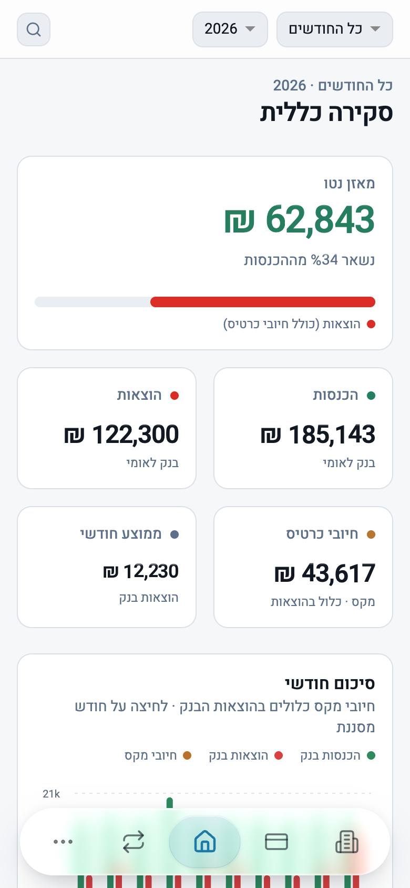
  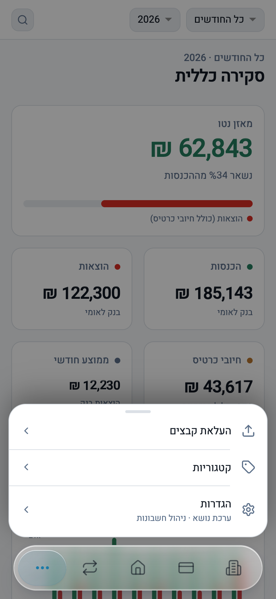
</p>

גם חלונות האישור (למשל לפני מחיקה) עולים מלמטה בטלפון, ובמסך רחב מופיעים במרכז:

<p align="center">
  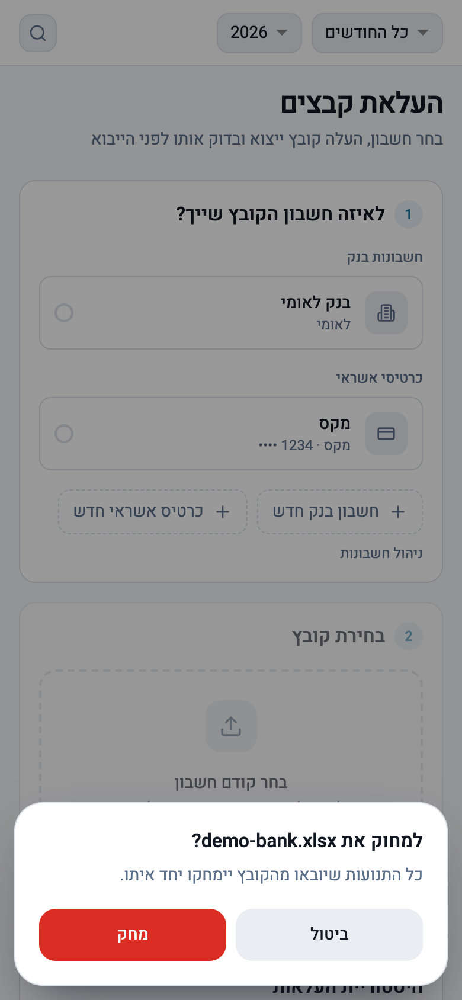
</p>

### התקנה כאפליקציה

אפשר להתקין את תזרים כאפליקציה, עם אייקון משלה ובחלון נפרד בלי סרגל הדפדפן:

- **Chrome / Edge במחשב:** לוחצים על אייקון ההתקנה בצד שורת הכתובת ("התקנת האפליקציה"). האפליקציה נפתחת בחלון משלה ומופיעה ב-Dock או בשורת המשימות.
- **iPhone (Safari):** כפתור השיתוף ← "הוספה למסך הבית". האפליקציה נפתחת במסך מלא.
- **Android (Chrome):** מאשרים את הצעת ההתקנה, או מתפריט הדפדפן ← "התקנת האפליקציה".

Chrome ו-Edge מתקינים כאפליקציה רק בחיבור מאובטח: `http://localhost` נחשב מאובטח, אבל בכתובת IP ברשת המקומית (`http://192.168...`) ב-Android מתקבל רק קיצור דרך שנפתח בדפדפן. ב-iPhone ההוספה למסך הבית עובדת גם בכתובת כזו.

---

## איך משתמשים

### 1. העלאת קבצים

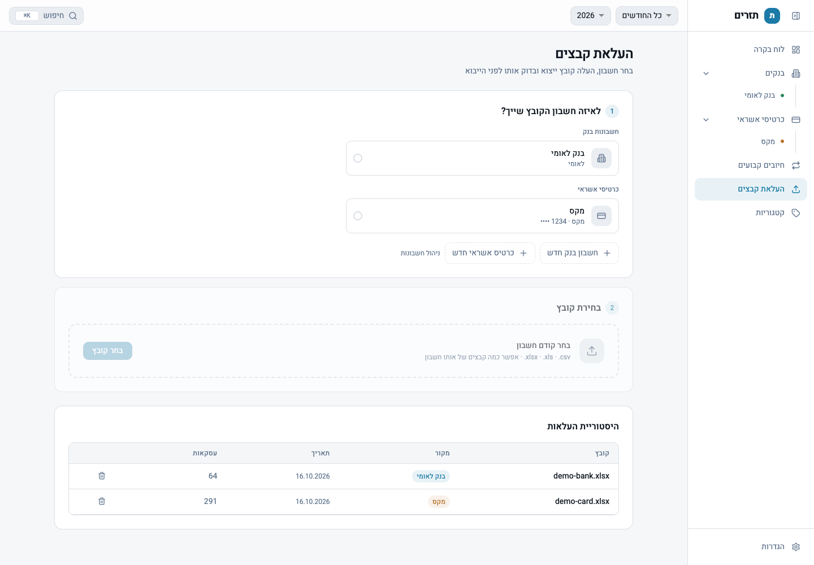

1. בדף **העלאת קבצים** בוחרים לאיזה חשבון הקובץ שייך. אפשר להוסיף כאן חשבון בנק או כרטיס אשראי חדש.
2. בוחרים קובץ (`.xlsx`, `.xls` או `.csv`). אפשר לבחור כמה קבצים של אותו חשבון בבת אחת.
3. בודקים את התצוגה המקדימה ומאשרים את הייבוא.

**איזה קבצים?** כל ייצוא טבלאי של בנק או חברת אשראי (`.xlsx`, `.xls`, `.csv`, כולל דפי ה-HTML ש"לאומי" שומר בשם `.xls`). האפליקציה מזהה לבד את שורת הכותרת ואת העמודות לפי השמות שלהן (תאריך, תיאור, חובה, זכות, סכום חיוב, תאריך חיוב…), גם כשבקובץ יש עמודות נוספות או בסדר אחר. בפעם הראשונה בודקים את ההתאמה בתצוגה חיה ומתקנים אם צריך, והמיפוי נשמר לחשבון לפעמים הבאות. אפשר לערוך אותו בכל רגע מחלון עריכת החשבון.

תנועות שכבר יובאו לא נכפלות, כך שאפשר להעלות קבצים חופפים בלי חשש. היסטוריית ההעלאות מופיעה בתחתית הדף, ואפשר למחוק ממנה העלאה עם כל התנועות שלה.

### 2. לוח בקרה

לוח הבקרה מרכז את השנה: מאזן נטו, הכנסות, הוצאות, חיובי כרטיסים, שינויים בהוצאות לפי קטגוריה, חיובים קבועים ותנועות חריגות.

- **בחירת תקופה:** במרכז הסרגל העליון. החצים עוברים לחודש הקודם או הבא (או לשנה, כשמוצגת שנה שלמה), ולחיצה על התקופה עצמה פותחת את כל החודשים של השנה, עם "כל השנה".
- **לחיצה על עמודה בגרף** מסננת את כל הדף לאותו חודש. לחיצה נוספת מבטלת את הסינון.

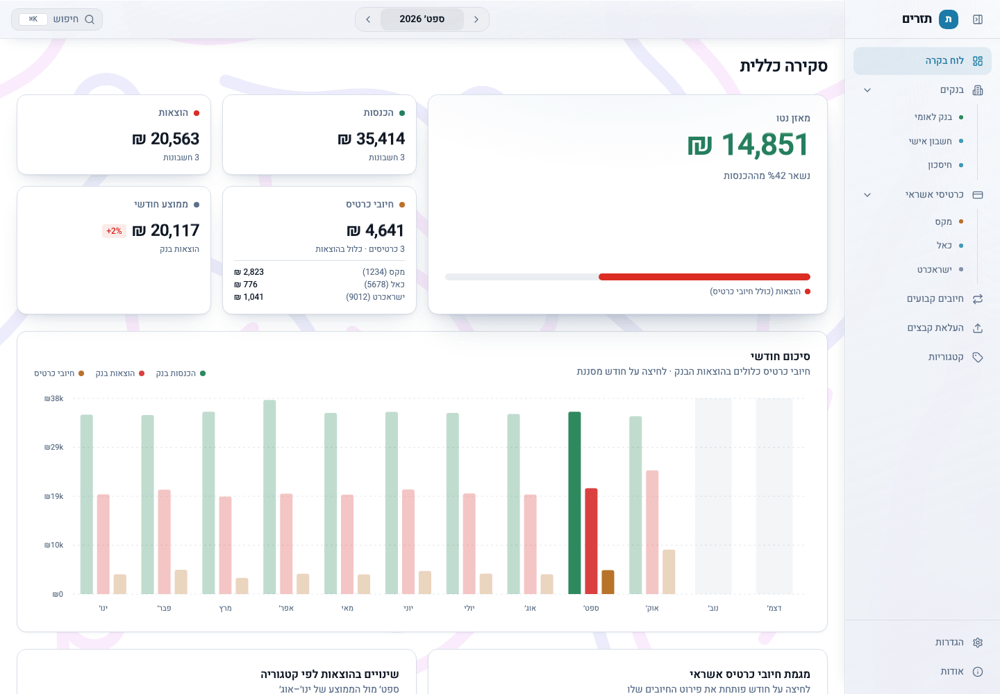

> **חיובי כרטיס כבר כלולים בהוצאות הבנק.** החיוב החודשי של חברת האשראי יורד מחשבון הבנק, ולכן סכום חיובי הכרטיס מוצג כפירוט של ההוצאה ולא נוסף עליה שוב.

### 3. בנקים וכרטיסי אשראי

לכל חשבון יש דף משלו עם סיכומים, גרף חודשי ורשימת התנועות. בדף הבנק מופיע גם גרף יתרה לאורך זמן.

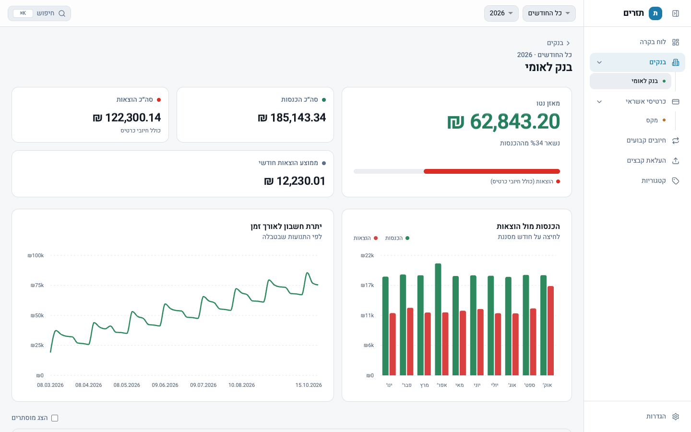

בדף כרטיס אשראי רואים את החיובים לפי קטגוריה ולפי חודש, ובטבלה אפשר לשנות קטגוריה לעסקה או להסתיר אותה.

**רשימת קטגוריות התחלתית:** התקנה חדשה מתחילה עם רשימת קטגוריות מוכנה (בשמות של מקס, ועוד כמה לתנועות בנק), כדי שגם לכרטיסים שהקבצים שלהם בלי קטגוריות, כמו כאל וישראכרט, יהיה ממה לבחור. אפשר לשנות שם, למחוק ולהוסיף כמו בכל קטגוריה.

**קטגוריות מחברות האשראי:** כשקובץ מגיע עם קטגוריות משלו (כמו מקס), כל קטגוריה שעוד לא מוכרת מוצגת אחרי ההעלאה: אפשר להוסיף אותה לרשימה, או לשייך אותה לקטגוריה שכבר יש לך. השיוך נשמר לכל הכרטיסים של אותה חברה, חל גם על העסקאות שכבר הועלו וגם על הקבצים הבאים, ואפשר לשנות אותו בדף **קטגוריות**. כך שתי חברות שקוראות לאותו דבר בשמות שונים מגיעות לאותה קטגוריה. קטגוריה ששונתה ידנית לעסקה או לבית עסק נשארת כמו שהיא.

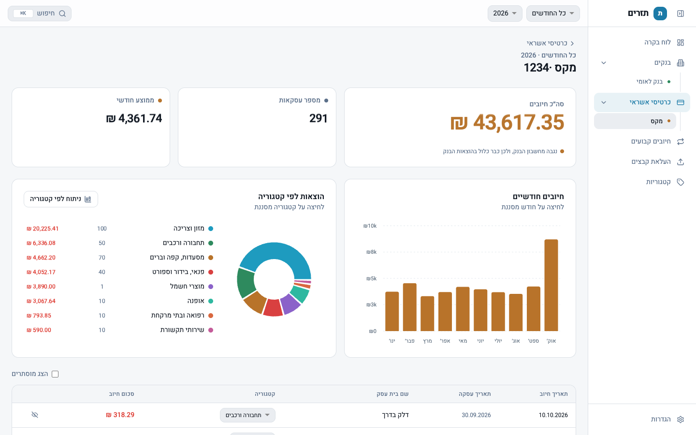

**ניתוח לפי קטגוריה** מציג את ההוצאות של כל קטגוריה לאורך השנה, עם טבלת פירוט לפי חודש וממוצע:

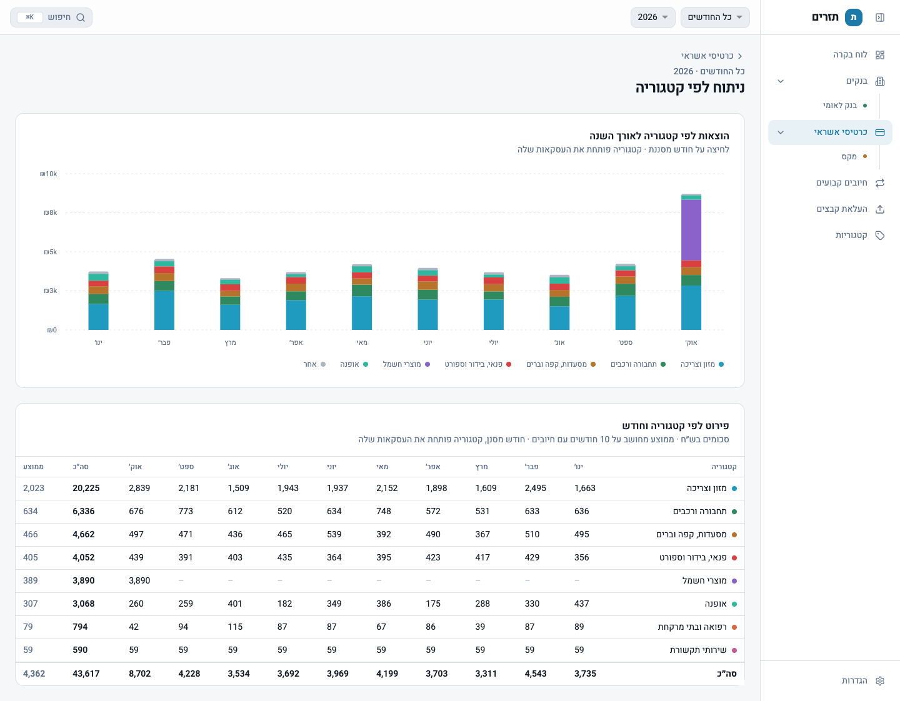

### 4. חיובים קבועים

האפליקציה מזהה לבד חיובים שחוזרים בסכום דומה (שכר דירה, מנויים, ביטוחים…) ומציגה את העלות החודשית והשנתית שלהם. לכל חיוב אפשר:

- ✓ לאשר שהוא אכן קבוע
- להסתיר אותו אם הזיהוי שגוי
- ✎ לשנות לו שם

חיוב שהתייקר מסומן, ומוצג לצד הסכום הקודם.

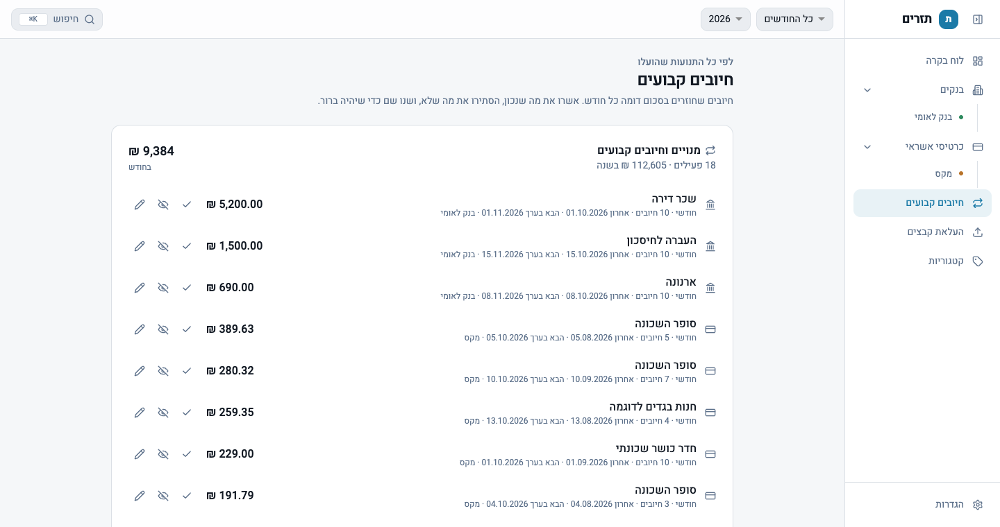

### 5. חיפוש

חיפוש בכל החשבונות ובכל השנים לפי שם בית עסק, תיאור, הערה או סכום. מקלידים `120` לסכום מדויק, או `100-200` לטווח. כפתור **סינון** פותח סינון לפי תאריכים, קטגוריה וחשבונות. קיצור מקלדת לפתיחת החיפוש: <kbd>⌘K</kbd> (או <kbd>Ctrl</kbd>+<kbd>K</kbd>).

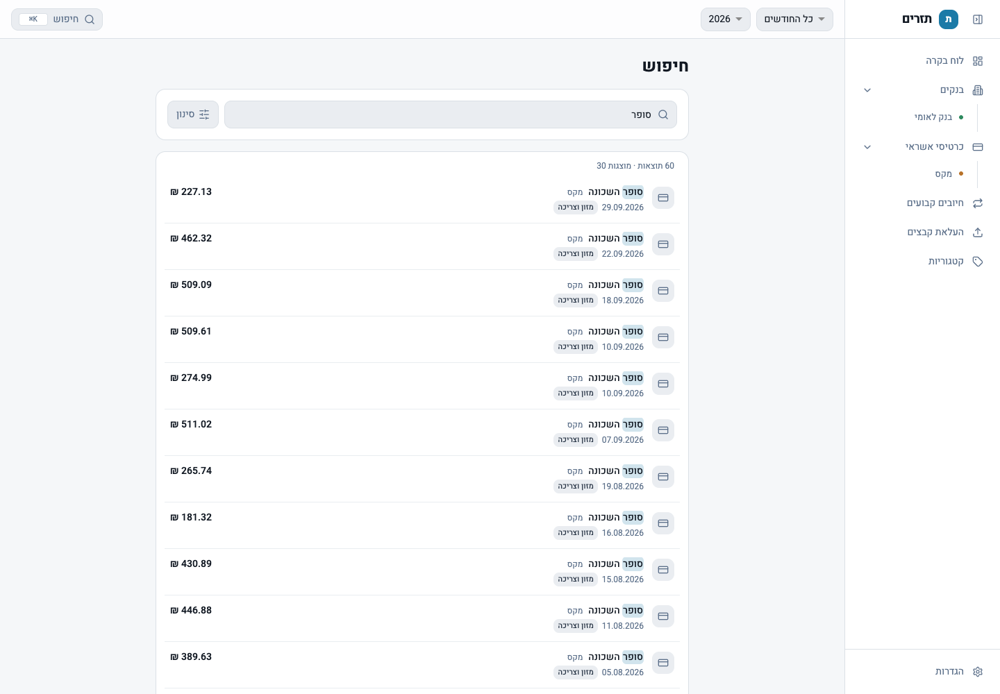

<p align="center">
  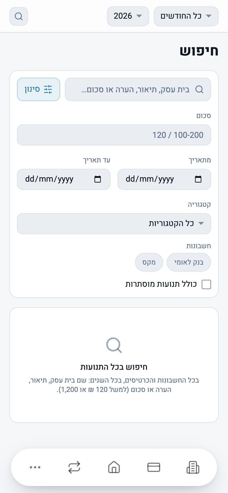
</p>

### 6. הגדרות

- **ערכת נושא:** בהירה, כהה, או לפי הגדרות המערכת.
- **כללי, כספת, עדכונים, טלפונים ורשת:** ראו [הגדרות](#הגדרות).
- **ניהול חשבונות:** הוספה, שינוי שם, העברה לארכיון ומחיקה.
- **מיפויי ייבוא:** מיפויי עמודות שנשמרו, עם אפשרות לשנות שם ולמחוק.
- **אנשים ומכשירים:** מי בבית, באילו מכשירים יש לו מפתח ולמי יש סיסמה, הזמנות, ביטול מכשיר, הגדרת סיסמה, קוד שחזור חדש ויציאה (ראו [כניסה עם מפתח](#כניסה-עם-מפתח)).
- **אזור מסוכן:** מחיקת כל הנתונים (חשבונות, תנועות, העלאות, קטגוריות, כללים, מיפויים והחלטות, וגם האנשים, המכשירים, הסיסמאות וקוד השחזור) והתחלה מחדש כמו בהתקנה חדשה, עם קוד התקנה חדש בלוג. צריך להקליד `מחק הכל`, ואז לאשר שזה באמת אתם: עם Face ID, Touch ID או קוד המכשיר, או עם הסיסמה שלכם. המפתחות שנשמרו במכשירים לא נמחקים מהם, ואפשר למחוק אותם בהגדרות הסיסמאות של המכשיר. כדאי [לגבות](#גיבוי-ושחזור) קודם. אפשר גם למחוק עם `docker compose down -v`.

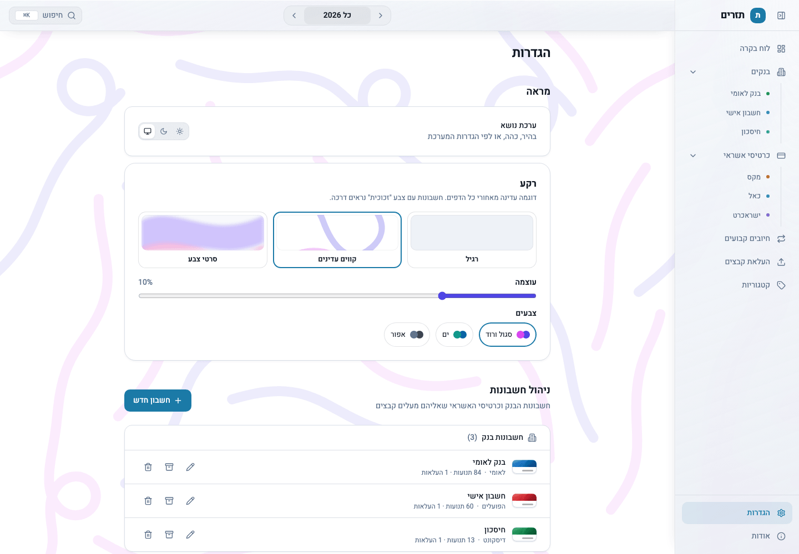

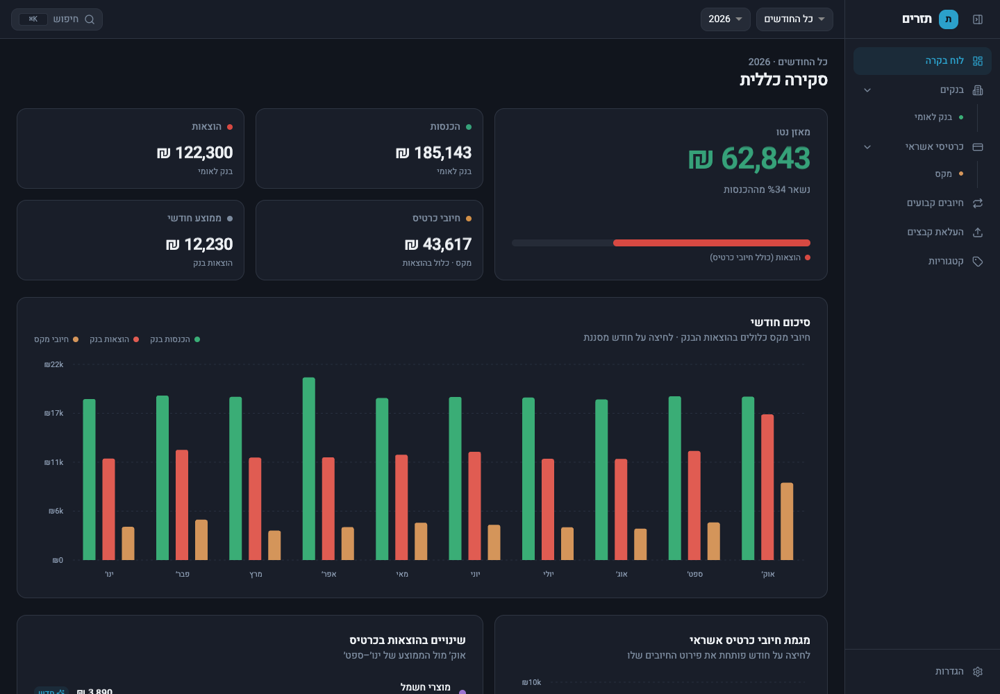

---

## פיתוח

### הרצה מהקוד

למי שרוצה לשנות את הקוד או לתרום. לשימוש רגיל עדיף [Docker](#התקנה-והפעלה).

**דרישות:**

- [Node.js](https://nodejs.org/) גרסה 20 ומעלה (כולל npm)
- Git
- ‏`sqlite3` (שורת פקודה): נדרש רק להרצת הבדיקות. ב-macOS הוא מותקן מראש.

```bash
# 1. הורדת הקוד
git clone https://github.com/JordanYefet/Tazrim.git
cd Tazrim

# 2. התקנת תלויות
npm install

# 3. יצירת Prisma Client ובסיס הנתונים (prisma/tazrim.db)
npx prisma generate
npx prisma migrate deploy

# 4. הרצה
npm run dev
```

פותחים בדפדפן את <http://localhost:3000>. בפעם הראשונה בסיס הנתונים ריק, ומעלים קבצים מדף **העלאת קבצים**.

`npm run dev` מתאים לפיתוח. כדי להריץ מהקוד לשימוש יומיומי, עדיף לבנות פעם אחת ולהריץ את הגרסה הבנויה: `npm run build` ואז `npm start`.

**נתוני דמו:** `npm run db:demo` בונה בסיס נתונים נפרד (`prisma/demo.db`) עם שנה של תנועות מומצאות בשלושה חשבונות בנק ושלושה כרטיסי אשראי, ו-`npm run dev:demo` מריץ את האפליקציה עליו. בסיס הנתונים האמיתי (`prisma/tazrim.db`) לא משתנה, ואפשר להריץ את `db:demo` שוב בכל רגע כדי להתחיל מחדש.

**גיבוי:** כל הנתונים נמצאים בקובץ אחד, ומספיק להעתיק אותו:

```bash
cp prisma/tazrim.db ~/Backups/tazrim-$(date +%Y%m%d).db
```

**עדכון:** הענף `release` מצביע תמיד על הגרסה האחרונה שפורסמה, ו-`main` על הפיתוח השוטף. כדי להישאר על גרסאות שפורסמו, עוברים פעם אחת ל-`release` (`git checkout release`), ומעדכנים כך (אחרי גיבוי):

```bash
git pull
npm install
npx prisma generate
npx prisma migrate deploy   # מעדכן את מבנה בסיס הנתונים, הנתונים נשמרים
```

> בסיס הנתונים וקבצי האקסל/CSV מוחרגים מ-Git (`.gitignore`), כדי שנתונים פיננסיים אישיים לא יגיעו למאגר בטעות.

**בניית האימג' מהקוד:** כדי לנסות שינויים בקוד ב-Docker, בונים את האימג' בתיקיית הקוד ומריצים אותו:

```bash
docker build -t ghcr.io/jordanyefet/tazrim:latest .
docker compose up -d
```

`docker compose pull` מחליף אחר כך את האימג' הזה בגרסה שפורסמה.

### פקודות

| פקודה | מה היא עושה |
| --- | --- |
| `npm run dev` | שרת פיתוח על פורט 3000 |
| `npm run dev:demo` | שרת פיתוח על בסיס נתוני הדמו |
| `npm run db:demo` | בונה מחדש את `prisma/demo.db` עם נתונים מומצאים |
| `npm test` | הרצת הבדיקות (Vitest) |
| `npm run build` | בנייה לסביבת ייצור |
| `npm run db:studio` | עיון בבסיס הנתונים דרך Prisma Studio |

**CI וגרסאות:** כל Pull Request ל-`main` עובר ב-GitHub Actions בדיקת טיפוסים, את כל הבדיקות ובנייה (`.github/workflows/ci.yml`). גרסה חדשה מפרסמים ידנית: **Actions ← Release ← Run workflow**, בלי למלא כלום. מספר הגרסה מחושב לבד מהכותרות של ה-PRs שמוזגו ל-`main` מאז הגרסה האחרונה, לפי הקידומת שלהן: `fix:` (וגם `docs:`, `chore:`, `refactor:` וכדומה) מעלה patch ‏(1.4.2 ← 1.4.3), `feat:` מעלה minor ‏(1.4.2 ← 1.5.0), וכל `<type>!:` (למשל `feat!:`) מעלה major ‏(1.4.2 ← 2.0.0). השינוי הגדול ביותר קובע, וכותרת בלי קידומת נחשבת minor. סיכום ההרצה מראה איזו גרסה יצאה ואילו PRs קבעו אותה (`.github/scripts/release-bump.sh`), ובכל PR בודקת `pr-title.yml` את הקידומת ומזהירה כשאין (בלי לחסום). התהליך מעדכן את הענף `release` (עם commit של מספר הגרסה), בונה ומפרסם את האימג' ב-GHCR, ויוצר את התג ואת ה-Release ב-GitHub. Vercel בונה מהענף `release` את הדמו החי, שמתעדכן גם פעם בשבוע (`demo.yml`) כדי שנתוני הדמו יגיעו עד השבוע הנוכחי.

**סקרייפר הבנקים מוצמד בכוונה:** ‏`israeli-bank-scrapers` נעול בדיוק ל-`6.13.0` ב-`package.json`. משדרגים אותו רק ב-PR משלו, אחרי שעוברים על ההבדלים בין הגרסאות (`npm diff --diff=israeli-bank-scrapers@<ישנה> --diff=israeli-bank-scrapers@<חדשה>`), ובודקים מחדש את `patches/`: התיקונים של patch-package קשורים לגרסה המדויקת. **ובנוסף מעדכנים את רשימת הדומיינים של בידוד הרשת:** בדיקה ב-`scripts/__tests__/egress-allowlist.test.ts` נכשלת כשהסקרייפר מוסיף חברה שחסרה ב-`docker/squid/allowlist.json`. מוסיפים אותה שם, מריצים מחדש את הסקר (`docker compose -f docker/squid/survey.compose.yml up -d`, ‏`node scripts/egress-survey.mjs`, ואז `down`) כדי לראות מה עמודי הכניסה טוענים, מעדכנים את הרשימה ומריצים `node scripts/egress-allowlist.mjs`.

**מצב קריאה בלבד:** עם `TAZRIM_READ_ONLY=1` (מתקדם בלבד, בלי מסך בהגדרות) השרת דוחה כל שינוי בנתונים, והממשק מסביר את זה כשמנסים לשמור. כך רץ הדמו החי.

**עיצוב:** כללי העיצוב, הטוקנים והרכיבים המשותפים מתועדים ב-[`docs/design-system.md`](docs/design-system.md), ובפיתוח אפשר לראות אותם חיים בכתובת `/design`.

**טכנולוגיות:** Next.js 15 (App Router), React 19, TypeScript, Prisma עם SQLite, Tailwind CSS, Recharts.

**מבנה עיקרי:**

```
app/          דפים ונתיבי API
components/   רכיבי ממשק לפי אזור (dashboard, cards, bank, search, upload…)
lib/          לוגיקה: parsers לקבצים, db לשאילתות, insights לזיהוי חיובים קבועים וחריגים
prisma/       סכמה ומיגרציות (בסיס הנתונים עצמו לא נשמר ב-Git)
scripts/      סקריפט נתוני הדמו
.github/      תהליכי GitHub Actions: CI, Release, Demo
docs/         מסמכי תכנון וצילומי מסך
```

---

## רישיון ופרטיות

**רישיון:** הקוד פתוח ומופץ בחינם תחת [רישיון MIT](LICENSE). מותר להשתמש בו, להעתיק, לשנות ולהפיץ אותו, גם לשימוש מסחרי, בתנאי שמשאירים את הודעת זכויות היוצרים והרישיון.

**הבהרה:** תזרים הוא כלי עזר אישי ולא ייעוץ פיננסי. התוכנה מסופקת כמו שהיא (AS IS), בלי אחריות מכל סוג. החישובים תלויים בקבצים שמעלים ובאופן שבו הם מפוענחים, ולכן כדאי תמיד להשוות את המספרים מול הבנק וחברות האשראי לפני שמקבלים החלטות.

**פרטיות:** כל הנתונים נשמרים רק על המחשב שלכם: ב-Docker בתוך ה-volume שלו, ובהרצה מהקוד בקובץ `prisma/tazrim.db`. האפליקציה לא שולחת את הנתונים שלכם לשום מקום: אין שרת מרוחק, אין חשבון משתמש ואין איסוף נתונים או אנליטיקה. גם הגופן (Heebo) מוגש מהאפליקציה עצמה, כך שהדפדפן לא פונה לשום שרת חיצוני.
