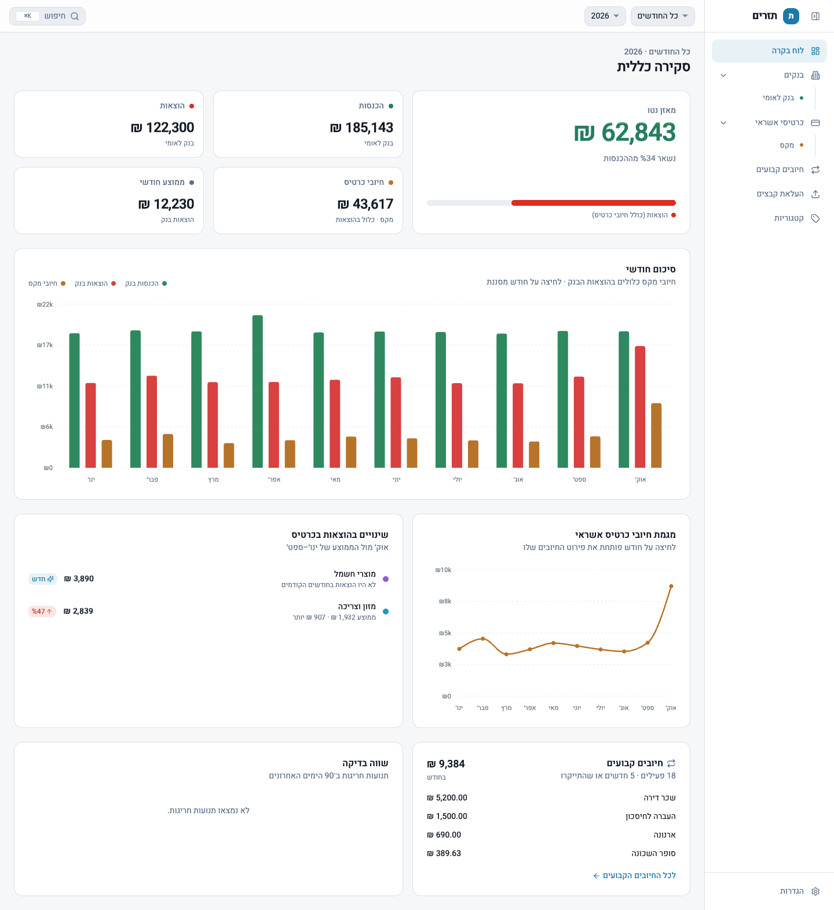
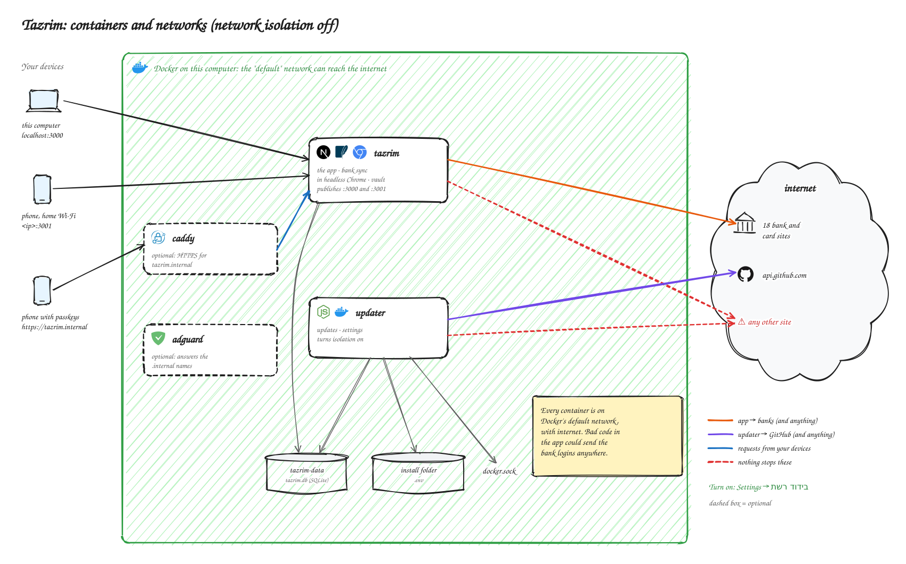

# תזרים

[](https://github.com/JordanYefet/Tazrim/actions/workflows/ci.yml)
[](https://github.com/JordanYefet/Tazrim/releases)
[](LICENSE)

**Tazrim** is a self-hosted personal finance dashboard for Israeli households. It reads the transaction exports of Israeli banks and credit-card companies and turns them into a clear monthly cash-flow picture: income, expenses, categories, recurring charges and unusual transactions. The interface is in Hebrew, everything runs on your own machine and your data never leaves it. Free and open source under the MIT license.

**Live demo** (read-only, made-up data): <https://tazrim-demo.vercel.app> · **Docker image:** `ghcr.io/jordanyefet/tazrim`

אפליקציה אישית למעקב אחרי התזרים החודשי: מעלים קבצי תנועות מהבנק ופירוטי חיובים מחברות האשראי, ומקבלים תמונה ברורה של הכנסות, הוצאות, קטגוריות, חיובים קבועים ותנועות חריגות.

הכול רץ מקומית על המחשב שלכם. הנתונים נשמרים בקובץ SQLite אחד על המחשב שלכם ולא נשלחים לשום שירות חיצוני.

> **רוצים לנסות בלי להתקין?** ב[דמו החי](https://tazrim-demo.vercel.app) יש שנה של נתונים מומצאים בשלושה חשבונות בנק ושלושה כרטיסי אשראי. הוא לקריאה בלבד: אפשר ללחוץ על הכול, ושום שינוי לא נשמר.

> כל צילומי המסך כאן צולמו על נתוני דמו מומצאים (`npm run db:demo`).



---

## תוכן עניינים

- [התקנה והפעלה](#התקנה-והפעלה)
- [עדכון לגרסה חדשה](#עדכון-לגרסה-חדשה)
- [גיבוי ושחזור](#גיבוי-ושחזור)
- [פתיחה מהטלפון](#פתיחה-מהטלפון)
- [איך משתמשים](#איך-משתמשים)
- [אבטחה](#אבטחה)
- [ארכיטקטורה](#ארכיטקטורה)
- [פיתוח](#פיתוח)
- [רישיון ופרטיות](#רישיון-ופרטיות)

---

## התקנה והפעלה

הדרך המומלצת היא Docker. לא צריך לדעת לתכנת, ולא צריך Git, Node.js או טרמינל: מתקינים תוכנה אחת (Docker Desktop), מורידים מתקין, לוחצים עליו פעמיים, ושאר ההגדרה נעשית באפליקציה עצמה. בפעם הראשונה זה לוקח בערך רבע שעה. האפליקציה מגיעה כאימג' מוכן (`ghcr.io/jordanyefet/tazrim`) למחשבי Windows ו-Mac (Intel ו-Apple Silicon) ול-Linux. הנתונים נשמרים על המחשב שלכם בלבד.

1. מתקינים [Docker Desktop](https://www.docker.com/products/docker-desktop/) ופותחים אותו. אין צורך בחשבון Docker, ואפשר לדלג על ההתחברות.
2. מורידים מה-[עמוד הגרסה האחרונה](https://github.com/JordanYefet/Tazrim/releases/latest) את **`Install-Tazrim-Mac.zip`** (ל-Mac) או את **`Install-Tazrim-Windows.zip`** (ל-Windows), פותחים את ה-zip ולוחצים פעמיים על **`Install Tazrim.command`** (Mac) או **`Install Tazrim.bat`** (Windows). המערכת תזהיר שהקובץ לא חתום, וזה צפוי.
3. הדפדפן נפתח על **<http://localhost:3000>** ומתחילה ההגדרה הראשונה.

המתקין יוצר את התיקייה `tazrim` בתיקיית הבית, מוריד אליה את `docker-compose.yml`, כותב `.env` ומפעיל את האפליקציה. הוא מדבר רק עם GitHub ועם Docker.

- **הסבר מפורט** (התקנת Docker Desktop ב-Mac וב-Windows, אזהרות האבטחה והפתרון להן): [docs/install-docker.md](docs/install-docker.md).
- **Linux, או למי שמעדיף טרמינל:** [docs/install-terminal.md](docs/install-terminal.md).
- **כל ההגדרות ומשתני `.env`:** [docs/settings.md](docs/settings.md).

### שלב 3: ההגדרה הראשונה

כשהדפדפן נפתח, האפליקציה מובילה אתכם בעמוד **/setup**. רק הצעד הראשון חובה: שם וסיסמה. את השאר אפשר לדלג, והכול גם נמצא אחר כך ב**הגדרות**. את קוד השחזור שמוצג פעם אחת שומרים במנהל סיסמאות או על דף.

הכתובת של המחשב היא **<http://localhost:3000>**. אפשר להוסיף אותה לסימניות, או [להתקין כאפליקציה](docs/phones.md#התקנה-כאפליקציה). האפליקציה עולה לבד בכל פעם ש-Docker Desktop פועל.

**עצירה והפעלה:** בחלון של Docker Desktop, בלשונית **Containers**, יש כפתורי עצירה והפעלה ליד `tazrim`. בטרמינל, מתוך התיקייה `tazrim`: `docker compose stop` ו-`docker compose start`.

## עדכון לגרסה חדשה

הגרסה המותקנת מופיעה ב**הגדרות ← עדכונים**, ומה השתנה בכל גרסה מופיע ב-[Releases](https://github.com/JordanYefet/Tazrim/releases). פעם ביום האפליקציה בודקת מול GitHub אם יצאה גרסה חדשה (אפשר לכבות את זה בהגדרות), והכפתור **עדכון לגרסה vX** מעדכן בלחיצה כשפועל שירות העזר (`updater`), שהמתקין מפעיל מההתחלה. לפני כל עדכון נוצר גיבוי, ואם הגרסה החדשה לא עולה, הגרסה הקודמת חוזרת לבד. אפשר גם לחזור אחורה פעם אחת (כל מה שנשמר מאז העדכון נמחק).

עדכון ידני, מתוך התיקייה `tazrim` (אחרי [גיבוי](#גיבוי-ושחזור)):

```bash
docker compose pull
docker compose up -d
```

הנתונים נשמרים, ומבנה בסיס הנתונים מתעדכן לבד. כל הפרטים, כולל ההרשאות של שירות העזר ואיך לכבות אותו: [docs/updates.md](docs/updates.md).

## גיבוי ושחזור

כל הנתונים נמצאים בתיקייה `/data` בתוך Docker. מגבים את כל התיקייה, כשהאפליקציה עצורה, ורצוי לפני כל עדכון. בטרמינל, מתוך התיקייה `tazrim`:

```bash
docker compose stop
docker compose cp tazrim:/data ./tazrim-backup
docker compose start
```

הגיבוי נשמר בתיקייה `tazrim-backup`, ואפשר להעתיק אותה לדיסק חיצוני או לענן. שחזור, ושחזור ידני מגיבוי שנוצר לפני עדכון: [docs/backup.md](docs/backup.md).

> `docker compose down` משאיר את הנתונים. `docker compose down -v` **מוחק את כל הנתונים**.

## פתיחה מהטלפון

**המחשב** נפתח ב-`http://localhost:3000`. **טלפונים וטאבלטים** באותה רשת Wi-Fi נפתחים ב-`http://<הכתובת של המחשב>:3001`. ב**הגדרות ← טלפונים ורשת** מופיעה הכתובת הזו עם קוד QR ומדריכים קצרים. מפתחות (Face ID, Touch ID) עובדים רק ב-`https`: מתג אחד באותו מסך מפעיל כתובת כמו `https://tazrim.internal` (Caddy ו-AdGuard Home), עם קובצי אישור להורדה ל-iPhone, ל-Android ולמחשבים אחרים. אפשר גם להתקין את תזרים כאפליקציה במסך הבית.

<p align="center">
  
  
</p>

הפרטים (כתובת קבועה, reverse proxy משלכם, מראה בטלפון, התקנה כאפליקציה): [docs/phones.md](docs/phones.md).

## איך משתמשים

שישה חלקים עיקריים. הסבר מלא עם צילומי מסך: [docs/usage.md](docs/usage.md).

1. **העלאת קבצים:** בוחרים חשבון ואת קובץ התנועות (`.xlsx`, `.xls`, `.csv`), בודקים את התצוגה המקדימה ומאשרים. תנועות שכבר יובאו לא נכפלות.
2. **לוח בקרה:** מאזן נטו, הכנסות, הוצאות, שינויים לפי קטגוריה, חיובים קבועים ותנועות חריגות. לחיצה על עמודה בגרף מסננת לחודש.
3. **בנקים וכרטיסי אשראי:** דף לכל חשבון עם סיכומים, גרף ורשימת תנועות, וניתוח לפי קטגוריה.
4. **חיובים קבועים:** זיהוי אוטומטי של חיובים שחוזרים, עם עלות חודשית ושנתית.
5. **חיפוש:** בכל החשבונות והשנים, לפי שם, תיאור, הערה או סכום. קיצור: <kbd>⌘K</kbd> (או <kbd>Ctrl</kbd>+<kbd>K</kbd>).
6. **הגדרות:** ערכת נושא, חשבונות, אנשים ומכשירים, עדכונים, טלפונים ורשת, כספת, ואזור מסוכן למחיקת הנתונים.

> חיובי כרטיס כבר כלולים בהוצאות הבנק: החיוב החודשי של חברת האשראי יורד מחשבון הבנק, ולכן הוא מוצג כפירוט ולא נוסף שוב.

## אבטחה

- **כניסה עם מפתח (passkey):** Tazrim מבקש כניסה לפני כל עמוד: Face ID, Touch ID או קוד המכשיר, ומי שרוצה גם עם סיסמה. אין הרשמה פתוחה: מצטרפים עם קישור הזמנה, ויש קוד שחזור. [הפרטים](docs/login-and-vault.md).
- **כספת לפרטי הכניסה לבנקים:** הפרטים מוצפנים (AES-256-GCM) ונפתחים רק עם המפתח (passkey) של מישהו בבית, או עם סיסמת הכניסה שלו (העותק נוצר מעצמו בכניסה עם הסיסמה כשהכספת פתוחה; אפשר לכבות ב**הגדרות ← כספת**). המפתח נמצא רק בזיכרון, והכספת ננעלת אחרי זמן בלי שימוש. [הפרטים](docs/login-and-vault.md).
- **בידוד רשת (מומלץ, אופציונלי):** קונטיינר האפליקציה לא יכול לדבר עם שום דבר חוץ מהבנקים וחברות האשראי, כך שגם קוד זדוני (תלות שנפרצה, למשל) לא יוכל לשלוח החוצה את הנתונים או את פרטי הכניסה. זה כבוי כברירת מחדל, ומדליקים אותו ב**הגדרות ← בידוד רשת**. כל שינוי שמרפה את הסינון דורש אישור עם passkey או סיסמה. [הפרטים](docs/network-isolation.md).

## ארכיטקטורה

עם בידוד רשת (מומלץ):


- **`tazrim`:** האפליקציה (Next.js, SQLite), סנכרון הבנקים בדפדפן Chromium ללא חלון, והכספת.
- **`updater`:** שירות העזר: משגר קטן שמפעיל את העבודות (עדכונים, הגדרות `.env`, הדלקה וכיבוי של בידוד הרשת, ואישור שינויים ברשימת האתרים המותרים עם passkey או סיסמה) בקונטיינרים קצרים מהתמונה של האפליקציה עצמה, כך שהם תמיד באותה גרסה כמוה.
- **`squid`:** פרוקסי עם רשימת אתרים מותרים: האפליקציה מגיעה רק לאתרי הבנקים וחברות האשראי, ושירות העזר רק ל-`api.github.com`.
- **`gateway`:** מפרסם את פורטים 3000 ו-3001 כשהבידוד דלוק.
- **`caddy` ו-`adguard`:** אופציונליים, HTTPS ושמות `.internal` מקומיים.

בלי בידוד רשת (ברירת המחדל), כל הקונטיינרים ברשת הרגילה של Docker, עם גישה לכל אתר:



את שני התרשימים מצייר `npm run diagram` (מתוך `scripts/architecture-diagram.mjs`).

## פיתוח

למי שרוצה לשנות את הקוד או לתרום (Node.js 20 ומעלה, Git). לשימוש רגיל עדיף [Docker](#התקנה-והפעלה).

```bash
git clone https://github.com/JordanYefet/Tazrim.git
cd Tazrim
npm install
npx prisma generate
npx prisma migrate deploy
npm run dev
```

פותחים את <http://localhost:3000>. בסיס הנתונים ריק בהתחלה. נתוני דמו: `npm run db:demo` ואז `npm run dev:demo`.

| פקודה | מה היא עושה |
| --- | --- |
| `npm run dev` | שרת פיתוח על פורט 3000 |
| `npm run dev:demo` | שרת פיתוח על בסיס נתוני הדמו |
| `npm test` | הרצת הבדיקות (Vitest) |
| `npm run build` | בנייה לסביבת ייצור |
| `npm run diagram` | ציור מחדש של תרשימי הארכיטקטורה |

טכנולוגיות: Next.js 15, React 19, TypeScript, Prisma עם SQLite, Tailwind CSS, Recharts. הרצה לשימוש יומיומי, עדכון, בניית אימג', CI וגרסאות, הסקרייפר המוצמד ומבנה הקוד: [docs/development.md](docs/development.md). כללי העיצוב: [docs/design-system.md](docs/design-system.md).


## רישיון ופרטיות

**רישיון:** הקוד פתוח ומופץ בחינם תחת [רישיון MIT](LICENSE). מותר להשתמש בו, להעתיק, לשנות ולהפיץ אותו, גם לשימוש מסחרי, בתנאי שמשאירים את הודעת זכויות היוצרים והרישיון.

**הבהרה:** תזרים הוא כלי עזר אישי ולא ייעוץ פיננסי. התוכנה מסופקת כמו שהיא (AS IS), בלי אחריות מכל סוג. החישובים תלויים בקבצים שמעלים ובאופן שבו הם מפוענחים, ולכן כדאי תמיד להשוות את המספרים מול הבנק וחברות האשראי לפני שמקבלים החלטות.

**פרטיות:** כל הנתונים נשמרים רק על המחשב שלכם: ב-Docker בתוך ה-volume שלו, ובהרצה מהקוד בקובץ `prisma/tazrim.db`. האפליקציה לא שולחת את הנתונים שלכם לשום מקום: אין שרת מרוחק, אין חשבון משתמש ואין איסוף נתונים או אנליטיקה. גם הגופן (Heebo) מוגש מהאפליקציה עצמה, כך שהדפדפן לא פונה לשום שרת חיצוני.
