# תזרים

[](https://github.com/JordanYefet/Tazrim/actions/workflows/ci.yml)
[](https://github.com/JordanYefet/Tazrim/releases)
[](LICENSE)

**Tazrim** is a self-hosted personal finance dashboard for Israeli households. It reads the transaction exports of Israeli banks and credit-card companies and turns them into a clear monthly cash-flow picture: income, expenses, categories, recurring charges and unusual transactions. The interface is in Hebrew, everything runs on your own machine and your data never leaves it. Free and open source under the MIT license.

**Live demo** (read-only, made-up data): <https://tazrim-demo.vercel.app> · **Docker image:** `ghcr.io/jordanyefet/tazrim`

אפליקציה אישית למעקב אחרי התזרים החודשי: מעלים קבצי תנועות מהבנק ופירוטי חיובים מחברות האשראי, ומקבלים תמונה ברורה של הכנסות, הוצאות, קטגוריות, חיובים קבועים ותנועות חריגות.

הכול רץ מקומית על המחשב שלכם. הנתונים נשמרים בקובץ SQLite אחד על המחשב שלכם ולא נשלחים לשום שירות חיצוני.

> **רוצים לנסות בלי להתקין?** ב[דמו החי](https://tazrim-demo.vercel.app) יש שנה של נתונים מומצאים בשלושה חשבונות בנק ושלושה כרטיסי אשראי. הוא לקריאה בלבד: אפשר ללחוץ על הכול, ושום שינוי לא נשמר.

> כל צילומי המסך כאן צולמו על נתוני דמו מומצאים (`npm run db:demo`).

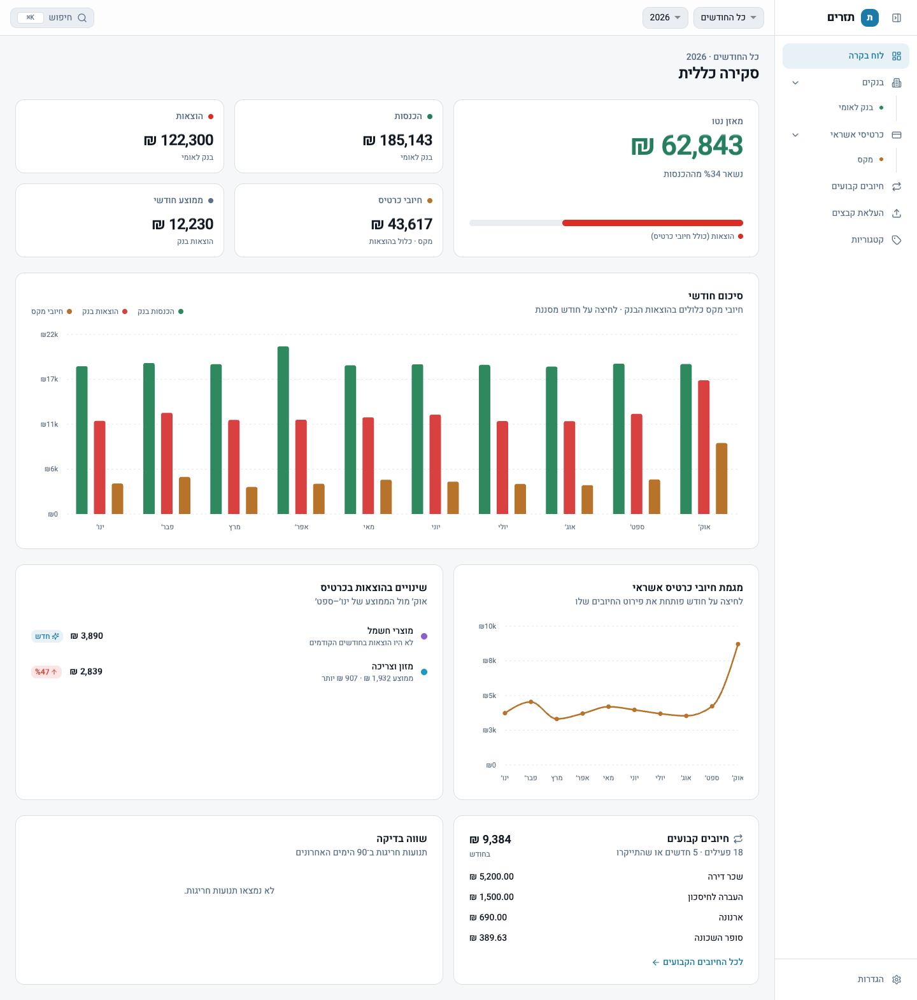

---

## תוכן עניינים

- [התקנה והפעלה](#התקנה-והפעלה) (Docker, בלי ידע בתכנות)
- [פתיחה מהטלפון](#פתיחה-מהטלפון)
- [איך משתמשים](#איך-משתמשים)
- [פיתוח](#פיתוח)
- [רישיון ופרטיות](#רישיון-ופרטיות)

---


## התקנה והפעלה

הדרך המומלצת היא Docker. לא צריך לדעת לתכנת, ולא צריך Git, Node.js או את הקוד עצמו: מתקינים תוכנה אחת (Docker Desktop), מורידים קובץ הגדרות אחד ומריצים פקודה אחת. בפעם הראשונה זה לוקח בערך רבע שעה.

האפליקציה מגיעה כאימג' מוכן (`ghcr.io/jordanyefet/tazrim`) שמתאים למחשבי Windows ו-Mac (גם Intel וגם Apple Silicon) ולמחשבי Linux. הנתונים נשמרים על המחשב שלכם בלבד.

> מתכנתים שרוצים להריץ מהקוד או לשנות אותו: [הרצה מהקוד](#הרצה-מהקוד).

### שלב 1: התקנת Docker Desktop

Docker Desktop הוא התוכנה שמריצה את האפליקציה. מתקינים אותו פעם אחת. אין צורך בחשבון Docker: כשמוצע להתחבר, אפשר לדלג.

**ב-Mac:**

1. בודקים איזה מעבד יש במחשב: תפריט Apple () ← **אודות Mac זה**. אם כתוב **Chip** עם Apple M1/M2/M3/M4, זה Apple Silicon. אם כתוב **Processor** עם Intel, זה Intel.
2. נכנסים ל-[docker.com/products/docker-desktop](https://www.docker.com/products/docker-desktop/) ומורידים את הגרסה המתאימה (**Download for Mac – Apple Silicon** או **– Intel Chip**).
3. פותחים את הקובץ שירד (`Docker.dmg`) וגוררים את Docker לתיקייה **Applications**.
4. פותחים את Docker מתיקיית Applications. בפתיחה הראשונה מאשרים את תנאי השימוש, ואם מתבקשים, מקלידים את סיסמת המחשב.
5. מחכים שבתחתית חלון Docker יופיע **Engine running**, ושבסרגל העליון של המסך יופיע אייקון הלווייתן.

**ב-Windows:**

1. נכנסים ל-[docker.com/products/docker-desktop](https://www.docker.com/products/docker-desktop/) ומורידים את **Download for Windows**.
2. מריצים את הקובץ שירד (`Docker Desktop Installer.exe`), ומשאירים מסומנת את האפשרות **Use WSL 2**.
3. בסוף ההתקנה מפעילים מחדש את המחשב, אם מתבקשים.
4. פותחים את **Docker Desktop** מתפריט התחל ומאשרים את תנאי השימוש. אם מופיעה הודעה שצריך להתקין או לעדכן את WSL, מאשרים אותה.
5. מחכים שבתחתית חלון Docker יופיע **Engine running**.

אם מופיעה שגיאה על וירטואליזציה (Virtualization), צריך להפעיל אותה בהגדרות המחשב (BIOS). ההסבר נמצא ב[מדריך התקלות של Docker](https://docs.docker.com/desktop/troubleshoot-and-support/troubleshoot/topics/), בחלק על Virtualization.

**ב-Linux:** מתקינים את Docker Engine עם התוסף Compose לפי [המדריך הרשמי](https://docs.docker.com/engine/install/) להפצה שלכם.

**כדאי לסמן:** בהגדרות של Docker Desktop (גלגל השיניים ← **General**) את **Start Docker Desktop when you sign in to your computer**. כך Docker, והאפליקציה איתו, עולים לבד אחרי הפעלה מחדש של המחשב.

### שלב 2: פתיחת טרמינל

את שני השלבים הבאים עושים בטרמינל, חלון שבו מקלידים פקודות. מעתיקים כל פקודה מכאן, מדביקים בטרמינל ולוחצים Enter.

- **Mac:** לוחצים <kbd>⌘</kbd>+<kbd>רווח</kbd>, מקלידים `Terminal` ולוחצים Enter.
- **Windows:** קליק ימני על כפתור התחל ← **Terminal** (או מחפשים בתפריט התחל `PowerShell`).

בודקים ש-Docker מוכן:

```bash
docker compose version
```

אם מופיע מספר גרסה, אפשר להמשיך. אם מופיעה שגיאה, בודקים ש-Docker Desktop פתוח ושכתוב בו **Engine running**.

### שלב 3: הורדת קובץ ההגדרות

יוצרים תיקייה בשם `tazrim` בתיקיית הבית ומורידים אליה את הקובץ `docker-compose.yml`. מדביקים בטרמינל:

**Mac / Linux:**

```bash
mkdir ~/tazrim
cd ~/tazrim
curl -O https://raw.githubusercontent.com/JordanYefet/Tazrim/main/docker-compose.yml
```

**Windows (PowerShell):**

```powershell
mkdir $HOME\tazrim
cd $HOME\tazrim
curl.exe -O https://raw.githubusercontent.com/JordanYefet/Tazrim/main/docker-compose.yml
```

(ב-Windows כותבים `curl.exe` ולא `curl`. בלי זה, הפקודה לא עובדת ב-PowerShell.)

אפשר גם להוריד את [`docker-compose.yml`](https://raw.githubusercontent.com/JordanYefet/Tazrim/main/docker-compose.yml) בדפדפן (קליק ימני ← שמירה בשם) לתוך התיקייה `tazrim`. במקרה כזה בודקים שהשם הוא בדיוק `docker-compose.yml`: דפדפנים מוסיפים לפעמים `.txt` בסוף, ואז צריך למחוק אותו.

### שלב 4: הפעלה

בטרמינל, באותה תיקייה:

```bash
docker compose up -d
```

בפעם הראשונה Docker מוריד את האפליקציה, וזה לוקח דקה או שתיים. כשהפקודה מסתיימת, פותחים בדפדפן את **<http://localhost:3000>**.

בפעם הראשונה האפליקציה ריקה: מוסיפים חשבון בנק או כרטיס אשראי ומעלים קבצים מדף **העלאת קבצים** ([איך משתמשים](#איך-משתמשים)). מכאן והלאה האפליקציה עולה לבד בכל פעם ש-Docker Desktop פועל, ונשארת זמינה בכתובת הזו. אפשר להוסיף אותה לסימניות, או [להתקין כאפליקציה](#התקנה-כאפליקציה).

**עצירה והפעלה:** בחלון של Docker Desktop, בלשונית **Containers**, יש כפתורי עצירה והפעלה ליד `tazrim`, בלי טרמינל. בטרמינל, מתוך התיקייה `tazrim`: `docker compose stop` ו-`docker compose start`.

### עדכון לגרסה חדשה

הגרסה המותקנת מופיעה בדף **אודות** באפליקציה, ומה השתנה בכל גרסה מופיע ב-[Releases](https://github.com/JordanYefet/Tazrim/releases). כדי לעדכן, פותחים טרמינל, נכנסים לתיקייה (`cd ~/tazrim`, או ב-Windows `cd $HOME\tazrim`), [מגבים](#גיבוי-ושחזור), ומריצים:

```bash
docker compose pull
docker compose up -d
```

הנתונים נשמרים, ומבנה בסיס הנתונים מתעדכן לבד כשהאפליקציה עולה.

### גיבוי ושחזור

כל הנתונים נמצאים בתיקייה `/data` בתוך Docker: הקובץ `tazrim.db`, ולידו `tazrim.db-wal` שמחזיק את השינויים האחרונים עד שהם נכנסים לקובץ הראשי. לכן מגבים את כל התיקייה, כשהאפליקציה עצורה. כדאי לגבות לפני כל עדכון, ומדי פעם גם סתם. בטרמינל, מתוך התיקייה `tazrim`:

```bash
docker compose stop
docker compose cp tazrim:/data ./tazrim-backup
docker compose start
```

הגיבוי נשמר בתיקייה `tazrim-backup` בתוך `tazrim`. אפשר להעתיק אותה לדיסק חיצוני או לענן.

שחזור מגיבוי (מחליף את כל הנתונים הנוכחיים בנתונים שבגיבוי):

```bash
docker compose stop
docker compose cp ./tazrim-backup/. tazrim:/data/
docker compose start
```

אותו קובץ מתאים גם ל[הרצה מהקוד](#הרצה-מהקוד): אפשר להעתיק אותו ל-`prisma/tazrim.db`, וגם להפך.

> `docker compose down` משאיר את הנתונים. `docker compose down -v` **מוחק את כל הנתונים**.

### הגדרות נוספות

**פורט אחר:** אם הכתובת `localhost:3000` כבר תפוסה במחשב, יוצרים בתיקייה `tazrim` קובץ בשם `.env` עם השורה `TAZRIM_PORT=3005`, ומריצים שוב `docker compose up -d`. האפליקציה תהיה ב-<http://localhost:3005>. באותו קובץ אפשר לקבוע גם `TAZRIM_VERSION=1.0.0`, כדי להישאר על גרסה מסוימת במקום האחרונה.

**סנכרון מהבנק:** כל מי שנכנס (ראו [כניסה](#כניסה-עם-מפתח)) יכול לסנכרן מכל מכשיר. דפדפן הסנכרון (Chromium) כבר בתוך האפליקציה ורץ ברקע, בלי חלון.

**אזור זמן:** התאריכים והחודשים מחושבים לפי שעון ישראל (`Asia/Jerusalem`), כמו בהרצה מקומית על מחשב בישראל, כך שבסיס נתונים שעובר בין השניים נשאר באותם חודשים. מי שנמצא באזור זמן אחר קובע `TAZRIM_TZ` בקובץ `.env` (למשל `TAZRIM_TZ=Europe/London`), ורצוי שיהיה זהה לאזור הזמן שבו הנתונים נוצרו.

**נתוני דמו:** כדי לראות את האפליקציה עם שנה של תנועות מומצאות לפני שמעלים נתונים אמיתיים, מוסיפים לקובץ `.env` את השורה `TAZRIM_DEMO=1` לפני ההפעלה הראשונה. הנתונים המומצאים נכנסים רק לבסיס נתונים ריק. כדי לעבור מהדמו לנתונים אמיתיים, מוחקים את השורה מ-`.env` ומתחילים מבסיס נתונים ריק:

```bash
docker compose down -v
docker compose up -d
```

### כניסה עם מפתח

Tazrim מבקש כניסה לפני כל עמוד. נכנסים עם מפתח (passkey), כלומר Face ID, Touch ID או קוד המכשיר, ומי שרוצה גם עם סיסמה. כולם בבית רואים את אותם נתונים ויכולים לעשות אותו דבר. הכניסה נגמרת כשסוגרים את הדפדפן.

- **הפעלה ראשונה:** לפני ההפעלה קובעים בקובץ `.env` קוד הגדרה משלכם, לפחות 8 תווים:
  ```env
  TAZRIM_SETUP_CODE=קוד-שרק-אתם-יודעים
  ```
  פותחים את האפליקציה, והיא עוברת לעמוד ההגדרה: מקלידים את הקוד ואת השם, ובוחרים מפתח במכשיר או סיסמה. הקוד מבטיח שרק מי שהתקין יכול להתחיל, ולא מי שהגיע ראשון לכתובת ברשת. בלי הקוד ב-`.env`, השרת כותב קוד אקראי ליומן: `docker compose logs tazrim | grep setup`. בסוף מוצג **קוד שחזור** פעם אחת. שומרים אותו במנהל סיסמאות או על דף.
- **אין הרשמה פתוחה:** מי שמצטרף לבית מקבל קישור הזמנה ממי שכבר בפנים.
- **עוד אדם או עוד מכשיר:** הגדרות ← אנשים ומכשירים. "הזמנת אדם" או "מכשיר נוסף" יוצרים קישור וקוד QR שעובדים פעם אחת, כרבע שעה. פותחים אותם במכשיר החדש.
- **מכשיר שאבד:** באותו מקום, "ביטול" ליד המכשיר. הבקשה הבאה שלו נדחית.
- **התפריט האישי:** בתחתית התפריט הצדדי (בטלפון, בראש "עוד"): אנשים ומכשירים, הוספת מכשיר, סיסמה ויציאה.
- **סיסמה (לא חובה):** הגדרות ← אנשים ומכשירים ← "הגדרה" ליד הסיסמה, לפחות 10 תווים. בעמוד הכניסה, "כניסה עם סיסמה" עם השם והסיסמה. שימושי במכשיר שאין בו מפתח, למשל מחשב כשהמפתח נוצר בטלפון ולא מסונכרן אליו.
- **אין גישה לאף מפתח:** בעמוד הכניסה, "כניסה עם קוד שחזור". הקוד עובד פעם אחת. אחרי הכניסה מוסיפים מפתח במכשיר ויוצרים קוד חדש.

### כספת לפרטי הכניסה לבנקים

כדי לסנכרן בלי להקליד סיסמה בכל פעם, שומרים את פרטי הכניסה לבנק או לחברת האשראי ב**כספת** (הגדרות ← כספת).

- **איך היא נעולה:** הפרטים מוצפנים ב-AES-256-GCM במפתח אקראי של הכספת. את המפתח הזה אפשר לפתוח רק עם המפתח (passkey) של מישהו בבית: Face ID או Touch ID מחזירים ערך סודי (הרחבת PRF של WebAuthn), וממנו נגזר המפתח שפותח את העותק שלו. הערך הזה לא נשמר בשום מקום.
- **רק בזיכרון:** כשהכספת פתוחה, המפתח שלה נמצא רק בזיכרון של השרת. היא ננעלת אחרי 15 דקות בלי שימוש (`TAZRIM_VAULT_IDLE_MINUTES`), ב"נעילה עכשיו", ובכל הפעלה מחדש. לכן גם מי שמעתיק את קובץ הנתונים ואת `.env` לא יכול לקרוא את הסיסמאות.
- **מפתח שחזור:** ביצירת הכספת מוצג פעם אחת מפתח שחזור. הוא פותח אותה כשאין מפתח זמין. בלי מפתח ובלי מפתח השחזור אי אפשר לפתוח אותה, והפתרון הוא להקליד את פרטי הכניסה מחדש. התנועות עצמן לא נפגעות.
- **מה צריך:** מכשיר ודפדפן שתומכים ב-PRF: iOS 18, macOS 15 (Safari או Chrome), או Chrome באנדרואיד. מי שנכנס עם סיסמה בלבד יכול להעלות קבצים ולסנכרן עם סיסמה שמקלידים בכל פעם.
- **עוד מכשיר:** כשהכספת פתוחה, "הוספת המפתח שלי לכספת" נותן למפתח נוסף עותק משלו. ביטול מכשיר מוחק את העותק שלו.

מפתחות עובדים רק בחיבור מאובטח: `https`, או `http://localhost` במחשב עצמו. כדי להיכנס מהטלפון צריך כתובת `https` (ראו [פתיחה מהטלפון](#פתיחה-מהטלפון)). מפתח שנוצר בכתובת אחת עובד רק בה, אז כדאי ליצור את המפתח הראשון כבר בכתובת שתשמש תמיד.

בלי כניסה: הדמו לקריאה בלבד (`TAZRIM_READ_ONLY=1`), ו-`TAZRIM_AUTH=off` (רק לפיתוח על נתוני דמו, אף פעם לא על נתונים אמיתיים). `TAZRIM_ORIGINS=https://tazrim.internal` מגביל את הכניסה לכתובות שברשימה.

---

## פתיחה מהטלפון

**הדרך הפשוטה, בלי להגדיר כלום:** בטלפון, באותה רשת Wi-Fi, פותחים `http://<כתובת ה-IP של המחשב>:3000` ונכנסים עם שם וסיסמה. בהפעלה הראשונה בוחרים "עם סיסמה", וכל מי שמצטרף בקישור הזמנה בוחר סיסמה משלו. הכתובת היא `http` ולא `https`, אז הסיסמה עוברת ב-Wi-Fi בלי הצפנה. ברשת ביתית עם סיסמה זה בדרך כלל בסדר. מי שלא רוצה את זה קובע `TAZRIM_REQUIRE_HTTPS=1` ב-`.env`, ואז סיסמאות עובדות רק ב-`https` או במחשב עצמו.

**עם מפתחות (Face ID, Touch ID) ובחיבור מוצפן:** ההמשך כאן.

הכניסה עם מפתח עובדת רק בחיבור מאובטח (`https`), ולכן מהטלפון פותחים את Tazrim בכתובת כמו `https://tazrim.internal` ולא בכתובת IP. לשם כך צריך שני דברים:

- **reverse proxy** על פורט 443, שמספק את ה-HTTPS ואת האישור ומעביר את הבקשות לאפליקציה.
- **שם** שהטלפון יודע לתרגם לכתובת של המחשב. `.internal` היא סיומת ששמורה לרשתות פרטיות, כך שאף אתר אמיתי לא יכול להשתמש בה.

לשניהם יש בקובץ ההגדרות תוספת מוכנה, כבויה כברירת מחדל. היא לא תלויה באינטרנט: האישורים והשמות מגיעים מהמחשב עצמו. היא גם לא משנה כלום בנתב, כך ששאר המכשירים בבית לא תלויים במחשב. מי שכבר מריץ reverse proxy או DNS מקומי משלו משאיר אותה כבויה ([עם reverse proxy משלכם](#עם-reverse-proxy-משלכם)).

### התוספת המוכנה (Caddy ו-AdGuard Home)

1. **כתובת קבועה למחשב.** באפליקציה או בעמוד ההגדרות של הנתב שומרים למחשב את כתובת ה-IP שלו (ב-Deco: עוד ← מתקדם ← Address Reservation).
2. **הפעלה.** מוסיפים לקובץ `.env` שבתיקייה `tazrim` (עם הכתובת של המחשב):

   ```
   COMPOSE_PROFILES=https,dns
   TAZRIM_LAN_IP=192.168.1.20
   TAZRIM_ORIGINS=https://tazrim.internal
   ```

   ומריצים `docker compose up -d`. עולים שני שירותים נוספים:
   - **Caddy** מספק HTTPS בכתובת `https://tazrim.internal`, עם רשות אישורים (CA) משלו.
   - **AdGuard Home** עונה על שמות `.internal` רק למכשירים שלכם: לטלפונים עם הכתובת של המחשב ברשת הביתית, ולמחשב עצמו עם `127.0.0.1`, כך שהשם עובד בו גם מחוץ לבית. דף הניהול שלו נפתח רק במחשב: <http://localhost:3053>.

   `TAZRIM_ORIGINS` מגביל את הכניסה לכתובת הזו בלבד.
3. **המחשב** (Mac), פעם אחת:

   ```bash
   sudo mkdir -p /etc/resolver && echo "nameserver 127.0.0.1" | sudo tee /etc/resolver/internal
   docker compose run --rm device-profile
   ```

   השורה הראשונה שולחת ל-AdGuard רק שמות `.internal`, וכל השאר ממשיך כרגיל. השנייה יוצרת בתיקייה את `tazrim-root.crt` ואת `tazrim.mobileconfig`. לוחצים פעמיים על `tazrim-root.crt`, ומוסיפים אותו ל-Keychain Access (System). פותחים אותו שם, ותחת Trust בוחרים "Always Trust".
4. **iPhone ו-iPad**, פעם אחת לכל מכשיר: שולחים את `tazrim.mobileconfig` למכשיר (AirDrop), ואז **הגדרות ← פרופיל הורד ← התקנה**. פרופיל אחד מתקין גם את האישור וגם את השמות.
   - **שלב שקל לפספס:** **הגדרות ← כללי ← אודות ← הגדרות אמון באישורים** ← מפעילים את **Caddy Local Authority**. בלי זה הכתובת נתקעת ולא נטענת.
   - **VPN (WireGuard):** באפליקציית WireGuard עורכים את החיבור ומשאירים את **DNS servers** ריק. שרת DNS שם גובר על הפרופיל, ואז השמות לא עובדים כשה-VPN מחובר.
5. פותחים בטלפון את `https://tazrim.internal` ויוצרים מפתח.

- **Android:** מתקינים את `tazrim-root.crt` (הגדרות ← אבטחה ← הצפנה ופרטי כניסה ← התקנת אישור ← אישור CA). את השם צריך להוסיף כרשומת DNS בנתב או ב-Pi-hole, כי ל-Android אין דרך לשלוח רק סיומת אחת לשרת DNS אחר.
- **פורטים תפוסים:** אם 80, 443 או 53 כבר תפוסים במחשב, משנים בקובץ `.env` את `TAZRIM_HTTP_PORT`, `TAZRIM_HTTPS_PORT` ו-`TAZRIM_DNS_PORT`. עם פורט אחר הכתובת כוללת אותו, למשל `https://tazrim.internal:8443`.
- **שם אחר:** `TAZRIM_HOST` (ברירת מחדל `tazrim.internal`). אחרי שינוי מריצים שוב את `device-profile` ומתקינים מחדש.
- **לא למחוק** את ה-volume `caddy-data`: הוא מחזיק את רשות האישורים. volume חדש פירושו אישור חדש, שצריך לאשר מחדש בכל מכשיר.
- מפתח שנוצר בכתובת אחת עובד רק בה. אם עוברים לכתובת אחרת, יוצרים מפתחות מחדש.

### עם reverse proxy משלכם

מי שכבר מריץ reverse proxy מפנה אותו לפורט של Tazrim (`3000` כברירת מחדל). הדרישה היחידה: להעביר לאפליקציה את הכתובת שהדפדפן ביקש (`Host` או `X-Forwarded-Host`) ואת הפרוטוקול (`X-Forwarded-Proto`), כי המפתחות קשורים לכתובת הזו. כל אלה עושים את זה מעצמם, חוץ מ-nginx רגיל:

**Nginx Proxy Manager:** Proxy Host חדש ← Domain Names: `tazrim.internal`, Scheme: `http`, Forward Hostname / IP: כתובת המחשב, Forward Port: `3000`, ולסמן **Websockets Support**. בלשונית SSL בוחרים את האישור שלכם (Custom).

**Traefik** (labels על השירות `tazrim` בקובץ ההגדרות):

```yaml
labels:
  - traefik.enable=true
  - traefik.http.routers.tazrim.rule=Host(`tazrim.internal`)
  - traefik.http.routers.tazrim.entrypoints=websecure
  - traefik.http.routers.tazrim.tls=true
  - traefik.http.services.tazrim.loadbalancer.server.port=3000
```

**Caddy** (`tls internal` נותן אישור מרשות האישורים של Caddy עצמו):

```
tazrim.internal {
	tls internal
	reverse_proxy 127.0.0.1:3000
}
```

**nginx:**

```nginx
location / {
    proxy_pass http://127.0.0.1:3000;
    proxy_set_header Host $host;
    proxy_set_header X-Forwarded-Proto $scheme;
    proxy_http_version 1.1;
    proxy_set_header Upgrade $http_upgrade;
    proxy_set_header Connection "upgrade";
}
```

קובעים ב-`.env` את `TAZRIM_ORIGINS=https://<הכתובת שלכם>`, כדי שמפתחות יעבדו רק בה, גם אם מישהו פונה לפורט ישירות. השם עצמו מגיע מה-DNS המקומי שלכם (נתב או Pi-hole), או מהשירות `dns` של התוספת (`COMPOSE_PROFILES=dns`).

בלי HTTPS, `http://<כתובת-ה-IP>:3000` עדיין נפתח, אבל אי אפשר להיכנס ממנו.

### מראה בטלפון

במסך צר התפריט הצדדי מתחלף בסרגל ניווט צף בצורת גלולה, עם אייקונים בלבד: בנקים, כרטיסים, לוח הבקרה (במרכז), חיובים קבועים, ו"עוד". הסרגל שקוף למחצה, כך שהתוכן נראה דרכו בזמן הגלילה. "עוד" פותח חלון קטן עם העלאת קבצים, קטגוריות והגדרות.

<p align="center">
  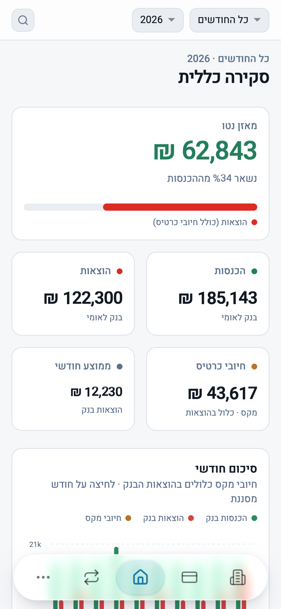
  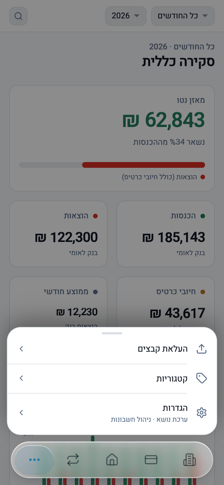
</p>

גם חלונות האישור (למשל לפני מחיקה) עולים מלמטה בטלפון, ובמסך רחב מופיעים במרכז:

<p align="center">
  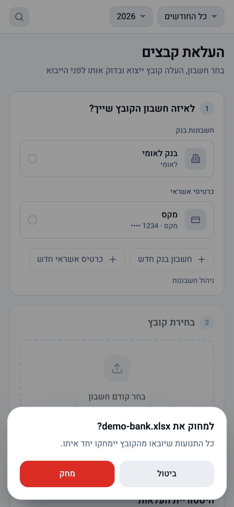
</p>

### התקנה כאפליקציה

אפשר להתקין את תזרים כאפליקציה, עם אייקון משלה ובחלון נפרד בלי סרגל הדפדפן:

- **Chrome / Edge במחשב:** לוחצים על אייקון ההתקנה בצד שורת הכתובת ("התקנת האפליקציה"). האפליקציה נפתחת בחלון משלה ומופיעה ב-Dock או בשורת המשימות.
- **iPhone (Safari):** כפתור השיתוף ← "הוספה למסך הבית". האפליקציה נפתחת במסך מלא.
- **Android (Chrome):** מאשרים את הצעת ההתקנה, או מתפריט הדפדפן ← "התקנת האפליקציה".

Chrome ו-Edge מתקינים כאפליקציה רק בחיבור מאובטח: `http://localhost` נחשב מאובטח, אבל בכתובת IP ברשת המקומית (`http://192.168...`) ב-Android מתקבל רק קיצור דרך שנפתח בדפדפן. ב-iPhone ההוספה למסך הבית עובדת גם בכתובת כזו.

---

## איך משתמשים

### 1. העלאת קבצים

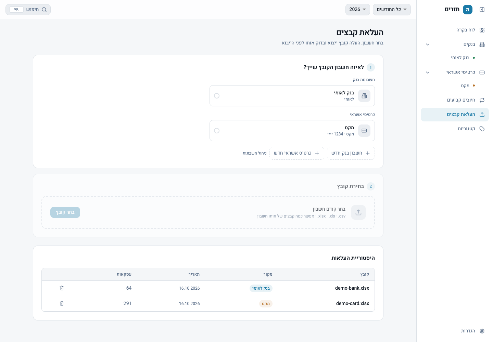

1. בדף **העלאת קבצים** בוחרים לאיזה חשבון הקובץ שייך. אפשר להוסיף כאן חשבון בנק או כרטיס אשראי חדש.
2. בוחרים קובץ (`.xlsx`, `.xls` או `.csv`). אפשר לבחור כמה קבצים של אותו חשבון בבת אחת.
3. בודקים את התצוגה המקדימה ומאשרים את הייבוא.

**איזה קבצים?** כל ייצוא טבלאי של בנק או חברת אשראי (`.xlsx`, `.xls`, `.csv`, כולל דפי ה-HTML ש"לאומי" שומר בשם `.xls`). האפליקציה מזהה לבד את שורת הכותרת ואת העמודות לפי השמות שלהן (תאריך, תיאור, חובה, זכות, סכום חיוב, תאריך חיוב…), גם כשבקובץ יש עמודות נוספות או בסדר אחר. בפעם הראשונה בודקים את ההתאמה בתצוגה חיה ומתקנים אם צריך, והמיפוי נשמר לחשבון לפעמים הבאות. אפשר לערוך אותו בכל רגע מחלון עריכת החשבון.

תנועות שכבר יובאו לא נכפלות, כך שאפשר להעלות קבצים חופפים בלי חשש. היסטוריית ההעלאות מופיעה בתחתית הדף, ואפשר למחוק ממנה העלאה עם כל התנועות שלה.

### 2. לוח בקרה

לוח הבקרה מרכז את השנה: מאזן נטו, הכנסות, הוצאות, חיובי כרטיסים, שינויים בהוצאות לפי קטגוריה, חיובים קבועים ותנועות חריגות.

- **בחירת תקופה:** במרכז הסרגל העליון. החצים עוברים לחודש הקודם או הבא (או לשנה, כשמוצגת שנה שלמה), ולחיצה על התקופה עצמה פותחת את כל החודשים של השנה, עם "כל השנה".
- **לחיצה על עמודה בגרף** מסננת את כל הדף לאותו חודש. לחיצה נוספת מבטלת את הסינון.

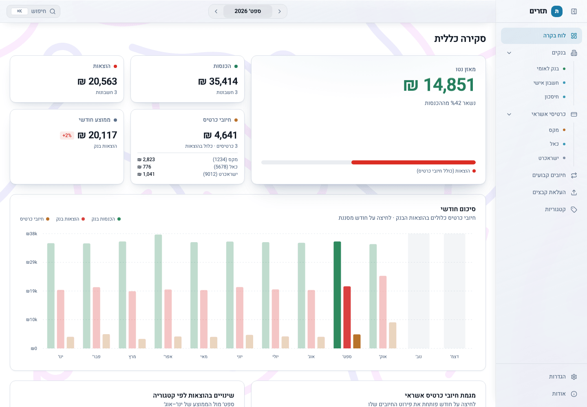

> **חיובי כרטיס כבר כלולים בהוצאות הבנק.** החיוב החודשי של חברת האשראי יורד מחשבון הבנק, ולכן סכום חיובי הכרטיס מוצג כפירוט של ההוצאה ולא נוסף עליה שוב.

### 3. בנקים וכרטיסי אשראי

לכל חשבון יש דף משלו עם סיכומים, גרף חודשי ורשימת התנועות. בדף הבנק מופיע גם גרף יתרה לאורך זמן.

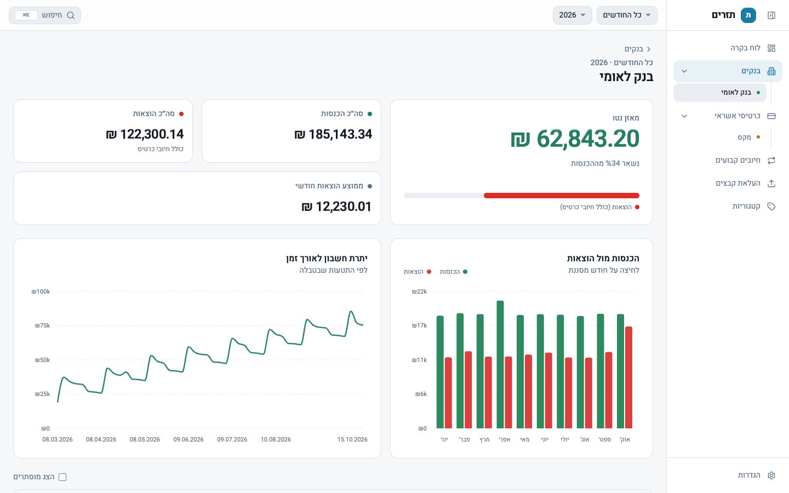

בדף כרטיס אשראי רואים את החיובים לפי קטגוריה ולפי חודש, ובטבלה אפשר לשנות קטגוריה לעסקה או להסתיר אותה.

**רשימת קטגוריות התחלתית:** התקנה חדשה מתחילה עם רשימת קטגוריות מוכנה (בשמות של מקס, ועוד כמה לתנועות בנק), כדי שגם לכרטיסים שהקבצים שלהם בלי קטגוריות, כמו כאל וישראכרט, יהיה ממה לבחור. אפשר לשנות שם, למחוק ולהוסיף כמו בכל קטגוריה.

**קטגוריות מחברות האשראי:** כשקובץ מגיע עם קטגוריות משלו (כמו מקס), כל קטגוריה שעוד לא מוכרת מוצגת אחרי ההעלאה: אפשר להוסיף אותה לרשימה, או לשייך אותה לקטגוריה שכבר יש לך. השיוך נשמר לכל הכרטיסים של אותה חברה, חל גם על העסקאות שכבר הועלו וגם על הקבצים הבאים, ואפשר לשנות אותו בדף **קטגוריות**. כך שתי חברות שקוראות לאותו דבר בשמות שונים מגיעות לאותה קטגוריה. קטגוריה ששונתה ידנית לעסקה או לבית עסק נשארת כמו שהיא.

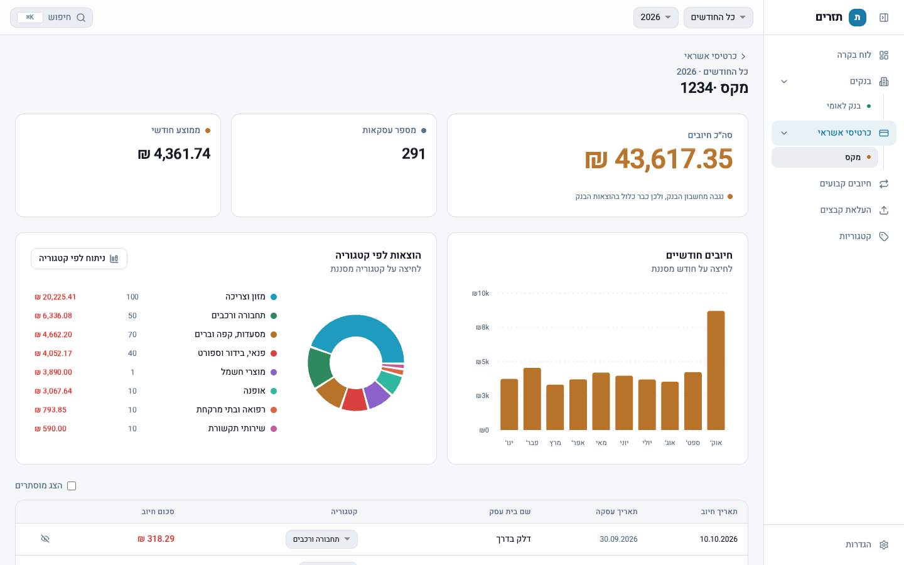

**ניתוח לפי קטגוריה** מציג את ההוצאות של כל קטגוריה לאורך השנה, עם טבלת פירוט לפי חודש וממוצע:

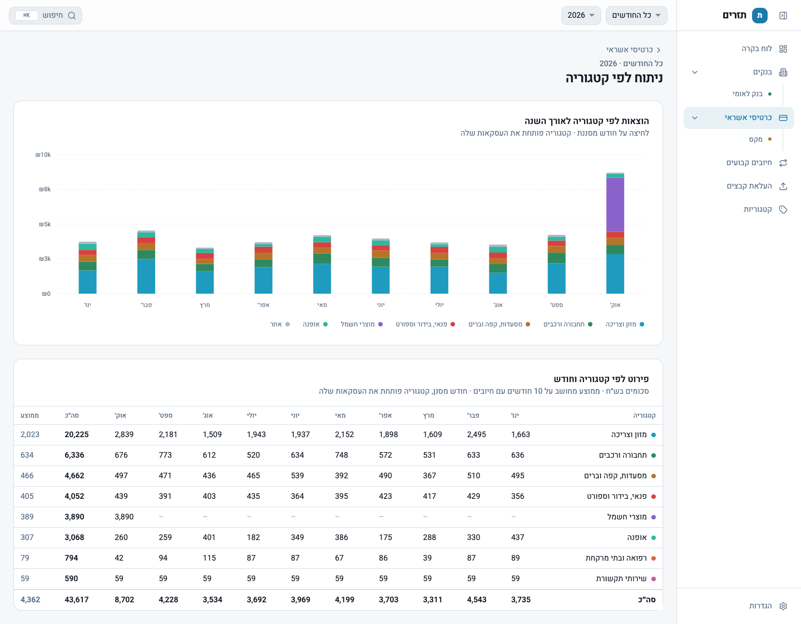

### 4. חיובים קבועים

האפליקציה מזהה לבד חיובים שחוזרים בסכום דומה (שכר דירה, מנויים, ביטוחים…) ומציגה את העלות החודשית והשנתית שלהם. לכל חיוב אפשר:

- ✓ לאשר שהוא אכן קבוע
- להסתיר אותו אם הזיהוי שגוי
- ✎ לשנות לו שם

חיוב שהתייקר מסומן, ומוצג לצד הסכום הקודם.

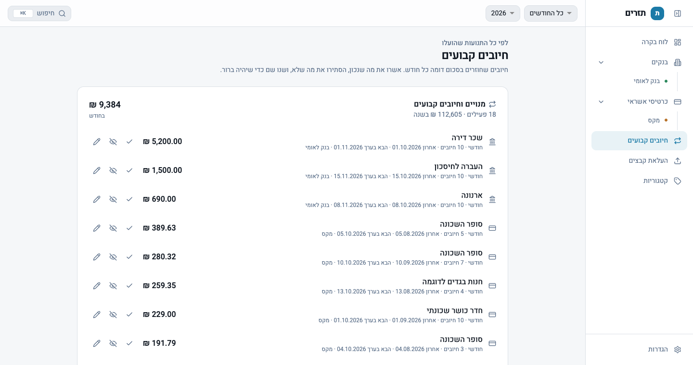

### 5. חיפוש

חיפוש בכל החשבונות ובכל השנים לפי שם בית עסק, תיאור, הערה או סכום. מקלידים `120` לסכום מדויק, או `100-200` לטווח. כפתור **סינון** פותח סינון לפי תאריכים, קטגוריה וחשבונות. קיצור מקלדת לפתיחת החיפוש: <kbd>⌘K</kbd> (או <kbd>Ctrl</kbd>+<kbd>K</kbd>).

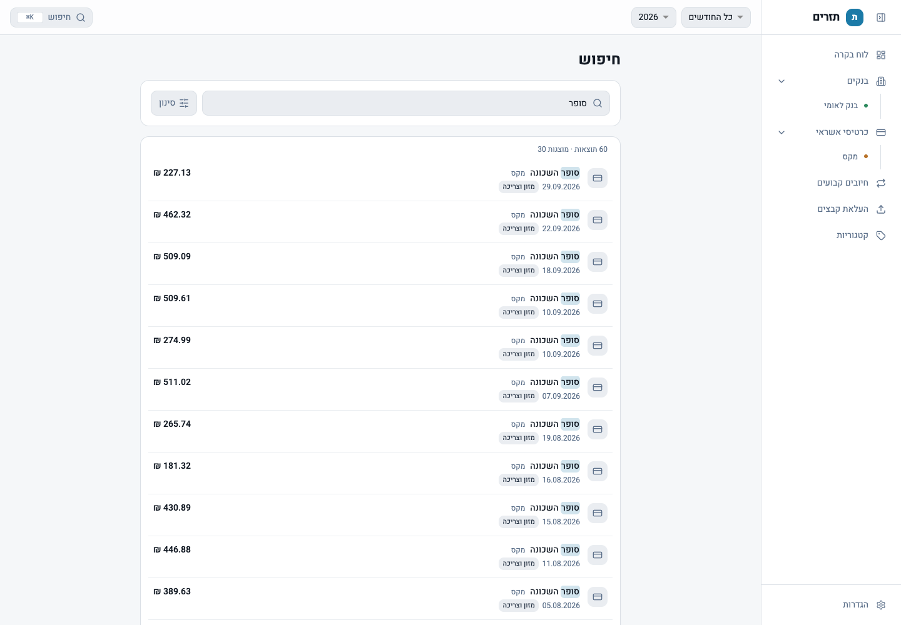

<p align="center">
  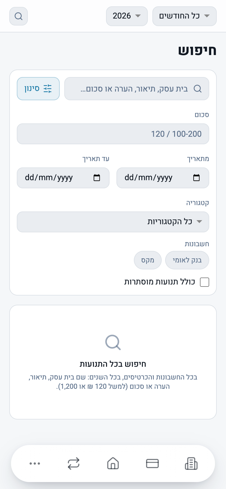
</p>

### 6. הגדרות

- **ערכת נושא:** בהירה, כהה, או לפי הגדרות המערכת.
- **ניהול חשבונות:** הוספה, שינוי שם, העברה לארכיון ומחיקה.
- **מיפויי ייבוא:** מיפויי עמודות שנשמרו, עם אפשרות לשנות שם ולמחוק.
- **אנשים ומכשירים:** מי בבית, באילו מכשירים יש לו מפתח ולמי יש סיסמה, הזמנות, ביטול מכשיר, הגדרת סיסמה, קוד שחזור חדש ויציאה (ראו [כניסה עם מפתח](#כניסה-עם-מפתח)).
- **אזור מסוכן:** מחיקת כל הנתונים (חשבונות, תנועות, העלאות, קטגוריות, כללים, מיפויים והחלטות, וגם האנשים, המכשירים, הסיסמאות וקוד השחזור) והתחלה מחדש כמו בהתקנה חדשה, עם קוד התקנה חדש בלוג. צריך להקליד `מחק הכל`, ואז לאשר שזה באמת אתם: עם Face ID, Touch ID או קוד המכשיר, או עם הסיסמה שלכם. המפתחות שנשמרו במכשירים לא נמחקים מהם, ואפשר למחוק אותם בהגדרות הסיסמאות של המכשיר. כדאי [לגבות](#גיבוי-ושחזור) קודם. אפשר גם למחוק עם `docker compose down -v`.

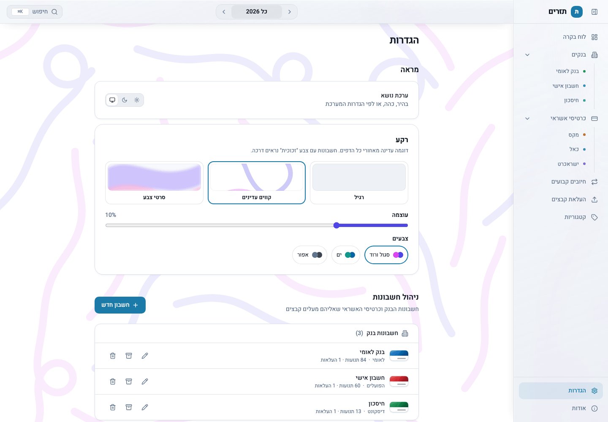

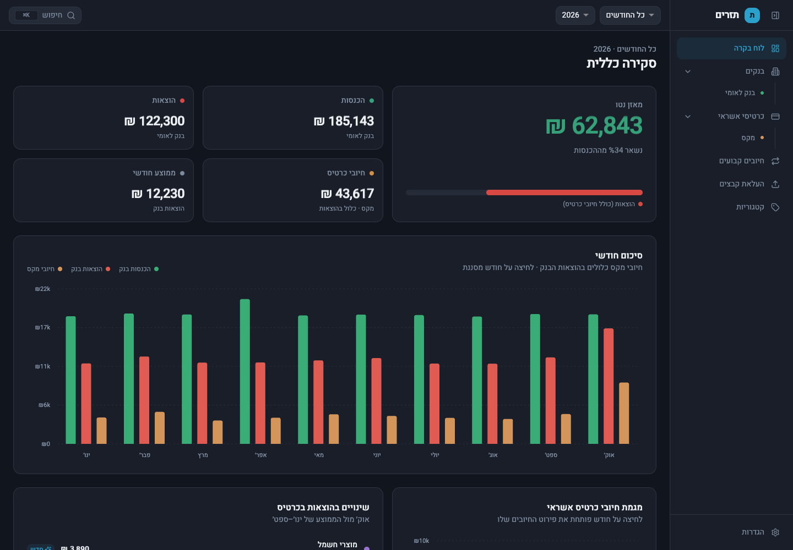

---

## פיתוח

### הרצה מהקוד

למי שרוצה לשנות את הקוד או לתרום. לשימוש רגיל עדיף [Docker](#התקנה-והפעלה).

**דרישות:**

- [Node.js](https://nodejs.org/) גרסה 20 ומעלה (כולל npm)
- Git
- ‏`sqlite3` (שורת פקודה): נדרש רק להרצת הבדיקות. ב-macOS הוא מותקן מראש.

```bash
# 1. הורדת הקוד
git clone https://github.com/JordanYefet/Tazrim.git
cd Tazrim

# 2. התקנת תלויות
npm install

# 3. יצירת Prisma Client ובסיס הנתונים (prisma/tazrim.db)
npx prisma generate
npx prisma migrate deploy

# 4. הרצה
npm run dev
```

פותחים בדפדפן את <http://localhost:3000>. בפעם הראשונה בסיס הנתונים ריק, ומעלים קבצים מדף **העלאת קבצים**.

`npm run dev` מתאים לפיתוח. כדי להריץ מהקוד לשימוש יומיומי, עדיף לבנות פעם אחת ולהריץ את הגרסה הבנויה: `npm run build` ואז `npm start`.

**נתוני דמו:** `npm run db:demo` בונה בסיס נתונים נפרד (`prisma/demo.db`) עם שנה של תנועות מומצאות בשלושה חשבונות בנק ושלושה כרטיסי אשראי, ו-`npm run dev:demo` מריץ את האפליקציה עליו. בסיס הנתונים האמיתי (`prisma/tazrim.db`) לא משתנה, ואפשר להריץ את `db:demo` שוב בכל רגע כדי להתחיל מחדש.

**גיבוי:** כל הנתונים נמצאים בקובץ אחד, ומספיק להעתיק אותו:

```bash
cp prisma/tazrim.db ~/Backups/tazrim-$(date +%Y%m%d).db
```

**עדכון:** הענף `release` מצביע תמיד על הגרסה האחרונה שפורסמה, ו-`main` על הפיתוח השוטף. כדי להישאר על גרסאות שפורסמו, עוברים פעם אחת ל-`release` (`git checkout release`), ומעדכנים כך (אחרי גיבוי):

```bash
git pull
npm install
npx prisma generate
npx prisma migrate deploy   # מעדכן את מבנה בסיס הנתונים, הנתונים נשמרים
```

> בסיס הנתונים וקבצי האקסל/CSV מוחרגים מ-Git (`.gitignore`), כדי שנתונים פיננסיים אישיים לא יגיעו למאגר בטעות.

**בניית האימג' מהקוד:** כדי לנסות שינויים בקוד ב-Docker, בונים את האימג' בתיקיית הקוד ומריצים אותו:

```bash
docker build -t ghcr.io/jordanyefet/tazrim:latest .
docker compose up -d
```

`docker compose pull` מחליף אחר כך את האימג' הזה בגרסה שפורסמה.

### פקודות

| פקודה | מה היא עושה |
| --- | --- |
| `npm run dev` | שרת פיתוח על פורט 3000 |
| `npm run dev:demo` | שרת פיתוח על בסיס נתוני הדמו |
| `npm run db:demo` | בונה מחדש את `prisma/demo.db` עם נתונים מומצאים |
| `npm test` | הרצת הבדיקות (Vitest) |
| `npm run build` | בנייה לסביבת ייצור |
| `npm run db:studio` | עיון בבסיס הנתונים דרך Prisma Studio |

**CI וגרסאות:** כל Pull Request ל-`main` עובר ב-GitHub Actions בדיקת טיפוסים, את כל הבדיקות ובנייה (`.github/workflows/ci.yml`). גרסה חדשה מפרסמים ידנית: **Actions ← Release ← Run workflow**, בלי למלא כלום. מספר הגרסה מחושב לבד מהכותרות של ה-PRs שמוזגו ל-`main` מאז הגרסה האחרונה, לפי הקידומת שלהן: `fix:` (וגם `docs:`, `chore:`, `refactor:` וכדומה) מעלה patch ‏(1.4.2 ← 1.4.3), `feat:` מעלה minor ‏(1.4.2 ← 1.5.0), וכל `<type>!:` (למשל `feat!:`) מעלה major ‏(1.4.2 ← 2.0.0). השינוי הגדול ביותר קובע, וכותרת בלי קידומת נחשבת minor. סיכום ההרצה מראה איזו גרסה יצאה ואילו PRs קבעו אותה (`.github/scripts/release-bump.sh`), ובכל PR בודקת `pr-title.yml` את הקידומת ומזהירה כשאין (בלי לחסום). התהליך מעדכן את הענף `release` (עם commit של מספר הגרסה), בונה ומפרסם את האימג' ב-GHCR, ויוצר את התג ואת ה-Release ב-GitHub. Vercel בונה מהענף `release` את הדמו החי, שמתעדכן גם פעם בשבוע (`demo.yml`) כדי שנתוני הדמו יגיעו עד השבוע הנוכחי.

**מצב קריאה בלבד:** עם `TAZRIM_READ_ONLY=1` השרת דוחה כל שינוי בנתונים, והממשק מסביר את זה כשמנסים לשמור. כך רץ הדמו החי.

**עיצוב:** כללי העיצוב, הטוקנים והרכיבים המשותפים מתועדים ב-[`docs/design-system.md`](docs/design-system.md), ובפיתוח אפשר לראות אותם חיים בכתובת `/design`.

**טכנולוגיות:** Next.js 15 (App Router), React 19, TypeScript, Prisma עם SQLite, Tailwind CSS, Recharts.

**מבנה עיקרי:**

```
app/          דפים ונתיבי API
components/   רכיבי ממשק לפי אזור (dashboard, cards, bank, search, upload…)
lib/          לוגיקה: parsers לקבצים, db לשאילתות, insights לזיהוי חיובים קבועים וחריגים
prisma/       סכמה ומיגרציות (בסיס הנתונים עצמו לא נשמר ב-Git)
scripts/      סקריפט נתוני הדמו
.github/      תהליכי GitHub Actions: CI, Release, Demo
docs/         מסמכי תכנון וצילומי מסך
```

---

## רישיון ופרטיות

**רישיון:** הקוד פתוח ומופץ בחינם תחת [רישיון MIT](LICENSE). מותר להשתמש בו, להעתיק, לשנות ולהפיץ אותו, גם לשימוש מסחרי, בתנאי שמשאירים את הודעת זכויות היוצרים והרישיון.

**הבהרה:** תזרים הוא כלי עזר אישי ולא ייעוץ פיננסי. התוכנה מסופקת כמו שהיא (AS IS), בלי אחריות מכל סוג. החישובים תלויים בקבצים שמעלים ובאופן שבו הם מפוענחים, ולכן כדאי תמיד להשוות את המספרים מול הבנק וחברות האשראי לפני שמקבלים החלטות.

**פרטיות:** כל הנתונים נשמרים רק על המחשב שלכם: ב-Docker בתוך ה-volume שלו, ובהרצה מהקוד בקובץ `prisma/tazrim.db`. האפליקציה לא שולחת את הנתונים שלכם לשום מקום: אין שרת מרוחק, אין חשבון משתמש ואין איסוף נתונים או אנליטיקה. גם הגופן (Heebo) מוגש מהאפליקציה עצמה, כך שהדפדפן לא פונה לשום שרת חיצוני.
