# תזרים

**Tazrim** is a self-hosted personal finance dashboard for Israeli households. It reads the transaction exports of Israeli banks and credit-card companies and turns them into a clear monthly cash-flow picture: income, expenses, categories, recurring charges and unusual transactions. The interface is in Hebrew, everything runs on your own machine and your data never leaves it. Free and open source under the MIT license.

אפליקציה אישית למעקב אחרי התזרים החודשי: מעלים קבצי תנועות מהבנק ופירוטי חיובים מחברות האשראי, ומקבלים תמונה ברורה של הכנסות, הוצאות, קטגוריות, חיובים קבועים ותנועות חריגות.

הכול רץ מקומית על המחשב שלכם. הנתונים נשמרים בקובץ SQLite אחד (`prisma/tazrim.db`) ולא נשלחים לשום שירות חיצוני.

> כל צילומי המסך כאן צולמו על נתוני דמו מומצאים (`npm run db:demo`).

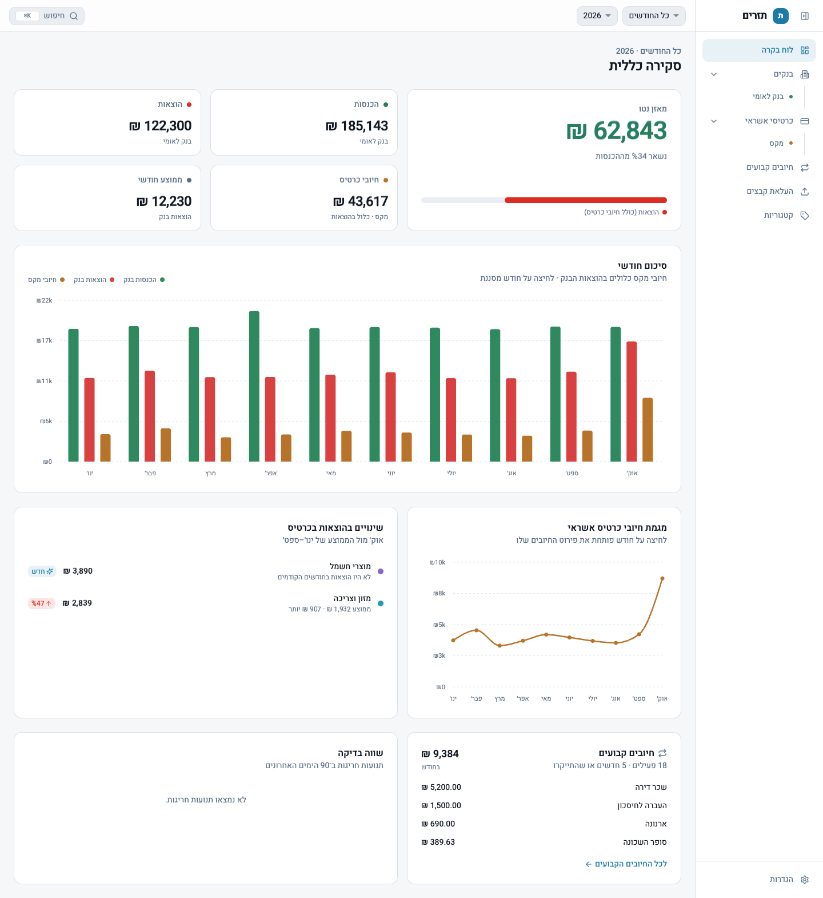

---

## תוכן עניינים

- [התקנה והרצה מקומית](#התקנה-והרצה-מקומית)
- [מצב דמו](#מצב-דמו)
- [פתיחה מהטלפון](#פתיחה-מהטלפון)
- [איך משתמשים](#איך-משתמשים)
- [גיבוי ועדכון גרסה](#גיבוי-ועדכון-גרסה)
- [פיתוח](#פיתוח)
- [רישיון ופרטיות](#רישיון-ופרטיות)

---

## התקנה והרצה מקומית

### דרישות

- [Node.js](https://nodejs.org/) גרסה 20 ומעלה (כולל npm)
- Git
- ‏`sqlite3` (שורת פקודה): נדרש רק למצב הדמו ולבדיקות. ב-macOS הוא מותקן מראש.

### שלבים

```bash
# 1. הורדת הקוד
git clone https://github.com/JordanYefet/Tazrim.git
cd Tazrim

# 2. התקנת תלויות
npm install

# 3. יצירת Prisma Client ובסיס הנתונים (prisma/tazrim.db)
npx prisma generate
npx prisma migrate deploy

# 4. הרצה
npm run dev
```

פותחים בדפדפן את <http://localhost:3000>. בפעם הראשונה בסיס הנתונים ריק, ומעלים קבצים מדף **העלאת קבצים** (פירוט בהמשך).

### הרצה קבועה (מהירה יותר)

`npm run dev` מתאים לפיתוח. לשימוש יומיומי עדיף לבנות פעם אחת ולהריץ את הגרסה הבנויה:

```bash
npm run build
npm start        # http://localhost:3000
```

---

## מצב דמו

רוצים לראות את האפליקציה לפני שמעלים נתונים אמיתיים? יש סקריפט שבונה בסיס נתונים נפרד עם שנה של תנועות מומצאות:

```bash
npm run db:demo      # יוצר את prisma/demo.db
npm run dev:demo     # מריץ את האפליקציה על בסיס הדמו
```

בסיס הנתונים האמיתי (`prisma/tazrim.db`) לא משתנה. אפשר להריץ את `db:demo` שוב בכל רגע כדי להתחיל מחדש.

---

## פתיחה מהטלפון

שרת הפיתוח מאזין לכל הכתובות ברשת (`-H 0.0.0.0`), כך שאפשר לפתוח את האפליקציה מהטלפון כשהוא מחובר לאותה רשת Wi-Fi:

1. מוצאים את כתובת ה-IP של המחשב (ב-macOS: `ipconfig getifaddr en0`).
2. פותחים בטלפון את `http://<כתובת-ה-IP>:3000`.

במסך צר התפריט הצדדי מתחלף בסרגל ניווט צף בצורת גלולה, עם אייקונים בלבד: בנקים, כרטיסים, לוח הבקרה (במרכז), חיובים קבועים, ו"עוד". הסרגל שקוף למחצה, כך שהתוכן נראה דרכו בזמן הגלילה. "עוד" פותח חלון קטן עם העלאת קבצים, קטגוריות והגדרות.

<p align="center">
  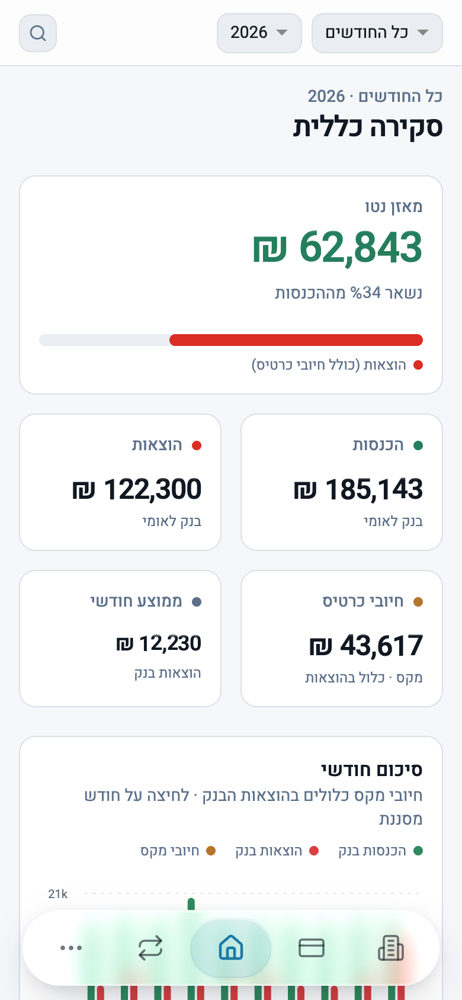
  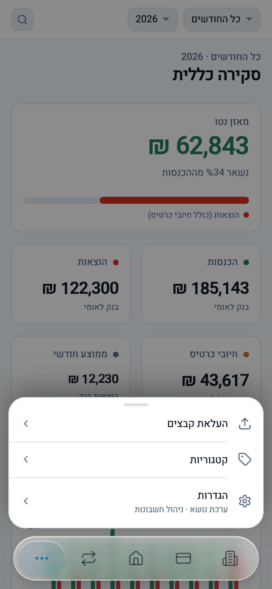
</p>

גם חלונות האישור (למשל לפני מחיקה) עולים מלמטה בטלפון, ובמסך רחב מופיעים במרכז:

<p align="center">
  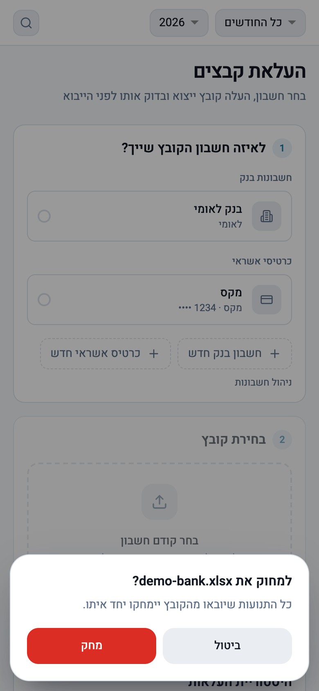
</p>

### התקנה כאפליקציה

אפשר להתקין את תזרים כאפליקציה, עם אייקון משלה ובחלון נפרד בלי סרגל הדפדפן:

- **Chrome / Edge במחשב:** לוחצים על אייקון ההתקנה בצד שורת הכתובת ("התקנת האפליקציה"). האפליקציה נפתחת בחלון משלה ומופיעה ב-Dock או בשורת המשימות.
- **iPhone (Safari):** כפתור השיתוף ← "הוספה למסך הבית". האפליקציה נפתחת במסך מלא.
- **Android (Chrome):** מאשרים את הצעת ההתקנה, או מתפריט הדפדפן ← "התקנת האפליקציה".

Chrome ו-Edge מתקינים כאפליקציה רק בחיבור מאובטח: `http://localhost` נחשב מאובטח, אבל בכתובת IP ברשת המקומית (`http://192.168...`) ב-Android מתקבל רק קיצור דרך שנפתח בדפדפן. ב-iPhone ההוספה למסך הבית עובדת גם בכתובת כזו.

---

## איך משתמשים

### 1. העלאת קבצים

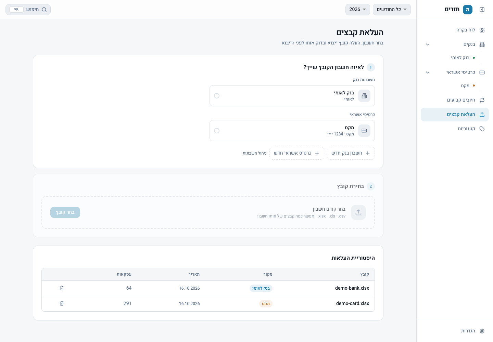

1. בדף **העלאת קבצים** בוחרים לאיזה חשבון הקובץ שייך. אפשר להוסיף כאן חשבון בנק או כרטיס אשראי חדש.
2. בוחרים קובץ (`.xlsx`, `.xls` או `.csv`). אפשר לבחור כמה קבצים של אותו חשבון בבת אחת.
3. בודקים את התצוגה המקדימה ומאשרים את הייבוא.

**פורמטים נתמכים:**

| מקור | קובץ |
| --- | --- |
| בנק לאומי | ייצוא "תנועות בחשבון" לאקסל |
| מקס | ייצוא "פירוט עסקאות" לאקסל |
| כל בנק או חברת אשראי אחרים | כל קובץ טבלאי: בפעם הראשונה ממפים את העמודות (תאריך, תיאור, סכום…) בתצוגה חיה, והמיפוי נשמר לפעם הבאה |

תנועות שכבר יובאו לא נכפלות, כך שאפשר להעלות קבצים חופפים בלי חשש. היסטוריית ההעלאות מופיעה בתחתית הדף, ואפשר למחוק ממנה העלאה עם כל התנועות שלה.

### 2. לוח בקרה

לוח הבקרה מרכז את השנה: מאזן נטו, הכנסות, הוצאות, חיובי כרטיסים, שינויים בהוצאות לפי קטגוריה, חיובים קבועים ותנועות חריגות.

- **בחירת שנה וחודש:** בבוררים שבראש העמוד.
- **לחיצה על עמודה בגרף** מסננת את כל הדף לאותו חודש. לחיצה נוספת מבטלת את הסינון.

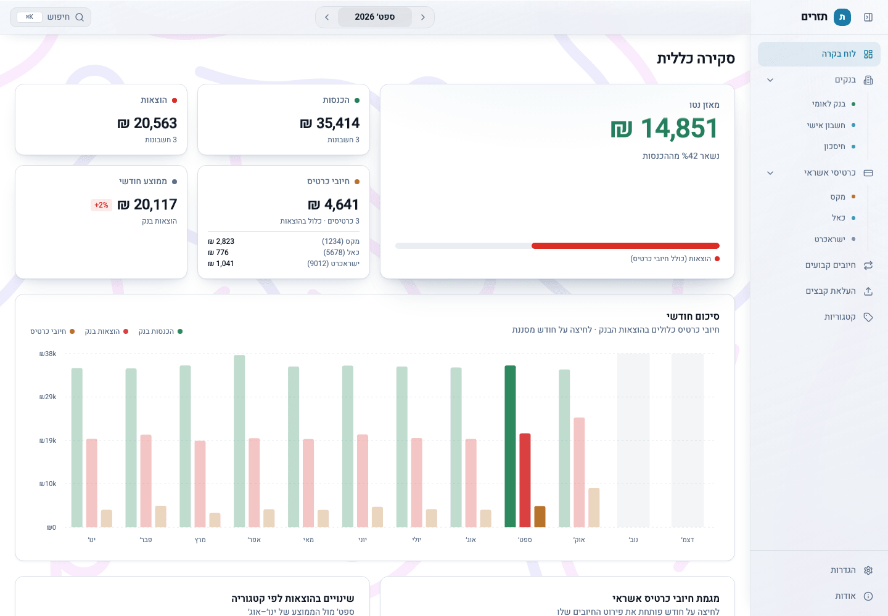

> **חיובי כרטיס כבר כלולים בהוצאות הבנק.** החיוב החודשי של חברת האשראי יורד מחשבון הבנק, ולכן סכום חיובי הכרטיס מוצג כפירוט של ההוצאה ולא נוסף עליה שוב.

### 3. בנקים וכרטיסי אשראי

לכל חשבון יש דף משלו עם סיכומים, גרף חודשי ורשימת התנועות. בדף הבנק מופיע גם גרף יתרה לאורך זמן.

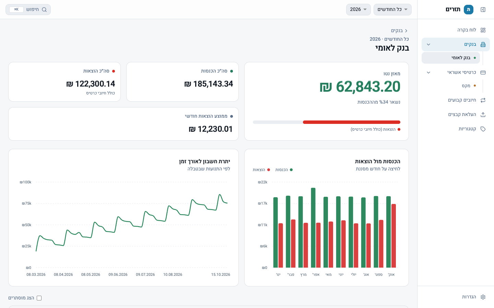

בדף כרטיס אשראי רואים את החיובים לפי קטגוריה ולפי חודש, ובטבלה אפשר לשנות קטגוריה לעסקה או להסתיר אותה.

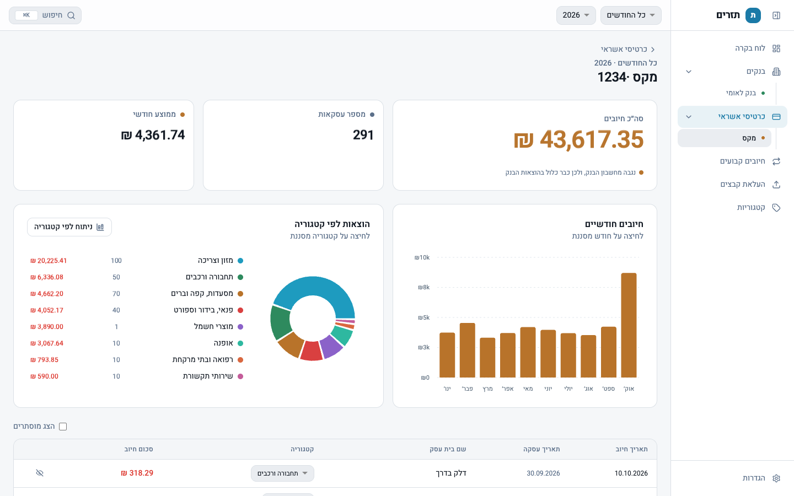

**ניתוח לפי קטגוריה** מציג את ההוצאות של כל קטגוריה לאורך השנה, עם טבלת פירוט לפי חודש וממוצע:

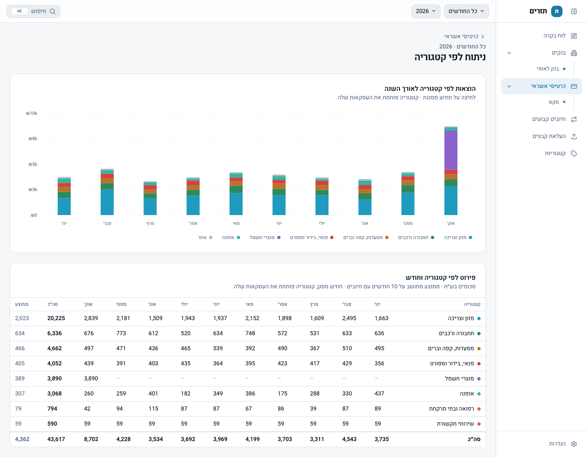

### 4. חיובים קבועים

האפליקציה מזהה לבד חיובים שחוזרים בסכום דומה (שכר דירה, מנויים, ביטוחים…) ומציגה את העלות החודשית והשנתית שלהם. לכל חיוב אפשר:

- ✓ לאשר שהוא אכן קבוע
- להסתיר אותו אם הזיהוי שגוי
- ✎ לשנות לו שם

חיוב שהתייקר מסומן, ומוצג לצד הסכום הקודם.

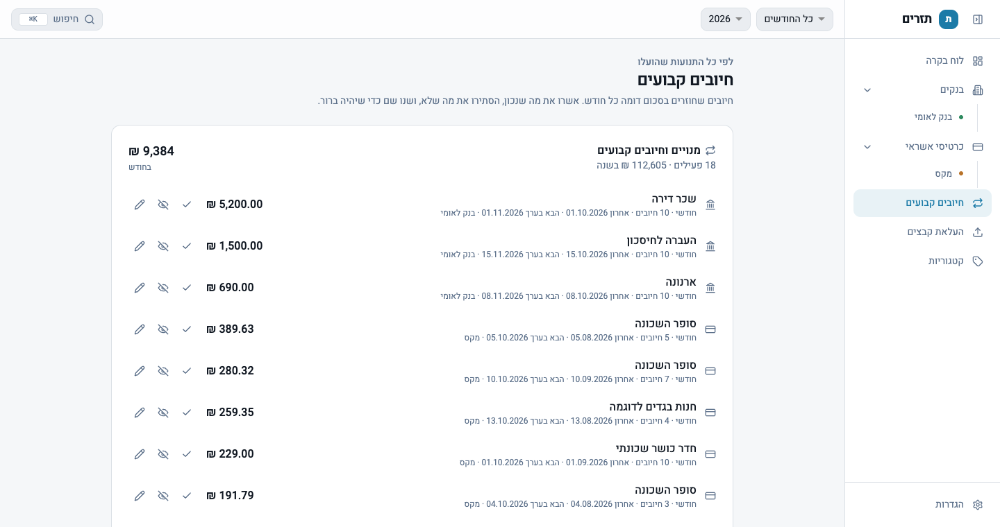

### 5. חיפוש

חיפוש בכל החשבונות ובכל השנים לפי שם בית עסק, תיאור, הערה או סכום. מקלידים `120` לסכום מדויק, או `100-200` לטווח. כפתור **סינון** פותח סינון לפי תאריכים, קטגוריה וחשבונות. קיצור מקלדת לפתיחת החיפוש: <kbd>⌘K</kbd> (או <kbd>Ctrl</kbd>+<kbd>K</kbd>).

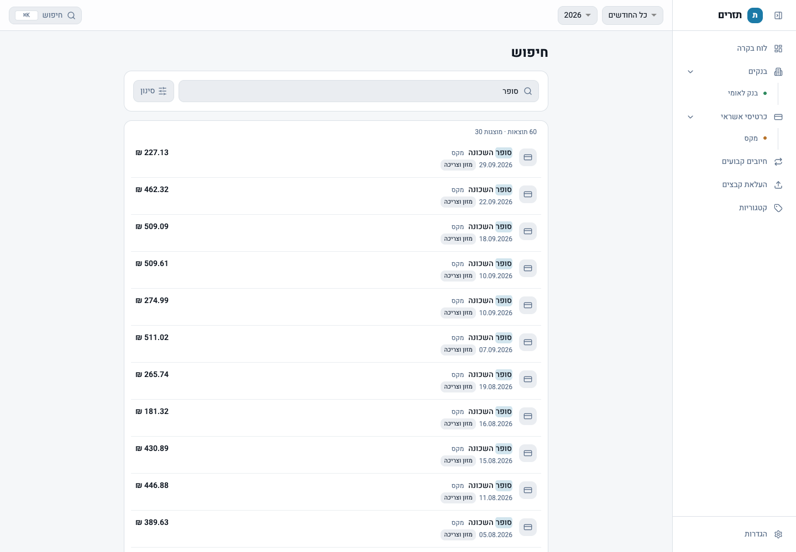

<p align="center">
  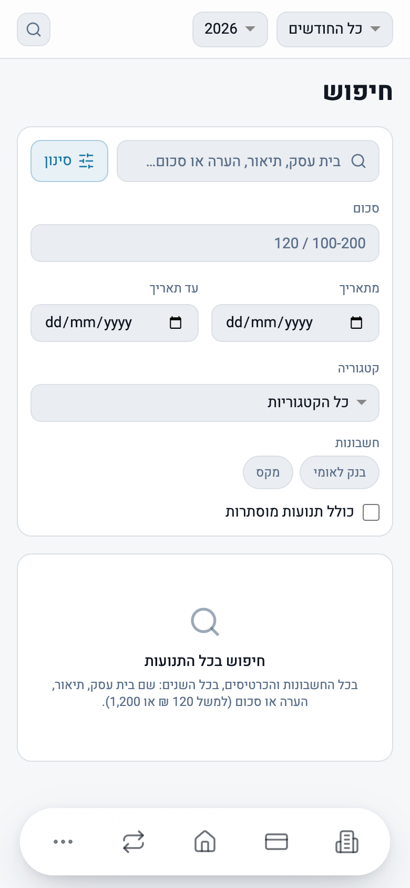
</p>

### 6. הגדרות

- **ערכת נושא:** בהירה, כהה, או לפי הגדרות המערכת.
- **ניהול חשבונות:** הוספה, שינוי שם, העברה לארכיון ומחיקה.
- **מיפויי ייבוא:** מיפויי עמודות שנשמרו, עם אפשרות לשנות שם ולמחוק.

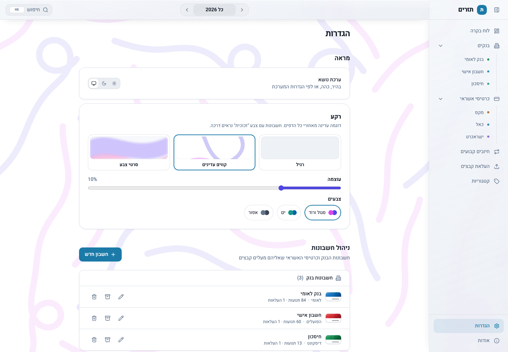

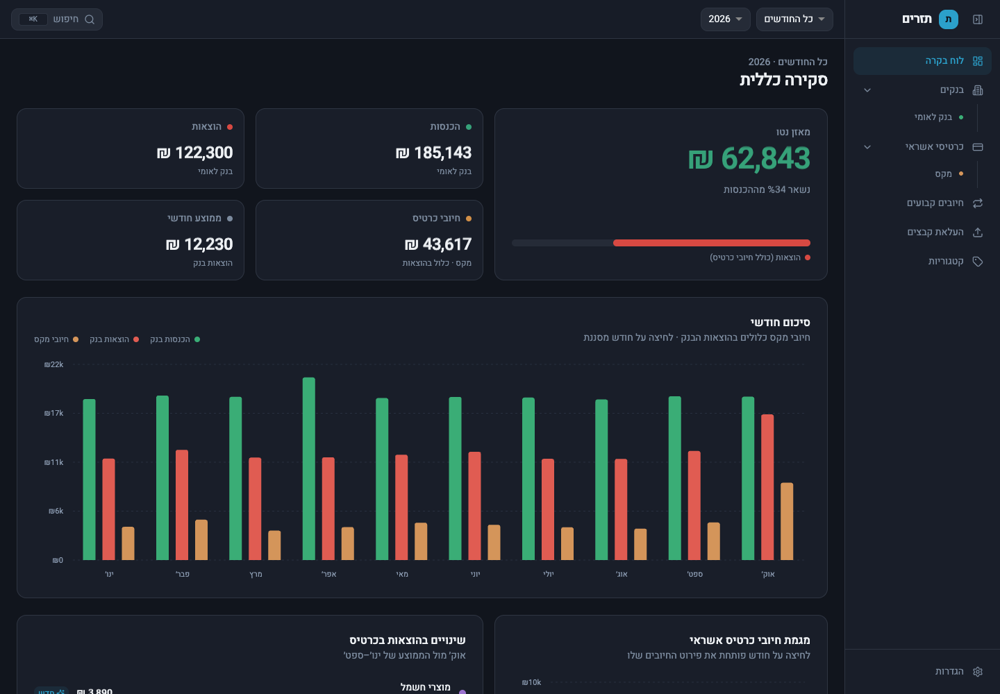

---

## גיבוי ועדכון גרסה

**גיבוי:** כל הנתונים נמצאים בקובץ אחד. מספיק להעתיק אותו:

```bash
cp prisma/tazrim.db ~/Backups/tazrim-$(date +%Y%m%d).db
```

**עדכון לגרסה חדשה:**

```bash
git pull
npm install
npx prisma generate
npx prisma migrate deploy   # מעדכן את מבנה בסיס הנתונים, הנתונים נשמרים
```

כדאי לגבות את `prisma/tazrim.db` לפני כל עדכון.

> בסיס הנתונים וקבצי האקסל/CSV מוחרגים מ-Git (`.gitignore`), כדי שנתונים פיננסיים אישיים לא יגיעו למאגר בטעות.

---

## פיתוח

| פקודה | מה היא עושה |
| --- | --- |
| `npm run dev` | שרת פיתוח על פורט 3000 |
| `npm run dev:demo` | שרת פיתוח על בסיס נתוני הדמו |
| `npm run db:demo` | בונה מחדש את `prisma/demo.db` עם נתונים מומצאים |
| `npm test` | הרצת הבדיקות (Vitest) |
| `npm run build` | בנייה לסביבת ייצור |
| `npm run db:studio` | עיון בבסיס הנתונים דרך Prisma Studio |

**טכנולוגיות:** Next.js 15 (App Router), React 19, TypeScript, Prisma עם SQLite, Tailwind CSS, Recharts.

**מבנה עיקרי:**

```
app/          דפים ונתיבי API
components/   רכיבי ממשק לפי אזור (dashboard, cards, bank, search, upload…)
lib/          לוגיקה: parsers לקבצים, db לשאילתות, insights לזיהוי חיובים קבועים וחריגים
prisma/       סכמה ומיגרציות (בסיס הנתונים עצמו לא נשמר ב-Git)
scripts/      סקריפט נתוני הדמו
docs/         מסמכי תכנון וצילומי מסך
```

---

## רישיון ופרטיות

**רישיון:** הקוד פתוח ומופץ בחינם תחת [רישיון MIT](LICENSE). מותר להשתמש בו, להעתיק, לשנות ולהפיץ אותו, גם לשימוש מסחרי, בתנאי שמשאירים את הודעת זכויות היוצרים והרישיון.

**הבהרה:** תזרים הוא כלי עזר אישי ולא ייעוץ פיננסי. התוכנה מסופקת כמו שהיא (AS IS), בלי אחריות מכל סוג. החישובים תלויים בקבצים שמעלים ובאופן שבו הם מפוענחים, ולכן כדאי תמיד להשוות את המספרים מול הבנק וחברות האשראי לפני שמקבלים החלטות.

**פרטיות:** כל הנתונים נשמרים רק על המחשב שלכם, בקובץ `prisma/tazrim.db`. האפליקציה לא שולחת את הנתונים שלכם לשום מקום: אין שרת מרוחק, אין חשבון משתמש ואין איסוף נתונים או אנליטיקה. הבקשה החיצונית היחידה היא טעינת הגופן Heebo מ-Google Fonts בדפדפן, והיא לא כוללת שום מידע פיננסי.
