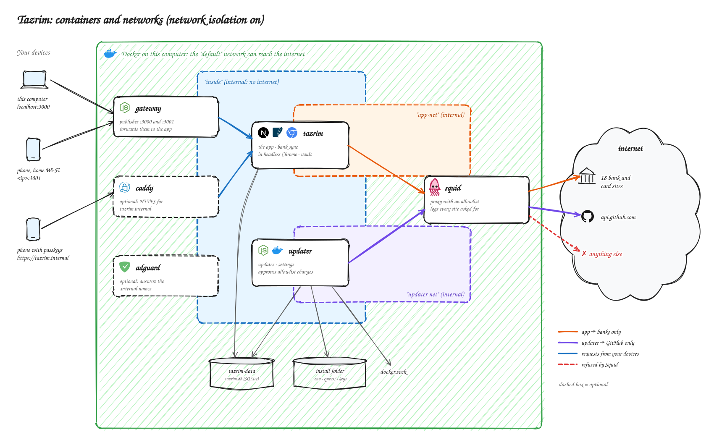
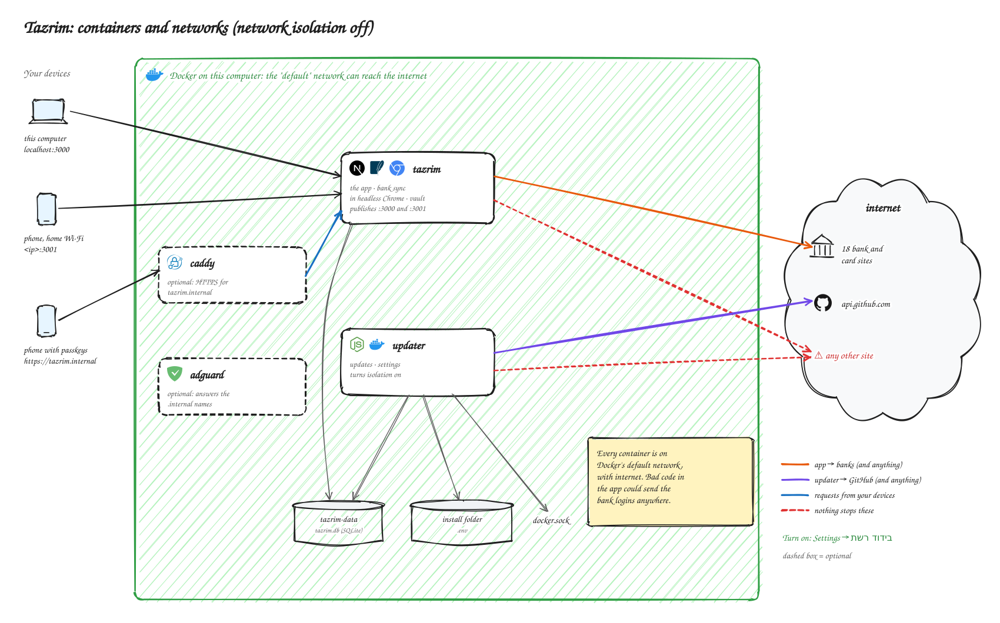

# בידוד רשת (אופציונלי)

[חזרה ל-README](../README.md)

בידוד רשת **דלוק**:



בידוד רשת **כבוי** (ברירת המחדל):



למי שרוצה ש**הקונטיינר של תזרים לא יוכל לדבר עם שום דבר חוץ מהבנקים וחברות האשראי**: גם אם יהיה בו קוד זדוני (תלות שנפרצה, למשל), הוא לא יוכל לשלוח החוצה את הנתונים או את פרטי הכניסה. זה כבוי כברירת מחדל, ובלי זה שום דבר לא משתנה.

**איך זה עובד.** הקונטיינר `tazrim` יושב רק ברשתות פנימיות של Docker (בלי נתיב לאינטרנט). הדרך היחידה שלו החוצה היא פרוקסי [Squid](https://www.squid-cache.org/) שמאשר רק את הדומיינים של הבנקים וחברות האשראי שהסקרייפר מכיר (`docker/squid/banks.txt`), והדפדפן שמסנכרן עובר דרכו. הוא לא פותח את ה-HTTPS: הוא רק רואה לאיזה שם פונים, לא מה נשלח. שירות העזר `updater` יושב ברשת משלו, ו-Squid מאשר לו רק את `api.github.com` (וכך גם לקונטיינרים הקצרים שהוא מפעיל לכל עבודה, שיושבים באותן רשתות); לכן את הבדיקה "יש גרסה חדשה?" עושה שירות העזר ולא האפליקציה (האפליקציה שואלת אותו). בלי הבידוד האפליקציה בודקת בעצמה, כמו קודם. הורדת התמונה החדשה בעדכון נעשית על ידי Docker עצמו במחשב (דרך ה-socket), ולא על ידי קונטיינר, ולכן היא לא עוברת ב-Squid.

**הפעלה.** מורידים לתיקייה `tazrim` עוד קובץ אחד, ומוסיפים שורה ל-`.env`:

```bash
curl -O https://raw.githubusercontent.com/JordanYefet/Tazrim/main/docker-compose.egress.yml
echo 'COMPOSE_FILE=docker-compose.yml:docker-compose.egress.yml' >> .env   # ב-Windows: ; במקום :
docker compose up -d
```

הפורטים (3000 ו-3001, ו-80/443 עם HTTPS) נשארים כמו שהיו: קונטיינר קטן בשם `gateway` מפרסם אותם ומעביר את החיבור הלאה ללא שינוי. צריך Docker Compose 2.24 ומעלה. כדי לבטל, מוחקים את השורה מ-`.env` ומריצים `docker compose up -d --remove-orphans`.

**מתג באפליקציה.** עם שירות העזר (`updater`) פועל, אפשר להדליק ולכבות את הבידוד ב**הגדרות ← בידוד רשת**, בלי לגעת בקבצים. המתג מוסיף או מוריד את `docker-compose.egress.yml` מהשורה `COMPOSE_FILE` ב-`.env` (קבצים אחרים שלכם נשארים), מחיל את השינוי, בודק שהאפליקציה חזרה ובריאה, ורק אז יוצר מחדש את שירות העזר עצמו (הרשתות שלו משתנות גם הן). אם הבדיקה נכשלת, ה-`.env` חוזר לקדמותו. קובץ ה-compose של הבידוד מועתק לתיקייה מהתמונה אם הוא לא קיים שם, ואף פעם לא נדרס אם כבר יש שם קובץ אחר.

**אתרים נוספים, ומי מאשר.** כל מה שמרפה את הסינון דורש אישור שהאפליקציה לא יכולה לזייף: להוסיף אתר מותר, להסיר אתר, להסיר מאשר, ולכבות את הבידוד. הכוונה היא שקוד זדוני בתוך האפליקציה לא יוכל לפתוח לעצמו דלת. ההדלקה לא צריכה אישור, כי היא מהדקת.

- **מפתח אישור (passkey).** ב**הגדרות ← בידוד רשת ← מפתחות אישור** מוסיפים מפתח: האפליקציה מבקשת מהשירות קוד חד-פעמי, והוא נכתב לקובץ `tazrim-approval-code.txt` בתיקיית `tazrim` **במחשב** (לא נראה לאפליקציה, ונמחק אחרי השימוש או אחרי 10 דקות). מקלידים אותו באפליקציה, וזה מוכיח שמי שמוסיף מפתח יושב ליד המחשב. אחר כך כל שינוי מאשרים עם Face ID, Touch ID או מפתח אבטחה, והחתימה נבדקת בתוך שירות העזר מול מפתחות ציבוריים שהאפליקציה לא יכולה לקרוא או לכתוב (`.tazrim-approvers/approvers.json`).
- **סיסמת אישור, למי שאין לו passkey.** אותו קוד חד-פעמי, ואז סיסמה של 12 תווים לפחות (נשמרת כ-hash של scrypt, לעולם לא כטקסט). אחרי 5 סיסמאות שגויות הסיסמה ננעלת ל-15 דקות. **סיסמה מוקלדת בתוך האפליקציה, ולכן קוד שכבר נפרץ יכול ללכוד אותה ולהשתמש בה אחר כך; את ה-passkey אי אפשר ללכוד כך. עדיף passkey.**
- **מגבלה ידועה.** ל-WebAuthn אין תצוגת פעולה: אפליקציה פרוצה יכולה להציג "הוספת אתר X" ולבקש אישור לכיבוי הבידוד. לכן שירות העזר רושם כל שינוי שאושר, ועל מה, ב-`egress/changes.jsonl` (מוצג ב**יומן שינויים**), מחוץ להישג ידה של האפליקציה.
- **קבצים.** התיקייה `egress/` ליד ה-compose: `extra-domains.json` (האתרים שהוספתם, ומי אישר), `extra-domains.txt` (מה ש-Squid קורא; נוצר אוטומטית, לא לערוך), `changes.jsonl`. האפליקציה רואה אותה לקריאה בלבד. מפתחות האישור (וגיבוב סיסמת האישור) נשמרים בנפרד, ב-`.tazrim-approvers/`, שהאפליקציה לא רואה בכלל. ל-Squid יש יומן גישה שהאפליקציה קוראת כדי להראות מה נחסם לאחרונה.
- **בלי שירות העזר** אין מתג ואין אישורים: מוסיפים אתר ב-`docker/squid/allowlist.json` או ב-`egress/extra-domains.txt` ביד, ומריצים `docker compose exec squid squid -k reconfigure`.

**מה כדאי לדעת.**

- הרשימה (`docker/squid/allowlist.json`) נבנתה מקוד הסקרייפר ומסקר של עמודי הכניסה. מה שבנק טוען **אחרי** הכניסה אפשר ללמוד רק עם חשבון אמיתי. אם סנכרון נכשל רק בבידוד, מדליקים ב-`docker/squid/squid.conf` את **LEARNING MODE** (שורה אחת), מסנכרנים כל חשבון פעם אחת, קוראים ביומן (`docker compose logs squid`) לאילו שמות פנו, מוסיפים רק את הנחוץ לרשימה, ומכבים.
- בכל שינוי ברשימה או ב-`squid.conf` מריצים `node scripts/egress-allowlist.mjs`: הוא בונה את `banks.txt` ומעתיק אותו ואת `squid.conf` לקובץ ה-compose (בדיקה נכשלת אם הם לא מסונכרנים).
- הרשתות הפנימיות הן `172.31.1.0/24` עד `172.31.3.0/24`. אם הטווח תפוס אצלכם, משנים אותו בקובץ ה-compose וב-`squid.conf`.
- `docker/squid/lab.compose.yml` הוא מעבדה קטנה לשחק בה עם Squid בלי לגעת בתזרים.
