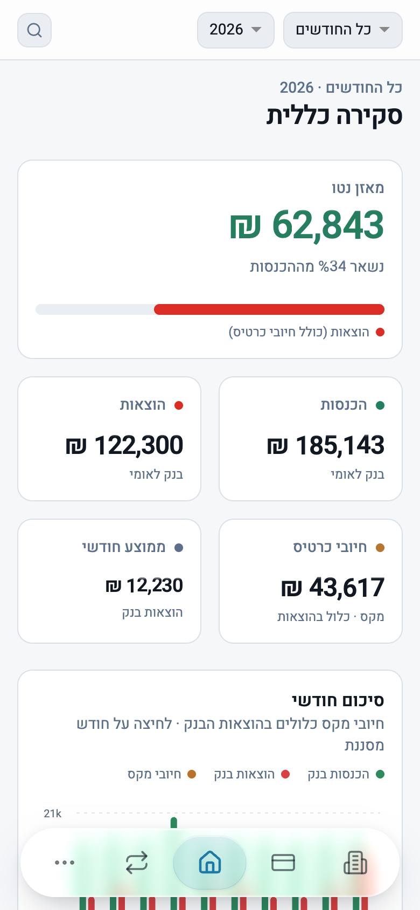
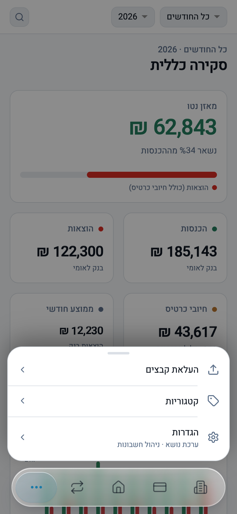
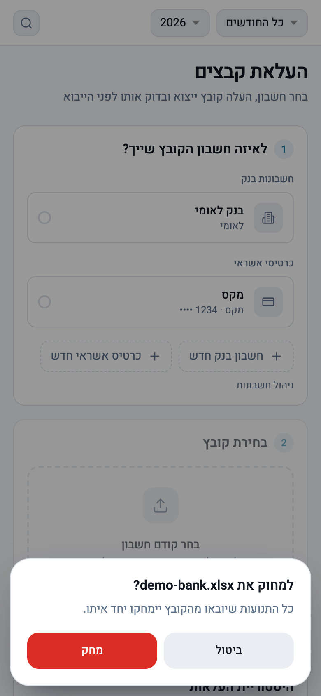

# פתיחה מהטלפון

[חזרה ל-README](../README.md)

**המחשב** נפתח ב-`http://localhost:3000`. **טלפונים וטאבלטים** באותה רשת Wi-Fi נפתחים בכתובת אחרת: `http://<הכתובת של המחשב>:3001`. הפורט 3001 הוא `TAZRIM_PHONE_PORT` (**הגדרות ← טלפונים ורשת ← מתקדם**). בטלפון לא משתמשים בפורט 3000.

**הדרך הפשוטה, בלי להגדיר כלום:** ב**הגדרות ← טלפונים ורשת** מופיעה הכתובת לטלפון עם קוד QR (המתקין כבר שמר את הכתובת של המחשב), ומדריכים קצרים: כתובת קבועה בנתב, והתקנה כאפליקציה. סורקים, ונכנסים עם שם וסיסמה. הכתובת היא `http` ולא `https`, אז הסיסמה עוברת ב-Wi-Fi בלי הצפנה. ברשת ביתית עם סיסמה זה בדרך כלל בסדר. מי שלא רוצה את זה מפעיל **סיסמאות רק ב-HTTPS** ב**הגדרות ← כללי ← מתקדם** (`TAZRIM_REQUIRE_HTTPS`), ואז סיסמאות עובדות רק ב-`https` או במחשב עצמו. הגדרה ראשונה מהטלפון (לפני שיש חשבון) מבקשת קוד, ראו [כניסה עם מפתח](login-and-vault.md#כניסה-עם-מפתח).

**עם מפתחות (Face ID, Touch ID) ובחיבור מוצפן:** מפתחות עובדים רק ב-`https`, ולכן מהטלפון פותחים את Tazrim בכתובת כמו `https://tazrim.internal`. ב**הגדרות ← טלפונים ורשת** מפעילים את זה במתג אחד (דורש את שירות העזר), ושם גם קובצי האישור והפרופיל להורדה, כל אחד עם קוד QR, עם מדריכים ל-iPhone, ל-Android ולמחשבים אחרים. תזרים עצמו מגיש את `/tazrim.mobileconfig` ואת `/tazrim-root.crt` בלי כניסה (טלפון עוד לא מחובר כשהוא צריך אותם), ובהם רק האישור הציבורי והכתובת של המחשב.

**מה המתג מפעיל:** שני שירותים נוספים, שהיו כבויים. הם לא תלויים באינטרנט ולא משנים כלום בנתב, כך ששאר המכשירים בבית לא תלויים במחשב.

- **Caddy** מספק HTTPS בכתובת `https://tazrim.internal`, עם רשות אישורים (CA) משלו. `.internal` היא סיומת ששמורה לרשתות פרטיות, כך שאף אתר אמיתי לא יכול להשתמש בה.
- **AdGuard Home** עונה על שמות `.internal` רק למכשירים שלכם: לאייפון ולאייפד דרך הפרופיל, ולמחשב עצמו עם `127.0.0.1`. דף הניהול שלו נפתח רק במחשב: <http://localhost:3053>. **שמות גם ל-Android ולמחשבים אחרים** (`TAZRIM_DNS_BIND=0.0.0.0`) פותח את פורט 53 לרשת הביתית; AdGuard עונה רק על `.internal` ומעביר כל שם אחר ל-DNS של המחשב, בלי סינון. ב-Android צריך אז גם לקבוע ל-Wi-Fi הביתי DNS סטטי שהוא הכתובת של המחשב, וכשהמחשב כבוי, לטלפון הזה עלול לא להיות אינטרנט ברשת הזו. ייתכן שמפתח לא יעבוד ב-Android עם אישור שהותקן כך; סיסמה תמיד עובדת.

**תחזוקה:**

- **כתובת קבועה למחשב.** שומרים למחשב את כתובת ה-IP שלו בנתב (ב-Deco: עוד ← מתקדם ← Address Reservation), וב**הגדרות ← טלפונים ורשת ← מתקדם** מעדכנים אותה אם השתנתה. בכל הפעלה AdGuard כותב מחדש את כללי `.internal` מהכתובת הזו.
- **לא למחוק** את ה-volume `caddy-data`: הוא מחזיק את רשות האישורים. volume חדש פירושו אישור חדש, שצריך לאשר מחדש בכל מכשיר.
- מפתח שנוצר בכתובת אחת עובד רק בה. אם עוברים לכתובת אחרת, יוצרים מפתחות מחדש.
- פורטים 80, 443 או 53 תפוסים במחשב? משנים `TAZRIM_HTTP_PORT`, `TAZRIM_HTTPS_PORT`, `TAZRIM_DNS_PORT` ב-`.env` (מתקדם בלבד). עם פורט אחר הכתובת כוללת אותו, למשל `https://tazrim.internal:8443`.
- שם אחר ל-`tazrim.internal`: קובעים `TAZRIM_HOST` ב-`.env` ומריצים `docker compose up -d` (מתקדם בלבד, אין לו מסך בהגדרות).

**בלי שירות העזר, או בידיים:** כמו כל הגדרת קונטיינר, אפשר גם ב-`.env` (אלה אותן הגדרות שבדף **טלפונים ורשת**): `COMPOSE_PROFILES=https,dns` (או `updater,https,dns` אם שירות העזר פועל), `TAZRIM_LAN_IP=<הכתובת של המחשב>`, ואז `docker compose up -d`. באפליקציה ההגדרות מוצגות אז כשלבים ידניים, כולל הפקודות. מי שמעדיף את קובצי האישור בתיקייה ולא כהורדה מהאפליקציה מריץ `docker compose run --rm device-profile`: נוצרים `tazrim-root.crt` ו-`tazrim.mobileconfig` בתיקייה `tazrim`.

> **אזהרה למי שמשנה את `docker-compose.yml`:** את הפורט הפנימי 3001 של האפליקציה (הדלת של "המחשב הזה") לא מפרסמים לעולם על כתובת שאינה `127.0.0.1`. אחרת כל הרשת הביתית נחשבת "המחשב הזה" וההגדרה הראשונה נפתחת לכולם בלי קוד.

## עם reverse proxy משלכם

מי שכבר מריץ reverse proxy או DNS מקומי משלו משאיר את Caddy ו-AdGuard כבויים. מפנים את ה-proxy לפורט הטלפונים של Tazrim (`3001` כברירת מחדל; בתוך רשת Docker, אל `tazrim:3000`). הדרישה היחידה: להעביר לאפליקציה את הכתובת שהדפדפן ביקש (`Host` או `X-Forwarded-Host`) ואת הפרוטוקול (`X-Forwarded-Proto`), כי המפתחות קשורים לכתובת הזו. כל אלה עושים את זה מעצמם, חוץ מ-nginx רגיל:

**Nginx Proxy Manager:** Proxy Host חדש ← Domain Names: `tazrim.internal`, Scheme: `http`, Forward Hostname / IP: כתובת המחשב, Forward Port: `3001`, ולסמן **Websockets Support**. בלשונית SSL בוחרים את האישור שלכם (Custom).

**Traefik** (labels על השירות `tazrim` בקובץ ההגדרות):

```yaml
labels:
  - traefik.enable=true
  - traefik.http.routers.tazrim.rule=Host(`tazrim.internal`)
  - traefik.http.routers.tazrim.entrypoints=websecure
  - traefik.http.routers.tazrim.tls=true
  - traefik.http.services.tazrim.loadbalancer.server.port=3000
```

**Caddy** (`tls internal` נותן אישור מרשות האישורים של Caddy עצמו):

```
tazrim.internal {
	tls internal
	reverse_proxy 127.0.0.1:3001
}
```

**nginx:**

```nginx
location / {
    proxy_pass http://127.0.0.1:3001;
    proxy_set_header Host $host;
    proxy_set_header X-Forwarded-Proto $scheme;
    proxy_http_version 1.1;
    proxy_set_header Upgrade $http_upgrade;
    proxy_set_header Connection "upgrade";
}
```


מגבילים את הכניסה לכתובת שלכם ב**הגדרות ← כללי ← מתקדם** (או `TAZRIM_ORIGINS=https://<הכתובת שלכם>` ב-`.env`), כדי שמפתחות יעבדו רק בה, גם אם מישהו פונה לפורט ישירות. השם עצמו מגיע מה-DNS המקומי שלכם (נתב או Pi-hole), או מ-AdGuard Home של התוספת (`dns` ב-`COMPOSE_PROFILES`).

בלי HTTPS, `http://<כתובת-ה-IP>:3001` נפתח, ומשתמשים בו עם סיסמה. מפתחות לא יעבדו בו.

## מראה בטלפון

במסך צר התפריט הצדדי מתחלף בסרגל ניווט צף בצורת גלולה, עם אייקונים בלבד: בנקים, כרטיסים, לוח הבקרה (במרכז), חיובים קבועים, ו"עוד". הסרגל שקוף למחצה, כך שהתוכן נראה דרכו בזמן הגלילה. "עוד" פותח חלון קטן עם העלאת קבצים, קטגוריות והגדרות.

<p align="center">
  
  
</p>

גם חלונות האישור (למשל לפני מחיקה) עולים מלמטה בטלפון, ובמסך רחב מופיעים במרכז:

<p align="center">
  
</p>

## התקנה כאפליקציה

אפשר להתקין את תזרים כאפליקציה, עם אייקון משלה ובחלון נפרד בלי סרגל הדפדפן:

- **Chrome / Edge במחשב:** לוחצים על אייקון ההתקנה בצד שורת הכתובת ("התקנת האפליקציה"). האפליקציה נפתחת בחלון משלה ומופיעה ב-Dock או בשורת המשימות.
- **iPhone (Safari):** כפתור השיתוף ← "הוספה למסך הבית". האפליקציה נפתחת במסך מלא.
- **Android (Chrome):** מאשרים את הצעת ההתקנה, או מתפריט הדפדפן ← "התקנת האפליקציה".

Chrome ו-Edge מתקינים כאפליקציה רק בחיבור מאובטח: `http://localhost` נחשב מאובטח, אבל בכתובת IP ברשת המקומית (`http://192.168...`) ב-Android מתקבל רק קיצור דרך שנפתח בדפדפן. ב-iPhone ההוספה למסך הבית עובדת גם בכתובת כזו.
