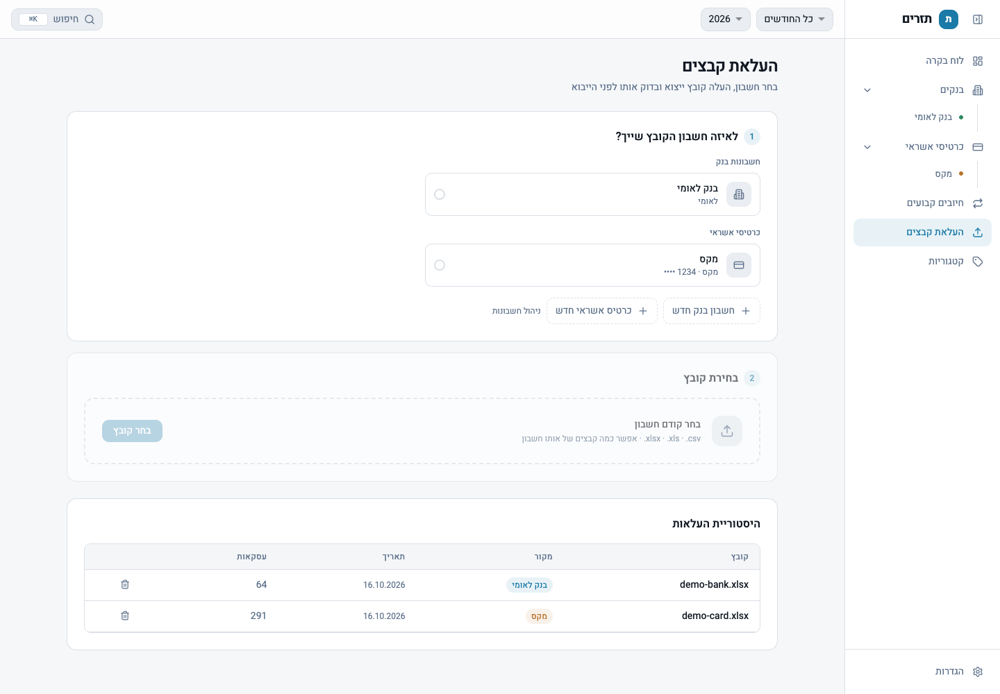
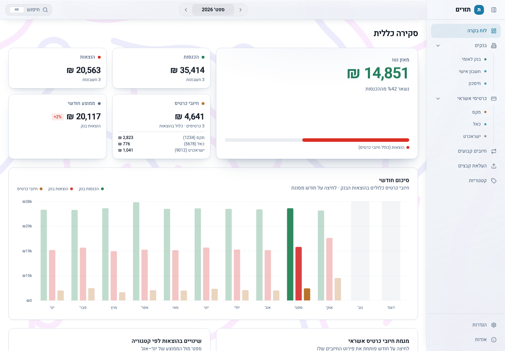
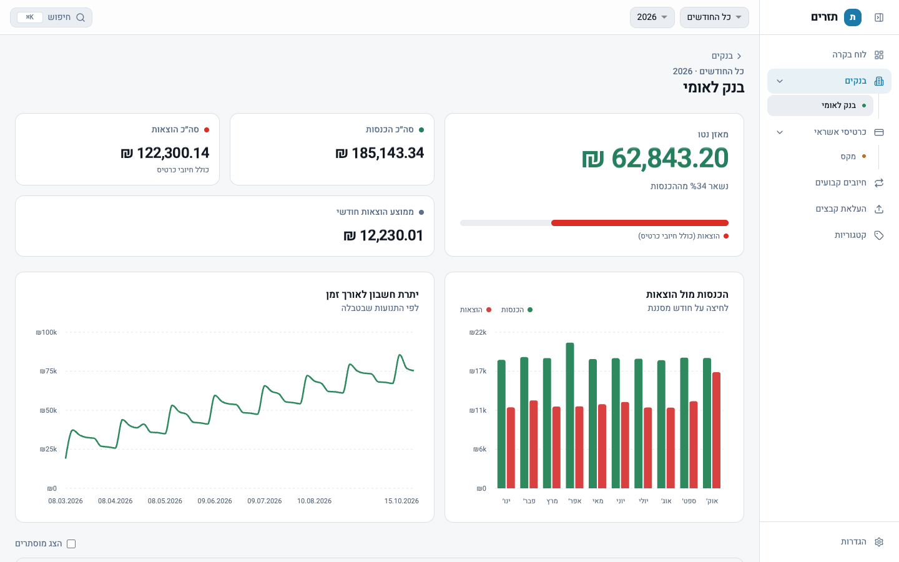
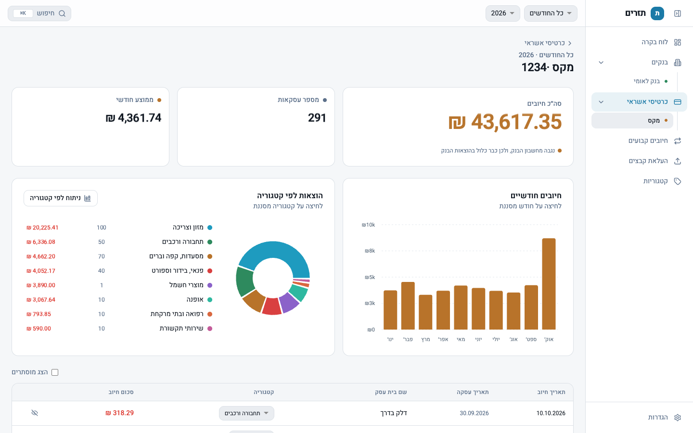
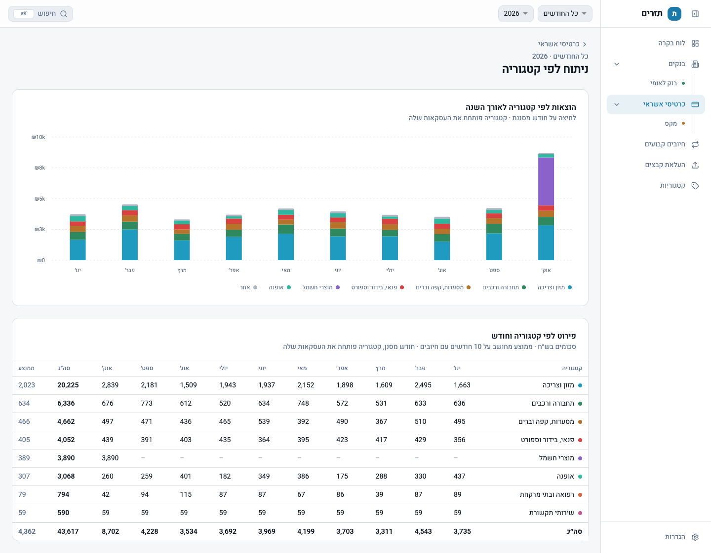
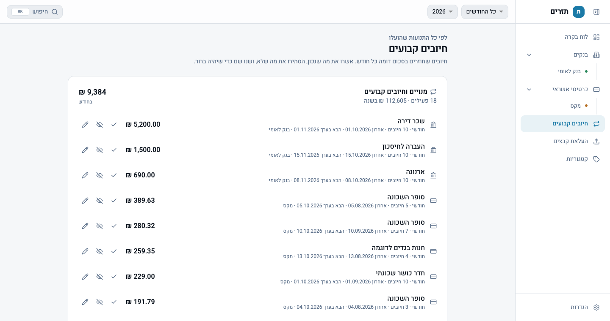
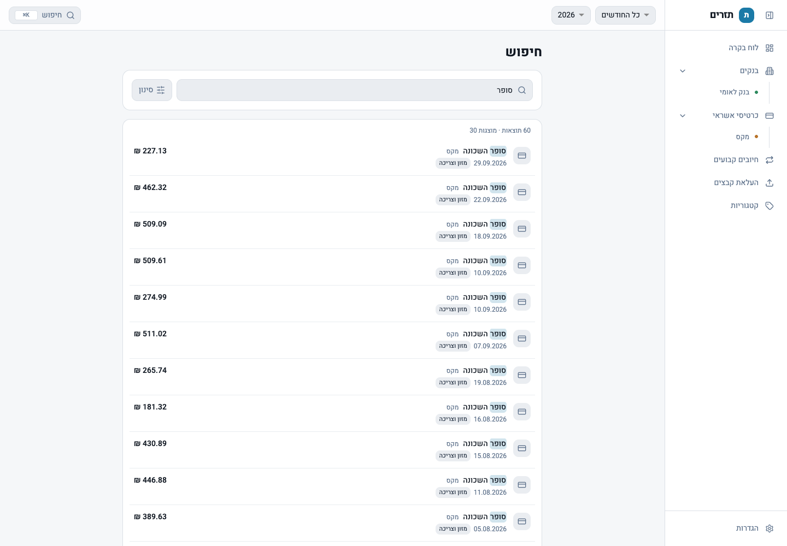
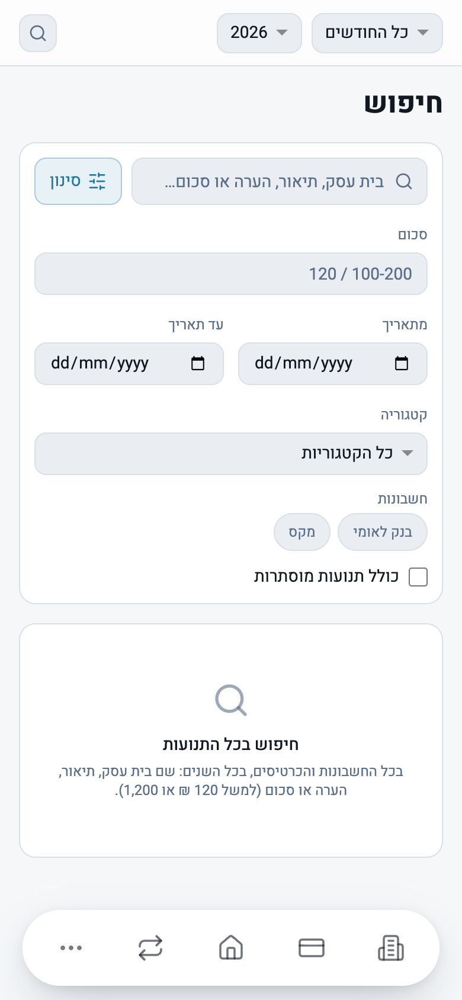
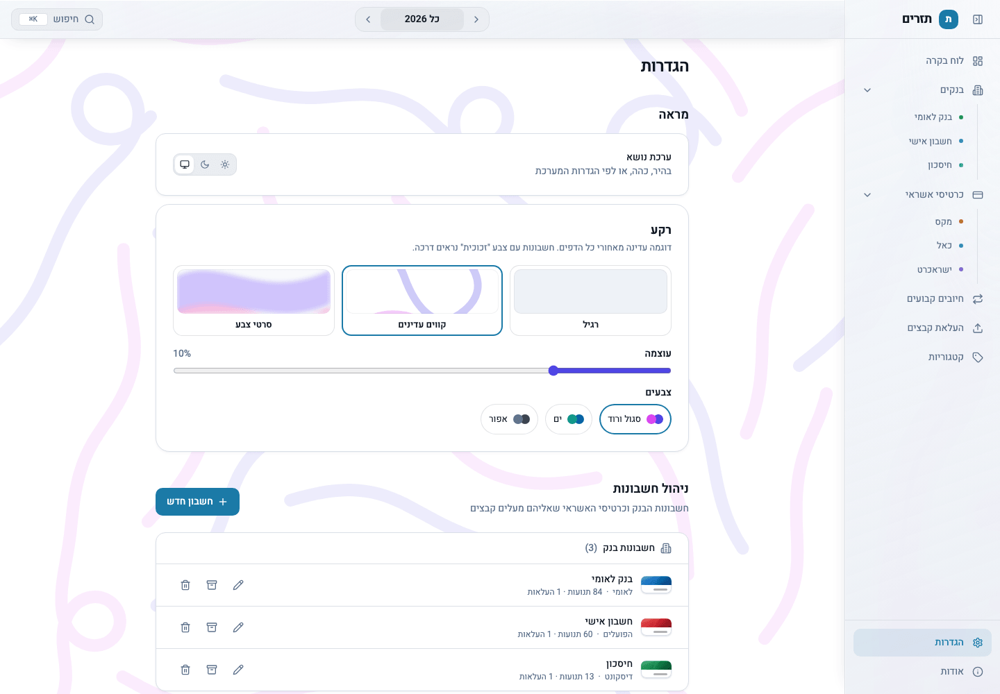
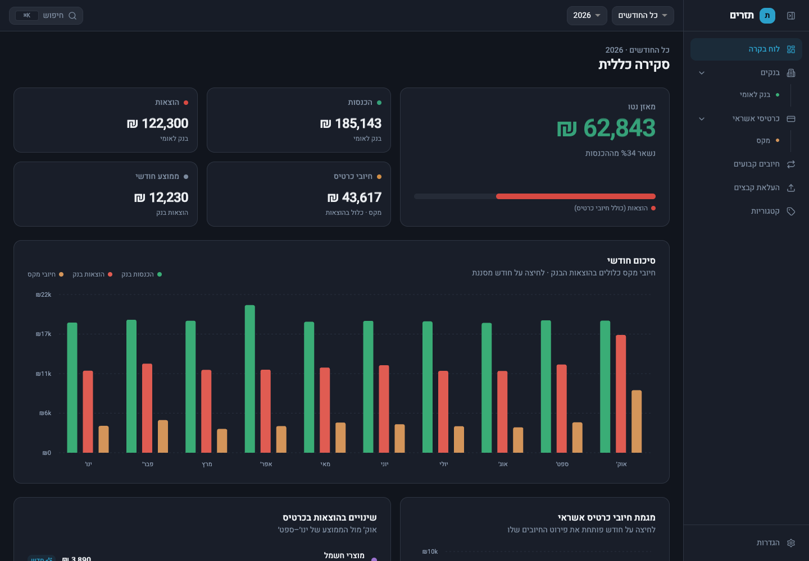

# איך משתמשים

[חזרה ל-README](../README.md)

## 1. העלאת קבצים

1. בדף **העלאת קבצים** בוחרים לאיזה חשבון הקובץ שייך. אפשר להוסיף כאן חשבון בנק או כרטיס אשראי חדש.
2. בוחרים קובץ (`.xlsx`, `.xls` או `.csv`). אפשר לבחור כמה קבצים של אותו חשבון בבת אחת.
3. בודקים את התצוגה המקדימה ומאשרים את הייבוא.

**איזה קבצים?** כל ייצוא טבלאי של בנק או חברת אשראי (`.xlsx`, `.xls`, `.csv`, כולל דפי ה-HTML ש"לאומי" שומר בשם `.xls`). האפליקציה מזהה לבד את שורת הכותרת ואת העמודות לפי השמות שלהן (תאריך, תיאור, חובה, זכות, סכום חיוב, תאריך חיוב…), גם כשבקובץ יש עמודות נוספות או בסדר אחר. בפעם הראשונה בודקים את ההתאמה בתצוגה חיה ומתקנים אם צריך, והמיפוי נשמר לחשבון לפעמים הבאות. אפשר לערוך אותו בכל רגע מחלון עריכת החשבון.

תנועות שכבר יובאו לא נכפלות, כך שאפשר להעלות קבצים חופפים בלי חשש. היסטוריית ההעלאות מופיעה בתחתית הדף, ואפשר למחוק ממנה העלאה עם כל התנועות שלה.

## 2. לוח בקרה

לוח הבקרה מרכז את השנה: מאזן נטו, הכנסות, הוצאות, חיובי כרטיסים, שינויים בהוצאות לפי קטגוריה, חיובים קבועים ותנועות חריגות.

- **בחירת תקופה:** במרכז הסרגל העליון. החצים עוברים לחודש הקודם או הבא (או לשנה, כשמוצגת שנה שלמה), ולחיצה על התקופה עצמה פותחת את כל החודשים של השנה, עם "כל השנה".
- **לחיצה על עמודה בגרף** מסננת את כל הדף לאותו חודש. לחיצה נוספת מבטלת את הסינון.

> **חיובי כרטיס כבר כלולים בהוצאות הבנק.** החיוב החודשי של חברת האשראי יורד מחשבון הבנק, ולכן סכום חיובי הכרטיס מוצג כפירוט של ההוצאה ולא נוסף עליה שוב.

## 3. בנקים וכרטיסי אשראי

לכל חשבון יש דף משלו עם סיכומים, גרף חודשי ורשימת התנועות. בדף הבנק מופיע גם גרף יתרה לאורך זמן.

בדף כרטיס אשראי רואים את החיובים לפי קטגוריה ולפי חודש, ובטבלה אפשר לשנות קטגוריה לעסקה או להסתיר אותה.

**רשימת קטגוריות התחלתית:** התקנה חדשה מתחילה עם רשימת קטגוריות מוכנה (בשמות של מקס, ועוד כמה לתנועות בנק), כדי שגם לכרטיסים שהקבצים שלהם בלי קטגוריות, כמו כאל וישראכרט, יהיה ממה לבחור. אפשר לשנות שם, למחוק ולהוסיף כמו בכל קטגוריה.

**קטגוריות מחברות האשראי:** כשקובץ מגיע עם קטגוריות משלו (כמו מקס), כל קטגוריה שעוד לא מוכרת מוצגת אחרי ההעלאה: אפשר להוסיף אותה לרשימה, או לשייך אותה לקטגוריה שכבר יש לך. השיוך נשמר לכל הכרטיסים של אותה חברה, חל גם על העסקאות שכבר הועלו וגם על הקבצים הבאים, ואפשר לשנות אותו בדף **קטגוריות**. כך שתי חברות שקוראות לאותו דבר בשמות שונים מגיעות לאותה קטגוריה. קטגוריה ששונתה ידנית לעסקה או לבית עסק נשארת כמו שהיא.

**ניתוח לפי קטגוריה** מציג את ההוצאות של כל קטגוריה לאורך השנה, עם טבלת פירוט לפי חודש וממוצע:

## 4. חיובים קבועים

האפליקציה מזהה לבד חיובים שחוזרים בסכום דומה (שכר דירה, מנויים, ביטוחים…) ומציגה את העלות החודשית והשנתית שלהם. לכל חיוב אפשר:

- ✓ לאשר שהוא אכן קבוע
- להסתיר אותו אם הזיהוי שגוי
- ✎ לשנות לו שם

חיוב שהתייקר מסומן, ומוצג לצד הסכום הקודם.

## 5. חיפוש

חיפוש בכל החשבונות ובכל השנים לפי שם בית עסק, תיאור, הערה או סכום. מקלידים `120` לסכום מדויק, או `100-200` לטווח. כפתור **סינון** פותח סינון לפי תאריכים, קטגוריה וחשבונות. קיצור מקלדת לפתיחת החיפוש: <kbd>⌘K</kbd> (או <kbd>Ctrl</kbd>+<kbd>K</kbd>).

  

## 6. הגדרות

- **ערכת נושא:** בהירה, כהה, או לפי הגדרות המערכת.
- **כללי, כספת, עדכונים, טלפונים ורשת:** ראו [הגדרות](settings.md#הגדרות).
- **ניהול חשבונות:** הוספה, שינוי שם, העברה לארכיון ומחיקה.
- **מיפויי ייבוא:** מיפויי עמודות שנשמרו, עם אפשרות לשנות שם ולמחוק.
- **אנשים ומכשירים:** מי בבית, באילו מכשירים יש לו מפתח ולמי יש סיסמה, הזמנות, ביטול מכשיר, הגדרת סיסמה, קוד שחזור חדש ויציאה (ראו [כניסה עם מפתח](login-and-vault.md#כניסה-עם-מפתח)).
- **אזור מסוכן:** מחיקת כל הנתונים (חשבונות, תנועות, העלאות, קטגוריות, כללים, מיפויים והחלטות, וגם האנשים, המכשירים, הסיסמאות וקוד השחזור) והתחלה מחדש כמו בהתקנה חדשה, עם קוד התקנה חדש בלוג. צריך להקליד `מחק הכל`, ואז לאשר שזה באמת אתם: עם Face ID, Touch ID או קוד המכשיר, או עם הסיסמה שלכם. המפתחות שנשמרו במכשירים לא נמחקים מהם, ואפשר למחוק אותם בהגדרות הסיסמאות של המכשיר. כדאי [לגבות](backup.md#גיבוי-ושחזור) קודם. אפשר גם למחוק עם `docker compose down -v`.

